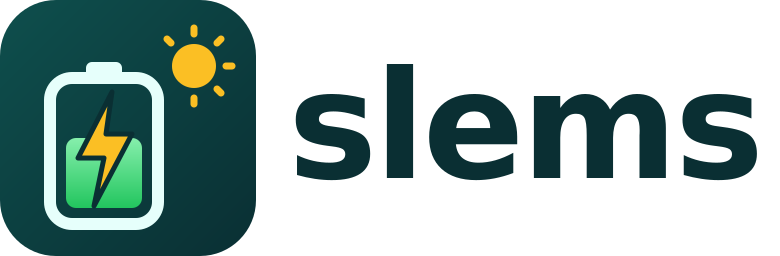
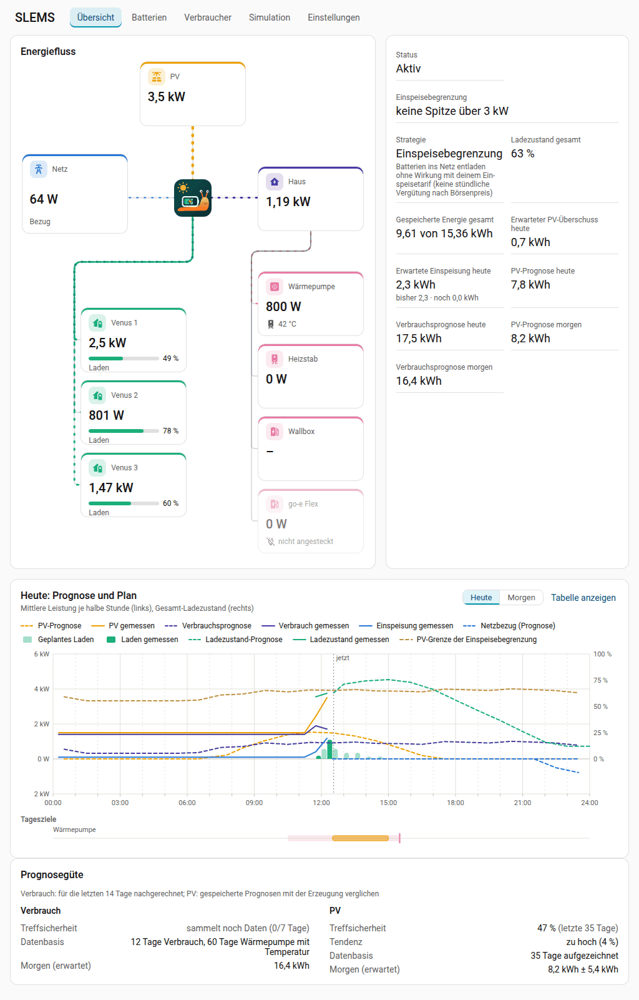
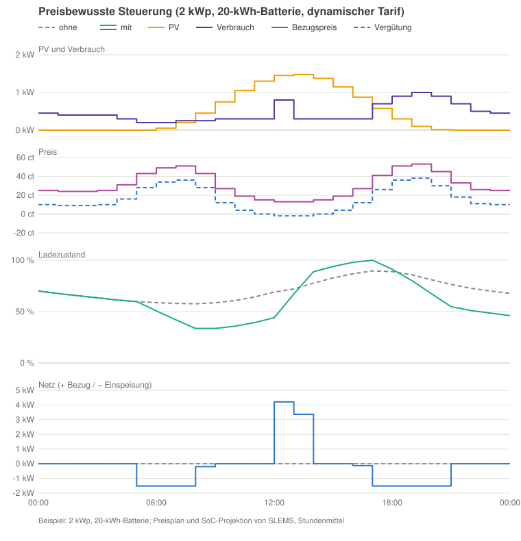
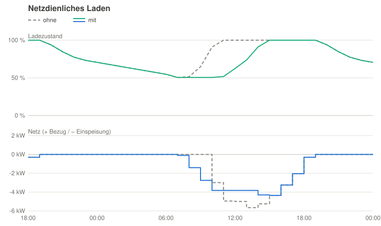
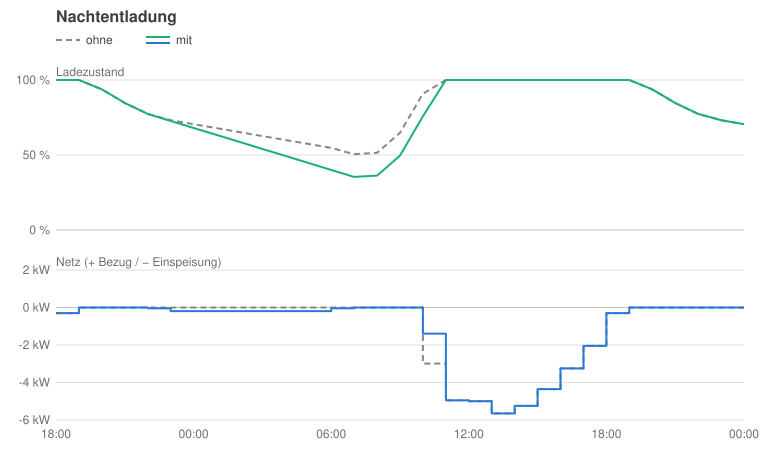
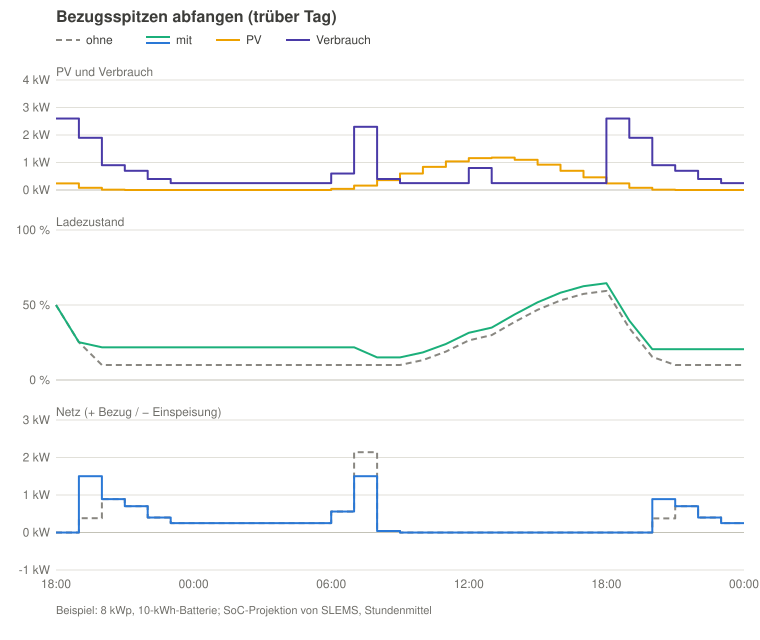
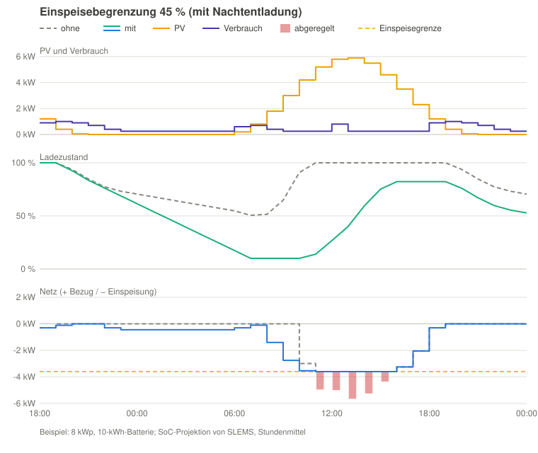

[English](README.md) | **Deutsch**

# SLEMS

SLEMS ist eine Home-Assistant-Integration, die Heimspeicher und regelbare
Verbraucher steuert. Ziel ist ein netzdienlicher Betrieb der Batterien, z. B.
durch Verschieben des Ladezeitpunkts, damit die tägliche Einspeisespitze
abgefangen wird. Grundlage dafür sind Prognosen für Verbrauch und PV-Ertrag.

Der Name setzt sich aus *Slug* (unsere „Lieblingshaustiere“ und ein lustiges
Wort für eine ganze Reihe [sehr interessanter
Tiere](https://en.wikipedia.org/wiki/Sea_slug)) und *EMS*
(Energiemanagementsystem) zusammen.

> **Status: Beta.** SLEMS läuft schon längere Zeit problemlos im
> Produktivbetrieb; neue Funktionen und Verbesserungen kommen weiterhin häufig
> dazu. Im Betriebsmodus **Aktiv** sendet es Vorgaben an
> Batterien und schaltet Verbraucher. Die Nutzung erfolgt auf eigene
> Verantwortung: Prüfe die Grenzen deiner Batterien und die Absicherung deiner
> Stromkreise. Fehler bitte als [Issue](https://github.com/gojux/SLEMS/issues)
> mit den Diagnosedaten melden (siehe [Schnellstart](#schnellstart)).

## Passt SLEMS zu deiner Anlage?

| Batterie | Unterstützung |
|---|---|
| AC-Batterie (eigener Wechselrichter, an der Steckdose oder im Verteiler) | Marstek Venus E 3.0 direkt über Modbus TCP; andere Modelle über ein [Modbus-Profil](docs/guide/battery-modbus-profile.de.md) oder die Entitäten ihrer Home-Assistant-Integration (Steuerung experimentell) |
| Balkonspeicher mit PV-Modulen (z. B. Marstek B2500, Zendure SolarFlow, Anker Solarbank) | über die Entitäten seiner Integration mit **Eigene PV-Module an der Batterie** (experimentell, Tester und Feedback willkommen) |
| Hybrid-Wechselrichter (PV und Batterie an einem Wechselrichter) | seine Batterie über die Entitäten seiner Integration (experimentell, Tester und Feedback willkommen) |
| Keine Batterie | PV-Überschuss nur in Verbraucher ([ohne Batterien](#ohne-batterien)) |

Wenn du SLEMS mit einer anderen Batterie nutzen möchtest, erstelle bitte ein
[Issue](https://github.com/gojux/SLEMS/issues) mit dem Modell, der Anbindung
(Modbus, lokale API, Home-Assistant-Integration) und ob du testen könntest.

| Tarif-Vorlagen | |
|---|---|
| Österreich | 23 Stromtarife und 2 PV-Einspeisetarife von 11 Lieferanten (Burgenland Energie, Energie AG Oberösterreich, Energie Steiermark, EVN, IKB, illwerke vkw, Kelag, LINZ AG, Salzburg AG, TIWAG, Wien Energie), ein allgemeiner dynamischer Tarif, die Netzentgelte aller 14 Netzbereiche, die Bundesabgaben |
| Deutschland | ein allgemeiner dynamischer Tarif, die EEG-Einspeisevergütung (bis 10 kWp, 8 Inbetriebnahme-Zeiträume), die Netzentgelte von 19 Netzbetreibern, die bundesweiten Abgaben |
| Schweiz | der Tarif deiner Gemeinde aus den offenen Daten der ElCom |
| Alle Länder | jeder Tarif, für den es keine Vorlage gibt (auch in Österreich, Deutschland und der Schweiz): wie auf der Rechnung eingegeben oder als YAML-Datei, die eine KI mit dem mitgelieferten Prompt aus deiner Rechnung erstellt (siehe [Tarife](#tarife-optional)) |

## Inhalt

- [Passt SLEMS zu deiner Anlage?](#passt-slems-zu-deiner-anlage)
- [Schnellstart](#schnellstart)
- [Warum SLEMS?](#warum-slems)
- [Funktionen](#funktionen)
- [Installation](#installation)
  - [HACS (benutzerdefiniertes Repository)](#hacs-benutzerdefiniertes-repository)
  - [Manuell](#manuell)
- [Einrichtung](#einrichtung)
  - [Smart Meter per Modbus (optional)](#smart-meter-per-modbus-optional)
  - [Tarife (optional)](#tarife-optional)
  - [PV-Prognose](#pv-prognose)
  - [Wetter (optional)](#wetter-optional)
  - [Verbrauchsprognose](#verbrauchsprognose)
- [Ohne Batterien](#ohne-batterien)
- [Batterien](#batterien)
- [Verbraucher](#verbraucher)
- [Dashboard](#dashboard)
- [Betrieb und Regelung](#betrieb-und-regelung)
  - [Betriebsmodus](#betriebsmodus)
  - [Regelung und Optionen](#regelung-und-optionen)
- [Sprache](#sprache)
- [Roadmap](#roadmap)
- [Entwicklung](#entwicklung)
- [Lizenz](#lizenz)

## Schnellstart

Was du brauchst:

- Home Assistant 2026.9 oder neuer und HACS.
- Einen Smart Meter in Home Assistant, der die Netzleistung (Bezug und
  Einspeisung) laufend meldet, z. B. ein Shelly Pro 3EM. Je öfter er meldet,
  desto genauer regelt SLEMS (z. B. jede Sekunde).
- Optional: eine PV-Prognose (z. B. Forecast.Solar), Batterien und
  Verbraucher, die SLEMS steuern soll.

In fünf Schritten:

1. SLEMS über HACS installieren und Home Assistant neu starten
   ([Installation](#installation)).
2. Die Integration hinzufügen, Smart Meter und PV-Anlagen auswählen und das
   Vorzeichen der Netzleistung prüfen ([Einrichtung](#einrichtung)).
3. Batterien und Verbraucher hinzufügen ([Batterien](#batterien),
   [Verbraucher](#verbraucher)). Die meisten Batterien erlauben nur eine
   Modbus-Verbindung: Trenne sie vorher von anderen Integrationen.
4. SLEMS vorübergehend im Betriebsmodus **Nur beobachten** laufen lassen (die
   Voreinstellung), so fallen offensichtliche Probleme früh auf. Im Dashboard
   siehst du Prognose und Plan; gesteuert wird noch nichts.
5. Andere Steuerungen derselben Batterien und Verbraucher (Automationen,
   andere Integrationen) abschalten und den [Betriebsmodus](#betriebsmodus)
   auf **Aktiv** stellen. Neue Batterien machen zuerst ihren
   [Selbsttest](docs/guide/batteries.de.md#selbsttest-einer-batterie) (etwa 5–10 Minuten), danach regelt
   SLEMS.

Die Voreinstellungen passen für den Anfang; Verluste, Reaktionszeiten und
Prognose-Puffer lernt SLEMS selbst (siehe [Gelernte Werte](docs/guide/control.de.md#gelernte-werte)).
Hinweise zu Problemen stehen unter
[Probleme und Benachrichtigungen](docs/guide/control.de.md#probleme-und-benachrichtigungen). Für eine
Fehlermeldung die Diagnosedaten anhängen: **Einstellungen → Geräte & Dienste →
SLEMS → ⋮ → Diagnosedaten herunterladen**. Adressen und Seriennummern der
Batterien sind darin geschwärzt.

## Warum SLEMS?

Die meisten Speichersteuerungen reagieren auf den Moment: Sie halten die
Netzleistung bei null und laden, sobald Überschuss da ist. Die Batterie ist
dann am späten Vormittag voll, und die Mittagsspitze geht trotzdem ins Netz.
SLEMS plant voraus und regelt genau:

- **Netzdienlich statt um 10 Uhr voll.** Aus PV- und Verbrauchsprognose
  berechnet SLEMS eine Einspeisegrenze und lädt die Batterien mit dem
  Überschuss darüber. So fangen sie die Einspeisespitze ab und sind am Abend
  trotzdem voll. Die Grenze wird laufend neu berechnet und sinkt von selbst,
  wenn der Tag schlechter wird als vorhergesagt.
- **Eigene Verbrauchsprognose.** Gelernt aus den Langzeitstatistiken deines
  Hauses, mit Wetter und eigenem Wärmepumpen-Modell; Urlaubsmodus,
  Nachtentladung bis zu einer prognosebasierten Reserve und eine Prognose des
  Ladezustands für heute und morgen.
- **Batterien und Verbraucher in einem Plan.** Der Überschuss wird auf
  Batterien und steuerbare Verbraucher (Heizstab, Wärmepumpe, …) verteilt, mit
  Prioritäten, Batterievorrang bis zur gesicherten Ladung, Mindestlaufzeiten,
  externer Sperre und Thermostat-Pausen. Tagesziele (Laufzeit, Energie oder
  Temperatur bis zu einer Uhrzeit) erfüllt SLEMS möglichst aus dem Überschuss
  und erst wenn nötig aus Batterie oder Netz; je Verbraucher legst du fest, ob
  die Batterien ihn versorgen dürfen.
- **Mehrere Batterien im effizienten Arbeitspunkt.** SLEMS lernt die
  Umwandlungsverluste jeder Batterie, betreibt nur so viele Batterien wie
  sinnvoll und wechselt zwischen ihnen mit sanftem Übergang.
- **Einspeisebegrenzung.** Darfst du nur einen Teil der PV-Leistung einspeisen
  (z. B. 60 % oder gar nichts), speichert SLEMS die Energie über der Grenze und
  schafft vorher rechtzeitig Platz in den Batterien, statt PV abzuregeln.
- **Bezugsspitzen wirtschaftlich abfangen.** Bei leistungsbezogenen
  Netzentgelten (Leistungspreis für die höchste Viertelstunde des Monats)
  wählt SLEMS Bezugsgrenze und Reserve mit den niedrigsten erwarteten Kosten,
  hält Energie in den Batterien für die Spitzen zurück, lässt erzwungene
  Verbraucher zurücktreten und lädt vor den Spitzen unter der Grenze nach.
- **Preise im Blick.** Tarife wie auf der Rechnung, mit Vorlagen für
  Österreich, Deutschland und die Schweiz; Börsenpreise je Viertelstunde nur
  mit deiner Zustimmung, geschätzt, bis die Preise des Folgetags erscheinen.
  Die preisbewusste Steuerung hebt die gespeicherte Energie für teure Stunden
  auf und kann optional günstig aus dem Netz laden oder teuer einspeisen; ein
  monatlicher Tarifvergleich zeigt, was ein anderer Tarif gekostet hätte.
- **Genaue Regelung ohne Schwingen.** Ereignisgesteuert bei jeder Meldung des
  Smart Meters; die gelernte Reaktionszeit der Batterien (auch eines Starts
  aus dem Standby und eines Richtungswechsels) wird ausgeglichen,
  die Regelverstärkung passt sich selbst an.
- **Batterieschonung und Sicherheit.** Ladezustandsfenster, Leistungsgrenzen
  (z. B. 800 W), Ladebegrenzung nach Temperatur, Überwachung des Zell-Deltas
  mit aktivem Zellausgleich, Erkennung nicht reagierender Batterien,
  Reparatur-Einträge und Benachrichtigungen.
- **Regelmäßige Vollladung ohne verschenkten Überschuss.** LFP-Batterien
  kalibrieren ihren Ladezustand nur bei einer Vollladung neu. SLEMS lädt die
  Batterie mit der ältesten letzten Vollladung zuerst, immer nur eine und nur
  mit dem Überschuss, der ohnehin gespeichert würde, und schont sie beim
  Entladen, damit sie am nächsten Tag höher startet. Es erkennt auch eine
  Vollladung, die das BMS knapp unter 100 % beendet, und misst dabei das
  Zell-Delta am oberen Ladeende.
- **Lernt statt zu fragen.** Neben der Verbrauchsprognose lernt SLEMS die
  Umwandlungsverluste und die Reaktionszeit der Batterien, das
  Meldeintervall des Smart Meters, die Regelverstärkung und die
  Verbrauchsspitzen; auf Wunsch
  auch die Prognose-Puffer, die Ziel-Netzüberschüsse, die Regelzeiten, die
  nutzbare Kapazität jeder Batterie sowie Leistung und Thermostatverhalten von
  Verbrauchern (siehe **Gelernte Werte**). Jeder gelernte Wert lässt sich wieder
  auf einen festen umstellen.
- **Transparent und lokal.** Ein Dashboard mit Energiefluss, Prognose-Diagramm
  und allen Einstellungen. Regelung, Prognosen und Lernen laufen lokal in Home
  Assistant, ohne Cloud-Konto. Ins Internet geht SLEMS nur für Börsenpreise
  und Monatsmarktwerte (nur mit deiner Zustimmung), für Schweizer Tarife aus
  den offenen Daten der ElCom und einmal für den Vorschlag der
  Feiertagsregion (Nominatim, siehe
  [Verbrauchsprognose](#verbrauchsprognose)). Im Betriebsmodus **Nur beobachten** siehst du, was SLEMS tun würde, bevor es
  etwas steuert, auch neben einer bestehenden Batterie-Integration.
- **Erst ausprobieren, dann ändern.** Die Simulation im Dashboard berechnet
  den Tagesplan mit anderen Einstellungen (netzdienliches Laden,
  Nachtentladung, Einspeisebegrenzung, Grenzen der Batterien, Prognosen ±%)
  und vergleicht Einspeisung, Netzbezug und Ladezustand mit dem aktuellen
  Plan, ohne etwas zu ändern.
- **Auch ohne Batterien.** SLEMS kann den PV-Überschuss auch allein in
  Verbraucher lenken (Heizstab, Wallbox, Luftentfeuchter, …), mit Tageszielen,
  Tarifen und Prognosen (siehe [Ohne Batterien](#ohne-batterien)).

**Andere Batterien und Elektroautos:** Batterien, die SLEMS noch nicht direkt
oder über ein [Modbus-Profil](docs/guide/battery-modbus-profile.de.md)
unterstützt, lassen sich trotzdem steuern, wenn es für sie eine Integration in
Home Assistant gibt: SLEMS steuert sie dann über deren Entitäten
(experimentell). Eine Wallbox regelt SLEMS mit dem Überschuss, mit **Sofort
laden** und mit einem Tagesziel nach dem Ladezustand des Autos. evcc ist auf
das Laden von E-Autos spezialisiert und ergänzt SLEMS gut (siehe
[evcc-Anleitung](docs/wallbox-evcc.de.md)).

## Funktionen

| Einrichtung | Status |
|---|---|
| Beliebig viele Batterien, jederzeit hinzufügen, bearbeiten, entfernen | ✅ |
| Smart Meter, PV-Leistung und Wetter frei wählbar | ✅ |
| Einrichtung aus den Geräten von Smart Meter und PV-Anlagen und aus dem Energie-Dashboard; mehrere PV-Anlagen addiert | ✅ |
| Smart Meter zusätzlich direkt per Modbus lesen (SunSpec), mit dem Sensor als Rückfallebene | ✅ |
| Betriebsmodus **Aus / Nur beobachten / Aktiv** | ✅ |
| Urlaubsschalter und Schlechtwetter-Modus | ✅ |
| Reparaturhinweise, Benachrichtigungen und Diagnosedaten | ✅ |

| Prognosen | Status |
|---|---|
| PV-Prognose aus beliebiger Solarprognose-Integration (Forecast.Solar, Solcast, …) | ✅ |
| Verbrauchsprognose heute/morgen (Historie + Wetter, Wärmepumpe temperaturabhängig, Feiertage des eigenen Bundeslands oder Kantons), nach einem plötzlichen Anstieg sofort angehoben | ✅ |
| Korrektur der PV-Prognose im Tagesverlauf und Prognosegüte von PV und Verbrauch | ✅ |

| Batterien | Status |
|---|---|
| Marstek Venus E 3.0 über Modbus TCP | ✅ |
| Batterie aus vorhandenen Entitäten: nur lesend oder gesteuert über Sollwert, Lade-/Entladeleistung oder Skript, Entitäten aus dem Gerät vorgeschlagen | ✅ (Steuerung experimentell) |
| Batterie aus einem Modbus-Profil: ein eigenes Profil mit einem KI-Prompt aus dem Handbuch erstellt, gelesene Werte und Schreibvorschau, bevor etwas geschrieben wird, Probebetrieb mit dem Selbsttest, bevor sie geregelt wird, beobachtet nach einem Firmware-Update; mitgeliefert (ungeprüft): Marstek Venus E Gen 2 | ✅ (experimentell) |
| Wirkungsgrad der Batterie (Batteriezähler, gelernt oder manuell), gelernte nutzbare Kapazität | ✅ |
| Verschleißkosten je Batterie (aus Kaufpreis und Zyklen) in der Planung | ✅ |
| Batteriemenü: Kommunikation für Firmware-Updates pausieren, Batterie deaktivieren, Gerät öffnen | ✅ |
| Aufteilung auf Batterien nach Wirkungsgrad, die schnellste Batterie übernimmt rasche Änderungen zuerst, Wechsel mit sanftem Übergang | ✅ |
| Grenzen je Batterie: minimaler/maximaler Ladezustand, Grenze Lade-/Entladeleistung (z. B. 800 W), Ladebegrenzung nach Temperatur, vorzeitiger Entladestopp des BMS nahe dem Minimum erkannt | ✅ |
| Erkennung von Batterien, die die vorgegebene Leistung nicht liefern, Bestätigung der Vorgaben | ✅ |
| Zell-Delta und aktiver Zellausgleich (Marstek Venus E 3.0) | ✅ |
| Selbsttest einer Batterie: Wirkung am Smart Meter, Vorzeichen und Einheit der Leistung, Energiezähler, Ladezustand, Reaktionszeit, Freigabe am Smart Meter geprüft, sofortiger Abbruch bei falscher Richtung | ✅ |
| Totzeit und Phase je Batterie mit einem kurzen Probeschritt gemessen (bei einer neuen Batterie, nach Änderungen an Batterie, Firmware, Smart Meter oder Integration, alle 90 Tage, von Hand) | ✅ |
| Regelmäßige Vollladung zur SoC-Kalibrierung der LFP-Zellen (immer eine Batterie, aus dem Überschuss, beim Entladen geschont) | ✅ |

| Verbraucher | Status |
|---|---|
| Verbraucher mit eigenen Leistungs-/Energiesensoren, im oder außerhalb des Smart Meters | ✅ |
| Verbraucher aus seinem Gerät einrichten: Geräte nach Eignung sortiert (z. B. Wärmepumpe, Heizstab, Wallbox), Entitäten, Steuerung und ihr Bereich vorgeschlagen | ✅ |
| Phase von Verbrauchern aus den Phasen des Smart Meters gelernt (beginnend mit dem Verlauf), von Batterien im Selbsttest, Wechsel gemeldet, neu lernen; Energiezähler, die nicht über die Phasen saldieren, erkannt | ✅ (Regelung je Phase noch nicht) |
| Wärmepumpe als Verbrauchertyp (wetterabhängige Prognose), optional Freigabe ihrer Warmwasserladung (Betriebsmodus, gelernte Warmwasserleistung, [Anleitung](docs/heat-pump-hot-water.de.md)) | ✅ |
| Steuerung von Verbrauchern: Ein/Aus, Leistungsvorgabe oder Freigabe für eine eigene Automation (mit spätestem Start), Priorität, Mindestlaufzeit/-pause, Takten vermeiden, externe Sperre, Steuerung je Verbraucher abschaltbar | ✅ |
| Verbraucher mit eigenem Thermostat: Pausen erkannt, ihre Leistung geht solange an die Batterien | ✅ |
| Temperaturfühler eines Speichers: gelernte Energie pro Grad, noch aufnehmbare Energie, gelernte Abkühlung je Stunde | ✅ |
| Einsatz eines Verbrauchers in der Einspeisebegrenzung (unterstützend, normal, nie) | ✅ |
| Tagesziele: Laufzeit, Freigabezeit, Energie, Temperatur oder Ladestand des Autos, mit frühestem Start, Frist und Quelle (Überschuss, Batterie, Netz) | ✅ |
| Batterie-Unterstützung je Verbraucher (immer, automatisch mit der Energie, die die Batterien übrig haben, nie) | ✅ |
| Wallbox / evcc-Ladepunkt: Stromvorgabe in A mit Phasen, Start/Stopp ([Anleitung](docs/wallbox-evcc.de.md)) | ✅ (noch nicht mit einer echten Wallbox getestet) |
| Auto an der Wallbox: Ladestand im Energiefluss, ohne angestecktes Auto keine Regelung und keine Planung, **Sofort laden** mit voller Leistung | ✅ (noch nicht mit einer echten Wallbox getestet) |

| Planung und Regelung | Status |
|---|---|
| Verteilung des Überschusses auf Batterien und Verbraucher (Priorität, Aufteilung, Mindestlaufzeit/-pause) | ✅ |
| Echtzeit-Regelung von Batterien und Verbrauchern (Betriebsmodus **Aktiv**) | ✅ |
| Gemittelter Netzüberschuss (0–300 s) | ✅ |
| Ziel-Netzüberschuss beim Laden/Entladen, maximale Einspeisung beim Entladen | ✅ |
| Netzdienliches Laden: PV-Einspeisespitzen abfangen | ✅ |
| Einspeisebegrenzung: PV-Energie über einer Einspeisegrenze speichern, rechtzeitig Platz schaffen | ✅ |
| Nachtentladung bis zu einer prognosebasierten Reserve | ✅ |
| Bezugsspitzen abfangen: eine Bezugsgrenze und eine Ladezustand-Schwelle, unter der die Batterien ihre Energie für die Spitzen zurückhalten (mit Leistungspreis das günstigste Paar, eine davon aus der Verbrauchsstatistik berechnet oder beide eingestellt; manuell aktivierbar); mit Leistungspreis im Tarif gilt die Grenze im Mittel über die Viertelstunde, erzwungene Verbraucher treten zurück, die Batterien laden vor den Spitzen unter der Grenze aus dem Netz nach, die Übersicht zeigt die Monatsspitze und ihre Mehrkosten, und der Tarifvergleich schätzt, was Spitzenabfang gespart hätte | ✅ |

| Dashboard | Status |
|---|---|
| Dashboard (Seitenleiste): Energiefluss, Kennzahlen, Tagesdiagramm mit Prognose und Plan, Batterien, Verbraucher, Einstellungen | ✅ |
| Simulation im Dashboard: Tagesplan mit anderen Einstellungen im Vergleich zum aktuellen (heute oder morgen), mit Preisdiagramm | ✅ |

| Tarife und Preise | Status |
|---|---|
| Tarife wie auf der Rechnung (Zeitfenster, Umsatzsteuer je Gruppe, prozentuale Abgaben) mit Prüfung gegen eine Rechnung | ✅ |
| Tarif-Vorlagen: Österreich (Netzentgelte aller Netzbereiche, Abgaben, Lieferanten inkl. Optionen wie Ökostrom-Upgrade), Deutschland (Abgaben, EEG-Einspeisevergütung, Netzentgelte von 19 Netzbetreibern inkl. § 14a-Module und Messstellenbetrieb), Schweiz (Abfrage der offenen Daten der ElCom); eine allgemeine Vorlage für dynamische Tarife (Börsenpreis plus Aufschlag aus dem Vertrag) | ✅ |
| Vorlagen-Updates: neue Preise, Nachfolgetarife und Korrekturen als Reparaturhinweis, Zurücksetzen auf die Vorlagenwerte | ✅ |
| Tarife als YAML (Import, Export, eigene Vorlagen) mit einem Prompt, um sie mit einer KI aus einer Rechnung zu erstellen | ✅ |
| Börsenpreise je Viertelstunde (APG, SMARD, Energy-Charts) und offizielle Monatsmarktwerte (E-Control) nur mit Zustimmung; keine Einspeisevergütung bei negativen Preisen, wo der Tarif es vorsieht (EEG) | ✅ |
| Monatlicher Tarifvergleich: Bezugskosten und Einspeisevergütung je Tarif, Tarife ein- und ausblendbar, geschätzte Ersparnis der preisbewussten Steuerung | ✅ |
| Preisbewusste Steuerung: gespeicherte Energie für die teuren Stunden halten, Netzanteil der Tagesziele im günstigsten Fenster, optional Laden aus dem Netz und Einspeisen aus den Batterien | ✅ |
| Geschätzte Börsenpreise, bis die Preise des Folgetags erscheinen (Profil der letzten Tage, Wochenende und Feiertage) | ✅ |

## Installation

### HACS (benutzerdefiniertes Repository)

Der Button öffnet SLEMS im HACS deiner Home-Assistant-Instanz und fügt das
benutzerdefinierte Repository hinzu; danach weiter mit Schritt 2. Oder von
Hand:

1. HACS → ⋮ → **Benutzerdefinierte Repositories** →
   `https://github.com/gojux/SLEMS` eintragen, Typ **Integration**.
2. **SLEMS** installieren und Home Assistant neu starten.

### Manuell

`custom_components/slems` in den Ordner `custom_components` deiner
Home-Assistant-Konfiguration kopieren und Home Assistant neu starten.

Voraussetzung: Home Assistant 2026.9 oder neuer.

## Einrichtung

1. **Einstellungen → Geräte & Dienste → Integration hinzufügen → SLEMS**.
2. Die Geräte deines Smart Meters und deiner PV-Anlagen auswählen (optional,
   vorausgewählt aus dem Energie-Dashboard von Home Assistant; die am besten
   passenden Geräte stehen oben, z. B. ein Shelly Pro 3EM oder der Zähler
   eines Wechselrichters). SLEMS schlägt ihre Sensoren vor und ergänzt, was
   das Energie-Dashboard schon kennt, auch das Vorzeichen seiner
   Netzleistung, die PV-Prognose und das Wetter. Die Netzleistungs-Entität
   prüfen (positiv = Bezug, negativ = Einspeisung; das Formular zeigt ihren
   aktuellen Wert; **Vorzeichen umkehren** aktivieren, wenn dein Zähler es
   umgekehrt meldet), optional PV-Leistung, PV-Prognose und Wetter. Mehrere
   PV-Anlagen (z. B. Dach und Balkon) werden addiert.
3. Auf der Seite der SLEMS-Integration für jede Batterie **Batterie
   hinzufügen** und für jeden Verbraucher, der gemessen oder gesteuert werden
   soll, **Verbraucher hinzufügen** wählen.

**Phasen** (optional): Misst dein Smart Meter jede Phase, kannst du in den
SLEMS-Einstellungen seine **Netzleistung L1**, **L2** und **L3** auswählen.
SLEMS lernt dann, an welcher Phase jedes Gerät hängt, und zeigt sie an; auf
die Regelung hat das noch keinen Einfluss (siehe
[Phase von Batterien und Verbrauchern](docs/guide/control.de.md#phase-von-batterien-und-verbrauchern)).

### Smart Meter per Modbus (optional)

Die Entität des Smart Meters wird einmal pro Abfragedurchlauf ihrer
Integration aktualisiert, oft nur etwa einmal pro Sekunde, und zeigt dann nur
einen Teil der Zählerwerte. Mit **Smart Meter zusätzlich per Modbus lesen**
liest SLEMS die Netzleistung direkt von einem SunSpec-Zähler alle
0,5 Sekunden (0,2 bis 5 s). Die Regelung
sieht jeden Wert früher; am meisten bringt das bei schnellen Batterien.

- SLEMS nutzt die geteilte Modbus-Verbindung von Home Assistant. Solange die
  Integration des Wechselrichters dessen einzige Modbus-TCP-Verbindung selbst
  belegt, muss ein Modbus-Proxy eingerichtet werden, z. B. die App [Modbus
  Proxy](https://github.com/TCzerny/ha-modbusproxy).
- SLEMS findet die Zähler in der SunSpec-Modellkette; bei mehreren Zählern
  (z. B. Einspeisung/Bezug und Verbrauch) wählst du den am Netzanschlusspunkt,
  die aktuelle Leistung jedes Zählers hilft beim Erkennen.
- Das Vorzeichen findet SLEMS selbst, indem es einige Werte mit der
  Netzleistungs-Entität vergleicht; dafür braucht es etwas Bezug oder
  Einspeisung (mindestens 100 W). Sonst lässt es sich von Hand wählen.
- Die Entität bleibt Pflicht: Sie ist die Historie, die Grundlage der Prognosen
  und die Rückfallebene. Solange kein Modbus-Wert neuer als 3 Intervalle
  (mindestens 5 Sekunden) ist, nutzt SLEMS die Entität; nach 5 Minuten ohne
  Modbus erscheint ein Reparaturhinweis. Der Sensor **Aktualisierungsintervall
  Smart Meter** zeigt die Quelle im Attribut `source`.
- Beim Wechsel der Quelle beginnen die gelernten Reaktionszeiten der
  Batterien neu, weil sie die Verzögerung der alten Quelle enthalten.

### Tarife (optional)

Mit einem Tarif rechnet SLEMS in Geld: Es prüft deine Stromrechnung nach,
zeigt jeden Monat, was ein anderer Tarif gekostet hätte, und kann die
Batterien nach den Preisen steuern.

- **Tarif eintragen** wie auf der Rechnung, Posten für Posten, aus
  **Vorlagen** mit öffentlichen Listenpreisen (Österreich, Deutschland, die
  Schweiz über die ElCom) oder als YAML, auch von einer KI aus einer Rechnung
  erstellt.
- **Dynamische Tarife** mit Börsenpreisen je Viertelstunde (abgerufen nur,
  wenn du es einschaltest) und **Leistungspreise** für die Monatsspitze.
- **Preisbewusste Steuerung** (optional): hebt die Energie der Batterien für
  teure Stunden auf, lädt auf Wunsch günstig aus dem Netz oder speist teuer
  ein und misst, was das gespart hat.

  

Alle Einstellungen und Details: [Tarife und Preise](docs/guide/tariffs.de.md).

### PV-Prognose

Auswählbar ist jede Integration, die eine Solarprognose für das
Energie-Dashboard von Home Assistant liefert, z. B. Forecast.Solar oder
Solcast. Mehrere Einträge (z. B. ein Forecast.Solar-Eintrag je Dachfläche)
werden addiert. SLEMS verwendet die feinste Auflösung, die der Anbieter
liefert (z. B. 15 oder 30 Minuten). Forecast.Solar kennzeichnet jede Periode
mit ihrem Ende; SLEMS berücksichtigt das.

**Empfehlung: [Helios Forecast](https://github.com/ReikanYsora/Helios-Forecast)**
(Open Source, ohne Konto und API-Schlüssel, lokal gerechnet mit Wetterdaten von
Open-Meteo). Es lernt aus der Erzeugung der eigenen PV-Anlage, auch
Abschattung durch Bäume oder Berge, Verschmutzung und eine um ein paar Grad
abweichende Ausrichtung, und nutzt dafür gleich die vorhandenen
Langzeitstatistiken des Energiesensors. Es liefert eine Prognose für das
Energie-Dashboard in 15-Minuten-Schritten und ist in SLEMS direkt auswählbar.

### Wetter (optional)

Die Wetter-Entität verbessert die Verbrauchsprognose, besonders bei einer
Wärmepumpe. Am besten passt die Prognose des nationalen Wetterdienstes:

| Land | Empfehlung | Warum |
|---|---|---|
| Deutschland | [DWD Weather](https://github.com/FL550/dwd_weather) (HACS) | Prognose des Deutschen Wetterdienstes für eine Station in deiner Nähe, stündlich |
| Österreich | [GeoSphere Austria Plus](https://github.com/coding-pagro/GeoSphere-Austria-Plus) oder [GeoSphere Austria Next](https://github.com/slettmayer/ha-geosphere-next) (HACS) | hochaufgelöstes AROME-Modell von GeoSphere Austria, gut für Alpentäler; die eingebaute Integration *GeoSphere Austria* liefert nur Messwerte, keine Prognose |
| Schweiz | [Swiss Weather](https://github.com/izacus/hass-swissweather) (HACS) | Lokalprognose von MeteoSchweiz für deine Postleitzahl, stündlich |
| Liechtenstein | [Swiss Weather](https://github.com/izacus/hass-swissweather) (HACS) | MeteoSchweiz deckt auch Liechtenstein ab |
| Überall | **Open-Meteo** (eingebaute Integration) | ohne Konto, kombiniert mehrere Wettermodelle; gute Wahl ohne eigene Integration |

**Met.no**, die Voreinstellung von Home Assistant, funktioniert überall, ist
aber im alpinen Gelände weniger detailliert.

### Verbrauchsprognose

SLEMS lernt den Verbrauch deines Hauses aus den Langzeitstatistiken von Home
Assistant und prognostiziert heute und morgen stundenweise: Wärmepumpen über
die Außentemperatur, Feiertage wie Wochenenden. Steigt der Verbrauch plötzlich
(z. B. zu Beginn der Heizsaison), hebt SLEMS die Prognose sofort an. Die Karte
**Prognosegüte** zeigt, wie gut Verbrauchs- und PV-Prognose treffen. Beim
Umstieg von einer anderen Batterie-Integration deren Hausverbrauchssensor als
**Historie Hausverbrauch** wählen, dann lernt SLEMS sofort aus der ganzen
Historie.

Details: [Verbrauchsprognose](docs/guide/consumption-forecast.de.md).

## Ohne Batterien

SLEMS funktioniert auch ohne Batterie: einfach nur die Verbraucher anlegen.

- **Funktioniert**: den PV-Überschuss in gesteuerte Verbraucher lenken
  (Heizstab, Wallbox auch mit evcc, Luftentfeuchter, Wärmepumpe über einen
  Schalteingang) mit Prioritäten, Mindestlaufzeit und -pause, **Takten
  vermeiden** und externer Sperre; Tagesziele mit den Quellen **Nur Überschuss**
  und **+ Netz** (mit preisbewusster Steuerung auch im günstigsten Fenster);
  Tarife, Rechnungsprüfung, Börsenpreise, Tarifvergleich und Preisdiagramm;
  Energiefluss, Verbrauchs- und PV-Prognose mit ihrer Güte.
- **Nicht ohne Batterien**: alles, was eine Batterie lädt, entlädt oder plant
  – netzdienliches Laden, Nachtentladung, Bezugsspitzen abfangen, Halten für
  teure Stunden, Laden aus dem Netz, Einspeisen aus den Batterien – und
  derzeit die Einspeisebegrenzung (sie braucht eine Batterie, auch mit
  unterstützenden Verbrauchern).

## Batterien

SLEMS steuert eine oder mehrere Heimbatterien: Es verteilt die Leistung auf
sie, plant ihren Einsatz über den Tag (netzdienliches Laden, Nachtentladung,
Preise, Bezugsspitzen) und schützt sie dabei. Eine Batterie lässt sich auf drei
Wegen einbinden:

- **Marstek Venus E 3.0** direkt per Modbus TCP: am schnellsten und mit den
  meisten Daten (Zellspannungen, Zähler, Firmware). SLEMS sucht sie im Netz.
  Die Venus erlaubt nur eine Modbus-Verbindung.
- **Vorhandene Home-Assistant-Entitäten** (Steuerung experimentell): jede
  Batterie, die eine andere Integration einbindet, z. B. über Omnibattery,
  auch ein Balkonspeicher oder Hybrid-Wechselrichter mit eigenen PV-Modulen.
- **Batterie aus einem Modbus-Profil** (experimentell): eine Batterie mit
  Modbus TCP, beschrieben durch ein Profil, das eine KI aus ihrem Handbuch
  erstellt.

Was SLEMS für jede Batterie mitbringt:

- Einen **Selbsttest** beim Hinzufügen, der Vorzeichen, Werte und Reaktion
  prüft.
- **Gelernte Werte**: Reaktionszeit, Phase und Wirkungsgrad. Bei mehreren
  Batterien laufen nur so viele, wie effizient ist, mit sanftem Wechsel.
- **Grenzen und Schutz**: Ladezustand, Lade- und Entladeleistung,
  Mindestleistung; sanftes Laden nahe voll, Zell-Delta und Zellausgleich, eine
  Pause für Firmware-Updates.
- Optional **Verschleißkosten**, damit sich preisbewusstes Laden aus dem Netz
  nur lohnt, wenn es mehr einbringt.

Alle Einstellungen und Details: [Batterien](docs/guide/batteries.de.md) und
[Batterie aus einem Modbus-Profil](docs/guide/battery-modbus-profile.de.md).

## Verbraucher

SLEMS lenkt den PV-Überschuss in steuerbare Verbraucher und plant sie zusammen
mit den Batterien. Anlegen solltest du die Verbraucher, die SLEMS steuert
(Heizstab, Wallbox, Luftentfeuchter, …), und Wärmepumpen, deren Verbrauch es
wetterabhängig prognostiziert. Jeder braucht einen eigenen Leistungs- und
Energiesensor; SLEMS schlägt sie aus dem Gerät vor.

- **Steuerung**: Ein/Aus, eine Leistungsvorgabe in W, eine Stromvorgabe in A
  (Wallbox, auch mit evcc) oder eine **Freigabe** für eine eigene Automation,
  z. B. für die Warmwasserladung einer Wärmepumpe.
- **Prioritäten**, Mindestlaufzeit und -pause, **Takten vermeiden** für Geräte
  mit Kompressor und eine externe Sperre; den eigenen Thermostat eines Geräts
  erkennt SLEMS selbst.
- **Batterie-Unterstützung**: je Verbraucher, ob die Batterien ihn versorgen
  dürfen.
- **Tagesziele**: Laufzeit, Energie, Temperatur oder Ladestand des Autos bis zu
  einer Uhrzeit, möglichst aus dem Überschuss und erst wenn nötig aus Batterie
  oder Netz.
- **Einspeisebegrenzung**: Verbraucher nehmen den Überschuss über der Grenze
  mit auf.

Alle Einstellungen und Details: [Verbraucher](docs/guide/consumers.de.md),
außerdem die Anleitungen zum
[Warmwasser einer Wärmepumpe](docs/heat-pump-hot-water.de.md) und zur
[Wallbox mit evcc](docs/wallbox-evcc.de.md).

## Dashboard

SLEMS fügt der Seitenleiste von Home Assistant den Eintrag **SLEMS** hinzu:

- **Übersicht**: Energiefluss, Kennzahlen, das Diagramm mit Prognose, Plan und
  Messwerten des Tages, mit einem Tarif auch die Preise.
- **Batterien** und **Verbraucher**: eine Karte je Gerät mit Zustand, Plan,
  Tagesziel und den wichtigsten Einstellungen.
- **Simulation**: andere Einstellungen ausprobieren und mit den aktuellen
  vergleichen, ohne etwas zu ändern.
- **Einstellungen**: alle Einstellwerte gruppiert und direkt änderbar, mit den
  gelernten Werten.

Alles im Detail: [Dashboard](docs/guide/dashboard.de.md).

## Betrieb und Regelung

### Betriebsmodus

Die Entität **SLEMS Betriebsmodus** schaltet zwischen:

- **Aus**: Es wird nichts geplant oder gesendet.
- **Nur beobachten**: Prognosen und Pläne werden berechnet und angezeigt, aber
  keine Befehle an Batterien oder Verbraucher gesendet. Das ist die
  Voreinstellung.
- **Aktiv**: Pläne werden ausgeführt: SLEMS sendet Vorgaben an die Batterien
  und schaltet bzw. stellt die Verbraucher. Es reagiert auf jede Änderung des
  Smart Meters. Die Entität **Regelstatus** zeigt, ob die Regelung aktiv ist oder
  pausiert, weil der Smart Meter eine Weile nichts gemeldet hat (60 s bzw.
  zehn Aktualisierungsintervalle; die Batterien folgen dann ihrer eigenen
  Logik, bis der Zähler wieder meldet).

### Regelung und Optionen

Im Betriebsmodus **Aktiv** regelt SLEMS bei jedem neuen Wert des Smart Meters:
Es bringt die Netzleistung mit den Batterien auf einen Zielwert und rechnet
dabei mit den gelernten Reaktionszeiten, damit kein Befehl doppelt zählt.
Darüber liegt ein Plan für den Tag aus PV- und Verbrauchsprognose. Die
Optionen lassen sich kombinieren:

- **Netzdienliches Laden** (standardmäßig an): Die Batterien laden mit dem
  Überschuss über einer Einspeisegrenze, fangen so die Mittagsspitze ab und
  sind am Nachmittag trotzdem voll.

  

- **Nachtentladung**: Energie, die morgens noch in den Batterien wäre, wird
  nachts eingespeist, bis auf eine Reserve, die die PV am nächsten Tag wieder
  auffüllt; sinnvoll z. B. in einer Energiegemeinschaft.

  

- **Bezugsspitzen abfangen**: Die Batterien halten Energie für die Spitzen
  zurück; mit Leistungspreis wählt SLEMS Grenze und Reserve mit den
  niedrigsten Kosten.

  

- **Einspeisebegrenzung**: Darfst du nur einen Teil einspeisen, hält SLEMS
  rechtzeitig Platz in den Batterien frei, statt PV abzuregeln.

  

- **Schlechtwetter-Modus**: speichert vor schlechtem Wetter möglichst viel
  Überschuss und behält ihn über die nächste Nacht.

Viele Werte lernt SLEMS selbst (Puffer, Ziel-Netzüberschuss, Kapazität,
Morgenreserve, Leistung der Verbraucher). Laufende Probleme meldet es unter
**Einstellungen → Reparaturen**.

Alles im Detail:
[Betrieb und Regelung](docs/guide/control.de.md), darin
[Welche Option wann?](docs/guide/control.de.md#welche-option-wann) und
[Probleme und Benachrichtigungen](docs/guide/control.de.md#probleme-und-benachrichtigungen).

## Sprache

SLEMS gibt es auf Deutsch und Englisch. Home Assistant verwendet dafür zwei
verschiedene Spracheinstellungen:

- **Namen der Entitäten** (z. B. **Hausverbrauch**, **Betriebsmodus**, auch die
  Kennzahlen im Dashboard) folgen der **Serversprache** unter **Einstellungen →
  System → Allgemein**. Sie werden beim Laden der Integration gesetzt; nach
  einer Änderung SLEMS neu laden.
- Dialoge, Menüs, Zustände (z. B. **Nur beobachten**) und die Texte des
  Dashboards folgen der Sprache im **Benutzerprofil**.

Bleiben Namen nach einem Update von SLEMS in der falschen Sprache, Home
Assistant neu starten (Übersetzungen werden nur beim Start gelesen) und den
Browser ohne Cache neu laden. Entitäts-IDs wie `sensor.slems_house_consumption`
behalten die Sprache, in der sie angelegt wurden; nur die angezeigten Namen
ändern sich.

## Roadmap

Mögliche Erweiterungen, nach Themen geordnet. Gesucht: Rückmeldungen von
Nutzern mit einer echten Wallbox zur [evcc-Anleitung](docs/wallbox-evcc.de.md).

**Elektroauto**

- Ziele, die ab dem Anstecken des Autos gelten („in 3 Stunden 80 %“).
- Batterien mit Verfügbarkeit (z. B. „Auto angesteckt“) und einer Reserve bis
  zu einer Uhrzeit: Grundlage für ein Auto, das das Haus versorgt (V2H).
- Gelernte Anwesenheit des Autos für die Planung.

**Planung und Preise**

- Eine gemeinsame Planung für alle Batterieziele: Laden, Entladen und
  Einspeisen je Viertelstunde nach Kosten über die nächsten 36–48 Stunden
  (Preise, Nachtentladung, Einspeisebegrenzung, netzdienliches Laden) statt
  getrennter Regeln mit jeweils eigenem Horizont. Dazu gehören:
  - die Tagesziele der Verbraucher gemeinsam mit den Batterien geplant,
  - ein stabilerer Plan der preisbewussten Steuerung (nur bei deutlicher
    Verbesserung geändert).
- Verbraucher bei sehr günstigen oder negativen Preisen bevorzugen: eine
  Preisschwelle je Verbraucher (z. B. Heizstab oder Boiler), gemessen am
  gesamten Bezugspreis mit Netzentgelten, nicht nur am Börsenpreis.
- Geschätzte Preise nach dem Wetter: die Prognose von Wind, Sonne und Last des
  Marktgebiets (Energy-Charts) verschiebt die Schätzung; bei genau bekannten
  Werten wäre die Abweichung im letzten Jahr um etwa ein Drittel gesunken.

**Tarife**

- Preise aus einer Home-Assistant-Entität des Lieferanten (z. B. die
  Tibber-Integration, Octopus Deutschland, Ostrom): eine Posten-Art mit
  Adaptern für die verbreiteten Vorschau-Formate, mit der Angabe, ob der Preis
  Netzentgelte und Abgaben schon enthält.
- Index-Tarife (z. B. nach dem Österreichischen Strompreisindex ÖSPI): eine
  Posten-Art mit der Formel des Lieferanten, die Monatswerte des Index mit
  Zustimmung von der Energieagentur abgerufen; damit auch Vorlagen für
  Index-Tarife.
- Einspeisen aus den Batterien auch in der Schätzung des Tarifvergleichs.
- Tarifvergleich mit anderer Hardware: was eine größere Batterie, mehr
  Ladeleistung, ein anderer höchster Ladezustand oder mehr PV im
  aufgezeichneten Jahr gebracht hätten (das Batteriemodell der Schätzung mit
  den Einstellungen der Simulation).

**Prognose**

- Eigene Prognose für den Urlaub: ein Grundlastprofil, gelernt aus ganzen
  Urlaubstagen (alle Urlaube zusammen), und ein Faktor für die Wärmepumpe aus
  denselben Tagen; bis etwa drei Urlaubstage gelernt sind, die heutige
  Schätzung.
- Programmgeräte (Waschmaschine, Geschirrspüler, Trockner): den Verlauf eines
  Programms lernen und den Rest eines laufenden Programms in die Prognose der
  nächsten Stunden aufnehmen (hilft der Abend- und Nachtplanung); später
  eventuell bei Überschuss starten, wenn das Gerät einen Fernstart erlaubt.

**Verbraucher**

- SG Ready / Smart Grid der Wärmepumpe: bei PV-Überschuss oder günstigen
  Preisen die Solltemperatur anheben (Gebäude, Pufferspeicher, Warmwasser als
  Wärmespeicher), über die SG-Ready-Zustände oder eine Offset-Entität;
  Vorheizen und Vorkühlen als Freigabe mit Grenzen (höchste Temperatur,
  Offset, Dauer), nicht als Tagesziel. Die Prognose weiß, dass die vorgezogene
  Wärme später fehlt.
- Temperatur-Tagesziele mit Sicherheitsnetz: fällt die Temperatur außerhalb
  des Zeitfensters unter das Minimum (z. B. Warmwasser nach dem Duschen am
  Abend), wird das Minimum innerhalb einer eingestellten Zeit wieder erreicht
  statt erst zur Frist am nächsten Tag.

**Batterien und Anlagen**

- Batteriegruppen mit gemeinsamer Absicherung: mehrere Batterien an einem
  Stromkreis (z. B. zwei Venus hinter einem Leitungsschutzschalter) bekommen
  eine gemeinsame Höchstleistung, die sich die aktiven Batterien der Gruppe
  teilen, statt fest der Hälfte für jede.
- Batterien mit eigener PV: die ersten echten Geräte (Marstek B2500, Zendure
  SolarFlow) und Hybrid-Wechselrichter über ihre Integrationen oder über
  Modbus-Profile (Kandidaten zum Testen vorhanden) und ein
  gemeinsamer höchster Ausgang für mehrere Einheiten an einem Wechselrichter.
- Weitere Anlagenarten: Batterien mit eigenem Zähler oder einem
  Notstromausgang mit Lasten dahinter, und Batterien an mehreren
  Wechselrichtern.
- Weitere Batteriemodelle: mitgelieferte Modbus-Profile aus eigenen Profilen
  und [Kandidaten](docs/battery-profiles/README.de.md), die bei Nutzern dieser
  Batterien ihren Probebetrieb bestanden haben; ein eigener Treiber nur für
  Modelle, die nicht in ein Profil passen.

## Entwicklung

Siehe [developers.md](developers.md).

## Lizenz

GPL-3.0, siehe [LICENSE](LICENSE). Register-Map und Ansteuerung der Marstek
Venus basieren auf [Omnibattery](https://github.com/ffunes/Omnibattery)
(GPL-3.0).
