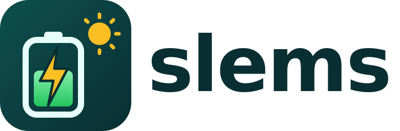
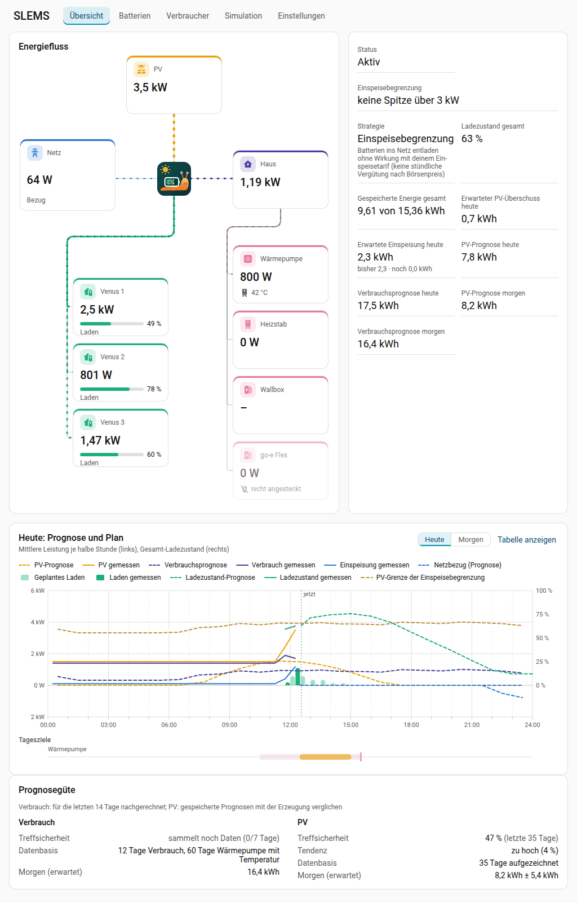
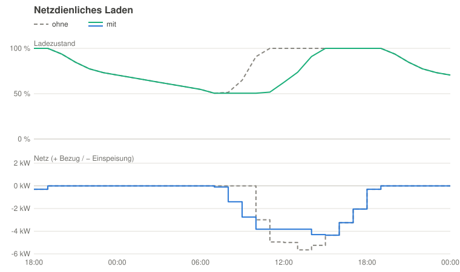

[English](README.md) | **Deutsch**

# SLEMS

SLEMS ist ein Energiemanagement für Home Assistant. Es steuert Heimbatterien
und Verbraucher wie Heizstab, Wärmepumpe oder Wallbox. Dabei reagiert es nicht
nur auf den Moment, sondern plant den Tag aus PV- und Verbrauchsprognose.

> **Status: Beta.** SLEMS läuft schon längere Zeit problemlos im
> Produktivbetrieb; neue Funktionen kommen weiterhin häufig dazu. Details
> unter [Status und Grenzen](#status-und-grenzen).

## Was SLEMS für dich tut

**Einspeisebegrenzung ohne verschenkten Strom.** Darfst du nur einen Teil
deiner PV-Leistung einspeisen (z. B. 60 oder 70 %), speichert SLEMS die
Energie über der Grenze und hält dafür rechtzeitig Platz in den Batterien
frei, statt die PV abzuregeln.

**Niedrigere Bezugsspitzen.** Bei leistungsabhängigen Netzentgelten zählt die
höchste Viertelstunde des Monats. SLEMS hält Energie in den Batterien für
diese Spitzen zurück und wählt die Bezugsgrenze mit den niedrigsten erwarteten
Kosten.

**Mehr eigener Strom im Haus.** Der Überschuss (die PV-Leistung, die dein Haus
gerade nicht braucht) geht nach deinen Prioritäten an Batterien und
Verbraucher. Mit einem Tagesziel ist z. B. das Warmwasser bis 17 Uhr warm:
möglichst aus dem Überschuss und nur wenn nötig aus Batterie oder Netz.

**Mehr aus deinem Tarif.** SLEMS rechnet mit deinem Tarif, wie er auf der
Rechnung steht. Mit einem dynamischen Tarif hebt es gespeicherte Energie für
teure Stunden auf, und ein monatlicher Vergleich zeigt, was ein anderer Tarif
gekostet hätte.

**Laden, wenn die Sonne am stärksten ist.** Die meisten Steuerungen laden,
sobald Überschuss da ist. Die Batterie ist dann am Vormittag voll, und die
Mittagsspitze geht ins Netz. SLEMS lädt *netzdienlich*: mit dem Überschuss
über einer berechneten Grenze, sodass die Batterien die Mittagsspitze
aufnehmen und am Nachmittag trotzdem voll sind.

Das bringt dir:

- Die Batterie steht kürzer bei hohem Ladezustand und altert langsamer (siehe
  [HTW Berlin](https://solar.htw-berlin.de/wp-content/uploads/WENIGER-2025-Smarte-Ladestrategien.pdf)).
- Du speist am Vormittag ein, wenn der Strom mehr wert ist und in einer
  Energiegemeinschaft eher einen Abnehmer findet.
- Deine Anlage ist auf Einspeisegrenzen vorbereitet, wie sie für neue Anlagen
  in Deutschland gelten und in Österreich beschlossen sind.
- Das Netz wird mittags entlastet, und es passen mehr PV-Anlagen hinein.

**Wenig einzustellen, nichts zu riskieren.** Verluste, Reaktionszeiten und
Prognose-Puffer lernt SLEMS selbst. Im Betriebsmodus **Nur beobachten** siehst
du, was es tun würde, bevor es etwas steuert, auch neben einer bestehenden
Steuerung. Die **Simulation** zeigt, was andere Einstellungen, eine weitere
Batterie oder mehr PV ändern würden, und ein Assistent schlägt passende Werte
vor.

## Passt SLEMS zu deiner Anlage?

Was du brauchst:

- Home Assistant 2026.10 oder neuer.
- Einen Smart Meter in Home Assistant, der die Netzleistung (Bezug und
  Einspeisung) laufend meldet, z. B. ein Shelly Pro 3EM. Je öfter er meldet,
  desto genauer regelt SLEMS (z. B. jede Sekunde).
- Optional: eine PV-Prognose (z. B. Forecast.Solar), Batterien und
  Verbraucher, die SLEMS steuern soll.

| Batterie | Unterstützung |
|---|---|
| AC-Batterie (eigener Wechselrichter, an der Steckdose oder im Verteiler) | Marstek Venus E 3.0 direkt über Modbus TCP; andere Modelle über ein [Modbus-Profil](docs/guide/battery-modbus-profile.de.md) oder die Entitäten ihrer Home-Assistant-Integration (Steuerung experimentell) |
| Steckerbatterie mit PV-Modulen (Balkonkraftwerk mit Batterie, z. B. Marstek B2500, Zendure SolarFlow, Anker Solarbank) | über die Entitäten ihrer Integration mit **Eigene PV-Module an der Batterie** (experimentell, Tester und Feedback willkommen) |
| Hybrid-Wechselrichter (PV und Batterie an einem Wechselrichter) | seine Batterie über die Entitäten seiner Integration (experimentell, Tester und Feedback willkommen) |
| Keine Batterie | PV-Überschuss in Verbraucher, mit Tageszielen, Tarifen und Prognosen ([was ohne Batterien geht](docs/guide/features.de.md#ohne-batterien)) |

Für einige weitere Batterien gibt es
[Kandidaten für Profile](docs/battery-profiles/README.de.md), zu denen uns
noch Rückmeldungen aus dem Betrieb fehlen. Hast du eine davon, freuen wir uns
über deinen Test und dein Feedback.

Wenn du SLEMS mit einer anderen Batterie nutzen möchtest, erstelle bitte ein
[Issue](https://github.com/gojux/SLEMS/issues/new?template=feature_request.yml) mit dem Modell, der Anbindung
(Modbus, lokale API, Home-Assistant-Integration) und ob du testen könntest.

**Tarife:** Vorlagen mit öffentlichen Listenpreisen gibt es für Österreich
(Lieferanten, Netzentgelte aller Netzbereiche, Abgaben), Deutschland
(Netzentgelte von 19 Netzbetreibern, EEG-Einspeisevergütung, Abgaben) und die
Schweiz (der Tarif deiner Gemeinde von der ElCom). Jeden anderen Tarif trägst
du wie auf der Rechnung ein oder lässt ihn mit dem mitgelieferten Prompt von
einer KI aus deiner Rechnung erstellen (siehe
[Vorlagen](docs/guide/tariffs.de.md#vorlagen)).

## Schnellstart

1. SLEMS über den Marktplatz (ab Home Assistant 2026.11) oder HACS
   installieren und Home Assistant neu starten. Der Button oben öffnet SLEMS
   dort; von Hand geht es mit dem benutzerdefinierten Repository
   `https://github.com/gojux/SLEMS` (siehe
   [Installation](docs/guide/setup.de.md#installation)).
2. Die Integration hinzufügen, Smart Meter und PV-Anlagen auswählen und das
   Vorzeichen der Netzleistung prüfen (siehe
   [Einrichtung](docs/guide/setup.de.md#einrichtung)).
3. Batterien und Verbraucher hinzufügen. Die meisten Batterien erlauben nur
   eine Modbus-Verbindung: Trenne sie vorher von anderen Integrationen.
4. SLEMS vorübergehend im Betriebsmodus **Nur beobachten** laufen lassen (die
   Voreinstellung). Im Dashboard siehst du Prognose und Plan; gesteuert wird
   noch nichts.
5. Andere Steuerungen derselben Batterien und Verbraucher (Automationen,
   andere Integrationen) abschalten und den Betriebsmodus auf **Aktiv**
   stellen. Neue Batterien machen zuerst ihren
   [Selbsttest](docs/guide/batteries.de.md#selbsttest-einer-batterie) (etwa
   5–10 Minuten), danach regelt SLEMS.

Die Voreinstellungen passen für den Anfang. Stellst du den Betriebsmodus
wieder auf **Aus**, folgen die Batterien ihrer eigenen Logik.

## Funktionen im Überblick

Die vollständige Liste steht unter [Alle Funktionen](docs/guide/features.de.md).

### Batterien

SLEMS steuert beliebig viele Heimbatterien, plant ihren Einsatz über den Tag
und schützt sie dabei. Eine Batterie lässt sich auf drei Wegen einbinden:

- **Marstek Venus E 3.0** direkt per Modbus TCP: am schnellsten und mit den
  meisten Daten. SLEMS sucht sie im Netz.
- **Vorhandene Home-Assistant-Entitäten** (Steuerung experimentell): jede
  Batterie, die eine andere Integration einbindet, auch ein Balkonkraftwerk
  mit Batterie oder ein Hybrid-Wechselrichter.
- **Modbus-Profil** (experimentell): eine Batterie mit Modbus TCP, beschrieben
  durch ein Profil, das eine KI aus ihrem Handbuch erstellt.

Was SLEMS für jede Batterie mitbringt:

- Einen **Selbsttest** beim Hinzufügen, der Vorzeichen, Werte und Reaktion
  prüft, bevor die Batterie geregelt wird.
- **Mehrere Batterien**: SLEMS schaltet nur so viele zu, wie für die aktuelle
  Leistung am effizientesten ist. Die übrigen bleiben im Standby in Reserve
  und übernehmen bei Bedarf mit sanftem Übergang.
- **Grenzen und Schutz**: Ladezustand, Lade- und Entladeleistung (z. B.
  800 W), sanftes Laden nahe voll, Überwachung der Zellspannungen, eine Pause
  für Firmware-Updates.
- **Regelmäßige Vollladung**: LFP-Batterien messen ihren Ladezustand nur nach
  einer Vollladung wieder genau. SLEMS sorgt dafür, mit Überschuss, der
  ohnehin gespeichert würde.

Details: [Batterien](docs/guide/batteries.de.md) und
[Batterie aus einem Modbus-Profil](docs/guide/battery-modbus-profile.de.md).

### Verbraucher

SLEMS lenkt den Überschuss in steuerbare Verbraucher (Heizstab, Wallbox,
Luftentfeuchter, Wärmepumpe, …) und plant sie zusammen mit den Batterien.

- **Steuerung**: Ein/Aus, eine Leistungsvorgabe in W, eine Stromvorgabe in A
  (Wallbox, auch mit evcc) oder eine **Freigabe** für eine eigene Automation,
  z. B. für die Warmwasserladung einer Wärmepumpe.
- **Prioritäten**, Mindestlaufzeit und -pause und **Takten vermeiden** für
  Geräte mit Kompressor. Den eigenen Thermostat eines Geräts erkennt SLEMS
  selbst.
- **Tagesziele**: Laufzeit, Energie, Temperatur oder Ladestand des Autos bis
  zu einer Uhrzeit.
- **Batterie-Unterstützung**: Je Verbraucher legst du fest, ob die Batterien
  ihn versorgen dürfen.

Details: [Verbraucher](docs/guide/consumers.de.md), außerdem die Anleitungen
zum [Warmwasser einer Wärmepumpe](docs/heat-pump-hot-water.de.md) und zur
[Wallbox mit evcc](docs/wallbox-evcc.de.md). evcc ist auf das Laden von
E-Autos spezialisiert und ergänzt SLEMS gut.

### Betrieb und Regelung

Die Entität **SLEMS Betriebsmodus** schaltet zwischen **Aus**, **Nur
beobachten** (Prognosen und Pläne werden gezeigt, aber nichts gesteuert) und
**Aktiv**. Im Betriebsmodus **Aktiv** regelt SLEMS bei jeder Meldung des Smart
Meters und rechnet mit der gelernten Reaktionszeit jeder Batterie, damit die
Regelung nicht schwingt. Darüber liegt der Plan für den Tag. Seine Optionen
lassen sich kombinieren:

- **Netzdienliches Laden** (standardmäßig an): die Mittagsspitze aufnehmen und
  am Nachmittag trotzdem voll sein.
- **Einspeisebegrenzung**: die Energie über einer Einspeisegrenze speichern.
- **Bezugsspitzen abfangen**: Energie für die Spitzen zurückhalten.
- **Nachtentladung**: Energie, die morgens noch in den Batterien wäre, nachts
  einspeisen; sinnvoll z. B. in einer Energiegemeinschaft.
- **Schlechtwetter-Modus**: vor schlechtem Wetter möglichst viel speichern und
  über die Nacht behalten.

Details mit einem Diagramm je Option:
[Betrieb und Regelung](docs/guide/control.de.md), darin
[Welche Option wann?](docs/guide/control.de.md#welche-option-wann).

### Tarife und Preise

Mit einem Tarif rechnet SLEMS in Geld: Es prüft deine Stromrechnung nach,
zeigt jeden Monat, was ein anderer Tarif gekostet hätte, und kann die
Batterien nach den Preisen steuern.

- **Tarif eintragen** wie auf der Rechnung, aus **Vorlagen** oder als
  YAML-Datei.
- **Dynamische Tarife** mit Börsenpreisen je Viertelstunde (abgerufen nur,
  wenn du es einschaltest) und **Leistungspreise** für die Monatsspitze.
- **Preisbewusste Steuerung** (optional): hebt die Energie der Batterien für
  teure Stunden auf, lädt auf Wunsch günstig aus dem Netz oder speist teuer
  ein und misst, was das gespart hat.

Details: [Tarife und Preise](docs/guide/tariffs.de.md).

### Prognosen

- **PV-Prognose**: jede Integration, die eine Solarprognose für das
  Energie-Dashboard liefert, z. B. Forecast.Solar oder Solcast. SLEMS
  korrigiert sie im Tagesverlauf mit der bisherigen Erzeugung.
- **Verbrauchsprognose**: gelernt aus den Langzeitstatistiken deines Hauses,
  für heute und morgen stundenweise, mit Wetter, Feiertagen und einem eigenen
  Modell für Wärmepumpen.

Details: [Einrichtung](docs/guide/setup.de.md#pv-prognose) und
[Verbrauchsprognose](docs/guide/consumption-forecast.de.md).

### Dashboard

SLEMS fügt der Seitenleiste von Home Assistant den Eintrag **SLEMS** hinzu:

- **Übersicht**: Energiefluss, Kennzahlen, das Diagramm mit Prognose, Plan und
  Messwerten des Tages, mit einem Tarif auch die Preise.
- **Batterien** und **Verbraucher**: eine Karte je Gerät mit Zustand, Plan und
  Tagesziel.
- **Simulation**: andere Einstellungen ausprobieren und mit den aktuellen
  vergleichen, ohne etwas zu ändern; auch, was andere Batterien oder mehr PV
  im aufgezeichneten Jahr geändert hätten.
- **Einstellungen**: alle Einstellwerte nach Bereichen, mit Suche und einem
  Assistenten, der Werte aus Tarif, Anlage und einem wählbaren Ziel
  vorschlägt.

Details: [Dashboard](docs/guide/dashboard.de.md).

## Status und Grenzen

- **Beta**: SLEMS läuft stabil im Produktivbetrieb, wird aber noch häufig
  erweitert.
- **Experimentell**: die Steuerung von Batterien über Entitäten und
  Modbus-Profile. Die Steuerung einer Wallbox ist noch nicht mit einer echten
  Wallbox getestet. Tester und Feedback sind willkommen.
- **Eigene Verantwortung**: Im Betriebsmodus **Aktiv** sendet SLEMS Vorgaben
  an Batterien und schaltet Verbraucher. Prüfe die Grenzen deiner Batterien
  und die Absicherung deiner Stromkreise.
- **Lokal**: Regelung, Prognosen und Lernen laufen in Home Assistant, ohne
  Cloud-Konto. Ins Internet geht SLEMS nur für Börsenpreise und
  Monatsmarktwerte (nur mit deiner Zustimmung), für Schweizer Tarife aus den
  offenen Daten der ElCom und einmal für den Vorschlag der Feiertagsregion.

## Hilfe und Feedback

Hinweise zu Problemen stehen unter
[Probleme und Benachrichtigungen](docs/guide/control.de.md#probleme-und-benachrichtigungen).
Fehler bitte als
[Issue](https://github.com/gojux/SLEMS/issues/new?template=bug_report.yml)
melden und die Diagnosedaten anhängen: **Einstellungen → Geräte & Dienste →
SLEMS → ⋮ → Diagnosedaten herunterladen**. Adressen und Seriennummern der
Batterien sind darin geschwärzt.

## Roadmap

- Bidirektionales Laden mit der Wallbox: das Auto als weitere Batterie, die
  auch das Haus versorgt (V2H).

## Der Name

*Slug* (unsere „Lieblingshaustiere“ und ein lustiges Wort für eine ganze Reihe
[sehr interessanter Tiere](https://en.wikipedia.org/wiki/Sea_slug)) und *EMS*
(Energiemanagementsystem).

## Entwicklung

Siehe [developers.md](developers.md).

## Lizenz

GPL-3.0, siehe [LICENSE](LICENSE). Register-Map und Ansteuerung der Marstek
Venus basieren auf [Omnibattery](https://github.com/ffunes/Omnibattery)
(GPL-3.0).
