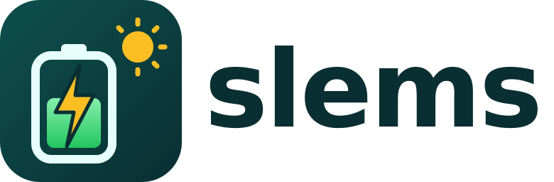
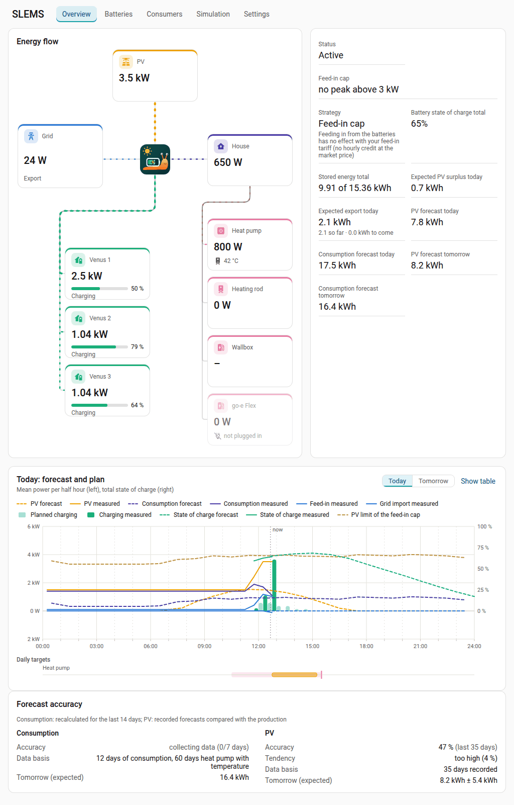
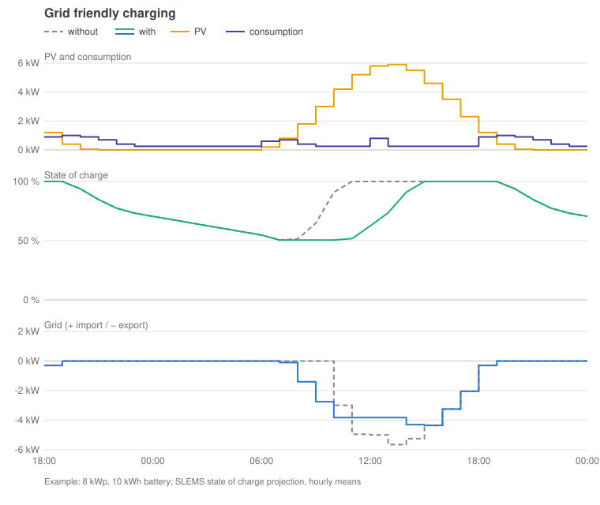

**English** | [Deutsch](README.de.md)

# SLEMS

SLEMS is an energy management system for Home Assistant. It controls home
batteries and consumers such as a heating rod, a heat pump or a wallbox. It
does not only react to the moment, but plans the day from the PV and
consumption forecasts.

> **Status: beta.** SLEMS has been running in production without problems
> for quite some time; new features keep coming often. Details under
> [Status and limits](#status-and-limits).

## What SLEMS does for you

**A feed-in cap without wasted power.** If you may feed in only part of your
PV power (e.g. 60 or 70 %), SLEMS stores the energy above the limit and keeps
room in the batteries for it in time, instead of curtailing PV.

**Lower import peaks.** With power based grid fees the highest quarter hour
of the month counts. SLEMS keeps energy in the batteries for these peaks and
picks the import limit with the lowest expected cost.

**More of your own power in the house.** The surplus (the PV power your house
does not need right now) goes to batteries and consumers by your priorities.
With a daily target the hot water, for example, is warm by 5 pm: from the
surplus where possible and only if needed from the batteries or the grid.

**More from your tariff.** SLEMS calculates with your tariff as it is on the
bill. With a dynamic tariff it keeps stored energy for expensive hours, and a
monthly comparison shows what another tariff would have cost.

**Charging when the sun is strongest.** Most controls charge as soon as there
is surplus. The battery is then full in the morning, and the midday peak goes
into the grid. SLEMS charges in a *grid friendly* way: with the surplus above
a calculated limit, so the batteries absorb the midday peak and are still
full in the afternoon.

What you gain:

- The battery spends less time at a high state of charge and ages more slowly
  (see [HTW Berlin](https://solar.htw-berlin.de/wp-content/uploads/WENIGER-2025-Smarte-Ladestrategien.pdf),
  in German).
- You feed in during the morning, when power is worth more and more likely to
  find a taker in an energy community.
- Your installation is prepared for feed-in limits such as those in force for
  new installations in Germany and passed in Austria.
- The grid is relieved at midday, and more PV systems fit into it.

**Little to set, nothing to risk.** SLEMS learns losses, response times and
forecast buffers by itself. The operating mode **Observe only** shows what it
would do before it controls anything, also next to an existing control. The
**simulation** shows what other settings, another battery or more PV would
change, and an assistant suggests fitting values.

## Does SLEMS fit your installation?

What you need:

- Home Assistant 2026.10 or later.
- A smart meter in Home Assistant that reports the grid power (import and
  export) continuously, e.g. a Shelly Pro 3EM. The more often it reports, the
  more precisely SLEMS controls (e.g. every second).
- Optional: a PV forecast (e.g. Forecast.Solar), batteries and consumers that
  SLEMS should control.

| Battery | Support |
|---|---|
| AC battery (its own inverter, at a socket or in the distribution board) | Marstek Venus E 3.0 directly over Modbus TCP; other models through a [Modbus profile](docs/guide/battery-modbus-profile.md) or the entities of their Home Assistant integration (control experimental) |
| Plug-in battery with PV modules (balcony solar with a battery, e.g. Marstek B2500, Zendure SolarFlow, Anker Solarbank) | through the entities of its integration with **Own PV modules at the battery** (experimental, testers and feedback welcome) |
| Hybrid inverter (PV and battery at one inverter) | its battery through the entities of its integration (experimental, testers and feedback welcome) |
| No battery | PV surplus into consumers, with daily targets, tariffs and forecasts ([what works without batteries](docs/guide/features.md#without-batteries)) |

For some further batteries there are
[candidate profiles](docs/battery-profiles/README.md) for which we still lack
feedback from real use. If you have one of them, we would be glad about your
test and your feedback.

If you would like to use SLEMS with another battery, please
[open an issue](https://github.com/gojux/SLEMS/issues/new?template=feature_request.yml) with the model and how
it is connected (Modbus, local API, Home Assistant integration), and whether
you could test it.

**Tariffs:** templates with public list prices exist for Austria (suppliers,
the grid fees of all grid areas, levies), Germany (the grid fees of 19 grid
operators, the EEG feed-in credit, levies) and Switzerland (the tariff of
your municipality from ElCom). You enter any other tariff as on the bill, or
have an AI make it from your bill with the prompt provided (see
[Templates](docs/guide/tariffs.md#templates)).

## Quick start

1. Install SLEMS through the Marketplace (from Home Assistant 2026.11) or
   HACS and restart Home Assistant. The button above opens SLEMS there; by
   hand, add the custom repository `https://github.com/gojux/SLEMS` (see
   [Installation](docs/guide/setup.md#installation)).
2. Add the integration, select the smart meter and the PV systems and check
   the sign of the grid power (see [Setup](docs/guide/setup.md#setup)).
3. Add batteries and consumers. Most batteries allow only one Modbus
   connection: disconnect them from other integrations first.
4. Let SLEMS run in the operating mode **Observe only** for a while (the
   default). The dashboard shows the forecast and the plan; nothing is
   controlled yet.
5. Turn off other controls of the same batteries and consumers (automations,
   other integrations) and set the operating mode to **Active**. New
   batteries first run their
   [self-test](docs/guide/batteries.md#self-test-of-a-battery) (about 5–10
   minutes), then SLEMS takes over.

The defaults are fine to start with. If you set the operating mode back to
**Off**, the batteries follow their own logic.

## Features at a glance

The complete list is under [All features](docs/guide/features.md).

### Batteries

SLEMS controls any number of home batteries, plans their use over the day and
protects them along the way. A battery can be added in three ways:

- **Marstek Venus E 3.0** directly over Modbus TCP: the fastest way, with the
  most data. SLEMS searches the network for it.
- **Existing Home Assistant entities** (control experimental): any battery
  that another integration brings in, also balcony solar with a battery or a
  hybrid inverter.
- **Modbus profile** (experimental): a battery with Modbus TCP, described by a
  profile an AI creates from its manual. For some batteries there are ready
  [candidate profiles](docs/battery-profiles/README.md) to paste.

What SLEMS brings for every battery:

- A **self-test** when it is added, checking signs, values and response
  before the battery is controlled.
- **Several batteries**: SLEMS switches on only as many as is most efficient
  for the current power. The others stay in standby as a reserve and take
  over with a smooth transition when needed.
- **Limits and protection**: state of charge, charge and discharge power
  (e.g. 800 W), gentle charging near full, monitoring of the cell voltages, a
  pause for firmware updates.
- **Regular full charge**: LFP batteries measure their state of charge
  exactly again only after a full charge. SLEMS takes care of it, with
  surplus that would be stored anyway.

Details: [Batteries](docs/guide/batteries.md) and
[Battery from a Modbus profile](docs/guide/battery-modbus-profile.md).

### Consumers

SLEMS steers the surplus into controllable consumers (heating rod, wallbox,
dehumidifier, heat pump, …) and plans them together with the batteries.

- **Control**: on/off, a power set point in W, a current set point in A
  (wallbox, also with evcc) or a **release** for an automation of your own,
  e.g. for the hot water charge of a heat pump.
- **Priorities**, minimum runtime and pause, and **Avoid short runs** for
  devices with a compressor. SLEMS recognises a device's own thermostat by
  itself.
- **Daily targets**: runtime, energy, temperature or the car's state of
  charge by a time of day.
- **Battery support**: per consumer you decide whether the batteries may
  supply it.

Details: [Consumers](docs/guide/consumers.md), plus the guides to the
[hot water of a heat pump](docs/heat-pump-hot-water.md) and the
[wallbox with evcc](docs/wallbox-evcc.md). evcc specialises in EV charging
and complements SLEMS well.

### Operation and control

The entity **SLEMS Operating mode** switches between **Off**, **Observe
only** (forecasts and plans are shown, but nothing is controlled) and
**Active**. In the operating mode **Active** SLEMS controls on every report
of the smart meter and takes the learned response time of every battery into
account, so the control does not oscillate. On top there is the plan for the
day. Its options can be combined:

- **Grid friendly charging** (on by default): absorb the midday peak and
  still be full in the afternoon.
- **Feed-in cap**: store the energy above a feed-in limit.
- **Import peak shaving**: keep energy for the peaks.
- **Night discharge**: feed in at night the energy that would still be in the
  batteries in the morning; useful e.g. in an energy community.
- **Bad weather mode**: store as much as possible before bad weather and keep
  it over the night.

Details with a chart per option:
[Operation and control](docs/guide/control.md), including
[Which option when?](docs/guide/control.md#which-option-when).

### Tariffs and prices

With a tariff SLEMS works in money: it checks your electricity bill, shows
every month what another tariff would have cost and can control the batteries
by the prices.

- **Enter a tariff** as on the bill, from **templates** or as a YAML file.
- **Dynamic tariffs** with day-ahead prices per quarter hour (fetched only when
  you switch it on) and **power prices** for the monthly peak.
- **Price aware control** (optional): keeps the batteries' energy for expensive
  hours, on request charges cheaply from the grid or feeds in when it pays
  well, and measures what that saved.

Details: [Tariffs and prices](docs/guide/tariffs.md).

### Forecasts

- **PV forecast**: any integration that provides a solar forecast for the
  energy dashboard, e.g. Forecast.Solar or Solcast. SLEMS corrects it during
  the day with the production so far.
- **Consumption forecast**: learned from the long-term statistics of your
  house, for today and tomorrow by the hour, with the weather, public
  holidays and a separate model for heat pumps.

Details: [Setup](docs/guide/setup.md#pv-forecast) and
[Consumption forecast](docs/guide/consumption-forecast.md).

### Dashboard

SLEMS adds the entry **SLEMS** to the Home Assistant sidebar:

- **Overview**: energy flow, key figures, the chart with the day's forecast,
  plan and measurements, with a tariff also the prices.
- **Batteries** and **Consumers**: one card per device with its state, plan
  and daily target.
- **Simulation**: try other settings and compare them with the current ones,
  without changing anything; also what other batteries or more PV would have
  changed in the recorded year.
- **Settings**: all settings by section, with a search and an assistant that
  suggests values from the tariff, the plant and an optional goal.

Details: [Dashboard](docs/guide/dashboard.md).

## Status and limits

- **Beta**: SLEMS runs stably in production, but is still extended often.
- **Experimental**: the control of batteries through entities and Modbus
  profiles. The control of a wallbox is not yet tested with a real wallbox.
  Testers and feedback are welcome.
- **At your own risk**: in the operating mode **Active** SLEMS sends commands
  to batteries and switches consumers. Check the limits of your batteries and
  the fuses of your circuits.
- **Local**: control, forecasts and learning run in Home Assistant, without a
  cloud account. SLEMS goes to the internet only for market prices and
  monthly market values (only with your consent), for Swiss tariffs from the
  open data of ElCom and once to suggest the region for public holidays.

## Help and feedback

Hints on problems are under
[Problems and notifications](docs/guide/control.md#problems-and-notifications).
Please report faults as an
[issue](https://github.com/gojux/SLEMS/issues/new?template=bug_report.yml)
and attach the diagnostics: **Settings → Devices & services → SLEMS → ⋮ →
Download diagnostics**. Addresses and serial numbers of the batteries are
redacted in them.

## Roadmap

- Bidirectional charging with a wallbox: the car as a further battery that
  also supplies the house (V2H).

## The name

*Slug* (our "favourite pets" and a funny word for a whole range of
[very interesting animals](https://en.wikipedia.org/wiki/Sea_slug)) and *EMS*
(energy management system).

## Development

See [developers.md](developers.md).

## License

GPL-3.0, see [LICENSE](LICENSE). The Marstek Venus register map and control
sequence are based on [Omnibattery](https://github.com/ffunes/Omnibattery)
(GPL-3.0).
