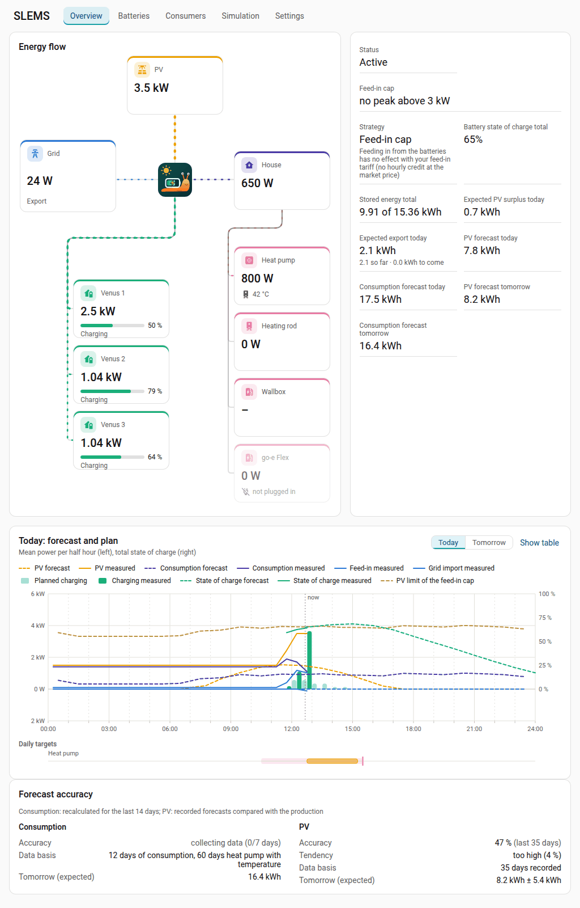
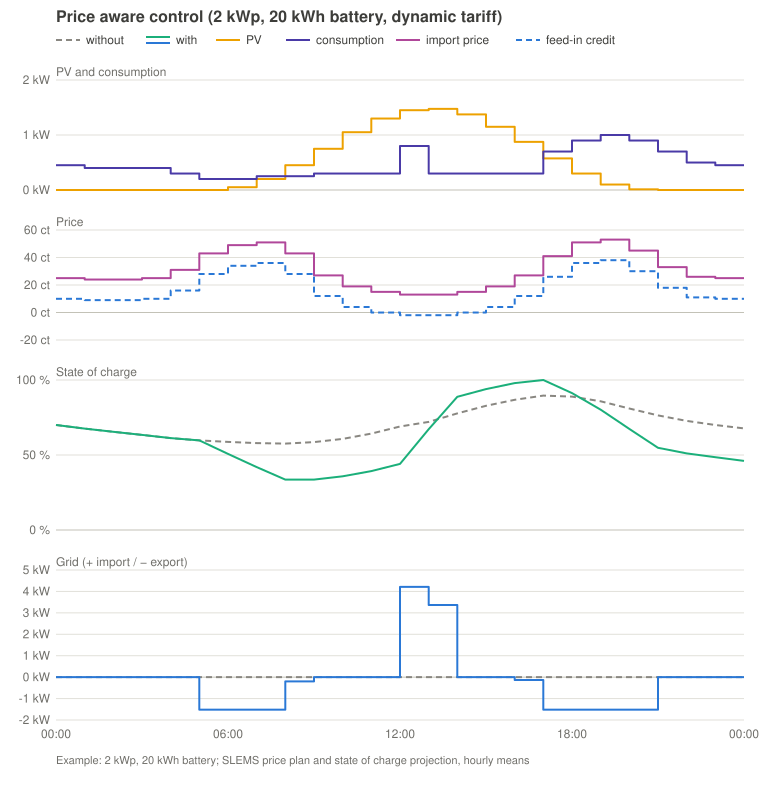
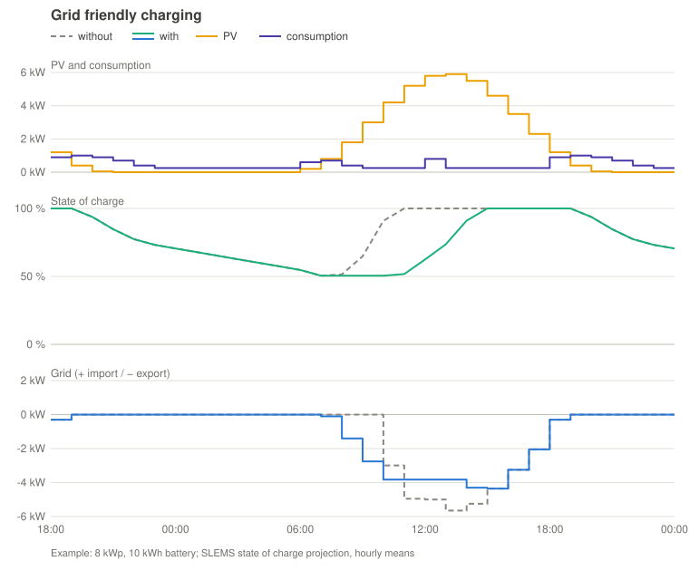
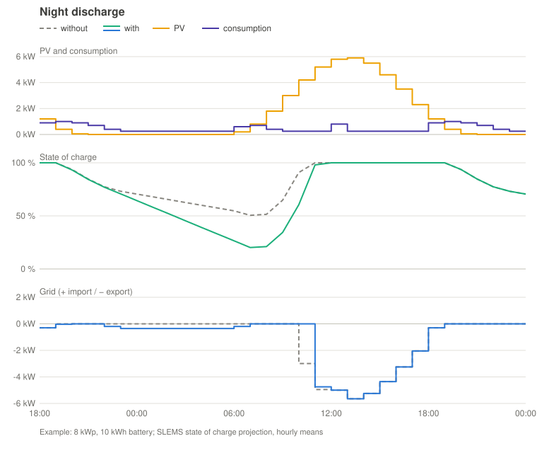
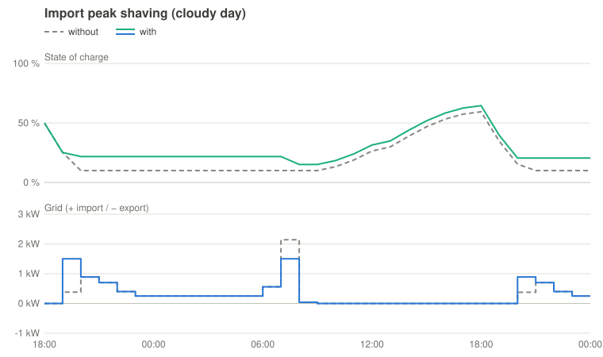
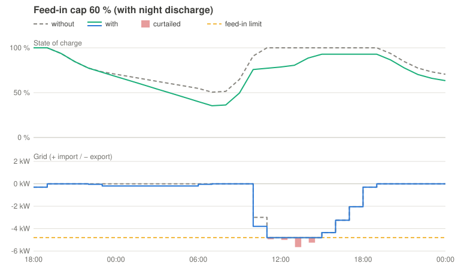

**English** | [Deutsch](README.de.md)

# SLEMS

SLEMS is a Home Assistant integration that manages home batteries and
controllable consumers. Its goal is to operate the batteries in a grid
friendly way, e.g. by shifting the charging time so that the daily feed-in
peak is absorbed, based on forecasts of consumption and PV production.

The name is a combination of *Slug* (our "favourite pets" and a funny word for
a whole range of [very interesting
animals](https://en.wikipedia.org/wiki/Sea_slug)) and *EMS* (energy management
system).

> **Status: beta.** SLEMS has been running in production without problems
> for quite some time; new features and improvements keep coming often. In the operating mode **Active** it sends
> commands to batteries and switches consumers. Use it at your own risk: check
> the limits of your batteries and the fuses of your circuits. Please report
> faults as an [issue](https://github.com/gojux/SLEMS/issues) with the
> diagnostics (see [Quick start](#quick-start)).

## Does SLEMS fit your installation?

| Battery | Support |
|---|---|
| AC battery (its own inverter, at a socket or in the distribution board) | Marstek Venus E 3.0 directly over Modbus TCP; other models through a [Modbus profile](docs/guide/battery-modbus-profile.md) or the entities of their Home Assistant integration (control experimental) |
| Plug-in battery with PV modules (balcony solar with a battery, e.g. Marstek B2500, Zendure SolarFlow, Anker Solarbank) | through the entities of its integration with **Own PV modules at the battery** (experimental, testers and feedback welcome) |
| Hybrid inverter (PV and battery at one inverter) | its battery through the entities of its integration (experimental, testers and feedback welcome) |
| No battery | PV surplus into consumers only ([without batteries](#without-batteries)) |

If you would like to use SLEMS with another battery, please
[open an issue](https://github.com/gojux/SLEMS/issues) with the model and how
it is connected (Modbus, local API, Home Assistant integration), and whether
you could test it.

| Tariff templates | |
|---|---|
| Austria | 23 supply tariffs and 2 PV feed-in tariffs of 11 suppliers (Burgenland Energie, Energie AG Oberösterreich, Energie Steiermark, EVN, IKB, illwerke vkw, Kelag, LINZ AG, Salzburg AG, TIWAG, Wien Energie), a general dynamic tariff, the grid fees of all 14 grid areas, the federal levies |
| Germany | a general dynamic tariff, the EEG feed-in credit (up to 10 kWp, 8 commissioning periods), the grid fees of 19 grid operators, the federal levies |
| Switzerland | the tariff of your municipality from the ElCom open data |
| All countries | any tariff without a template (also in Austria, Germany and Switzerland): entered as on the bill, or as a YAML file an AI makes from your bill with the prompt provided (see [tariffs](#tariffs-optional)) |

## Contents

- [Does SLEMS fit your installation?](#does-slems-fit-your-installation)
- [Quick start](#quick-start)
- [Why SLEMS?](#why-slems)
- [Features](#features)
- [Installation](#installation)
  - [HACS (custom repository)](#hacs-custom-repository)
  - [Manual](#manual)
- [Setup](#setup)
  - [Smart meter over Modbus (optional)](#smart-meter-over-modbus-optional)
  - [Tariffs (optional)](#tariffs-optional)
  - [PV forecast](#pv-forecast)
  - [Weather (optional)](#weather-optional)
  - [Consumption forecast](#consumption-forecast)
- [Without batteries](#without-batteries)
- [Batteries](#batteries)
- [Consumers](#consumers)
- [Dashboard](#dashboard)
- [Operation and control](#operation-and-control)
  - [Operating mode](#operating-mode)
  - [Control and options](#control-and-options)
- [Language](#language)
- [Roadmap](#roadmap)
- [Development](#development)
- [License](#license)

## Quick start

What you need:

- Home Assistant 2026.9 or later and HACS.
- A smart meter in Home Assistant that reports the grid power (import and
  export) continuously, e.g. a Shelly Pro 3EM. The more often it reports, the
  more precisely SLEMS controls (e.g. every second).
- Optional: a PV forecast (e.g. Forecast.Solar), batteries and consumers that
  SLEMS should control.

In five steps:

1. Install SLEMS through HACS and restart Home Assistant
   ([Installation](#installation)).
2. Add the integration, select the smart meter and the PV systems and check
   the sign of the grid power ([Setup](#setup)).
3. Add batteries and consumers ([Batteries](#batteries),
   [Consumers](#consumers)). Most batteries allow only one Modbus
   connection: disconnect them from other integrations first.
4. Let SLEMS run in the operating mode **Observe only** for a while (the
   default), so obvious problems show up early. The dashboard shows the
   forecast and the plan; nothing is controlled yet.
5. Turn off other controls of the same batteries and consumers (automations,
   other integrations) and set the [operating mode](#operating-mode) to
   **Active**. New batteries first run their
   [self-test](docs/guide/batteries.md#self-test-of-a-battery) (about 5–10 minutes), then SLEMS
   takes over.

The defaults are fine to start with; SLEMS learns losses, response times and
forecast buffers by itself (see [Learned values](docs/guide/control.md#learned-values)). Hints on
problems are under [Problems and notifications](docs/guide/control.md#problems-and-notifications).
For a fault report, attach the diagnostics: **Settings → Devices & services →
SLEMS → ⋮ → Download diagnostics**. Addresses and serial numbers of the
batteries are redacted in them.

## Why SLEMS?

Most home battery controls react to the moment: they keep the grid power at
zero and charge whenever there is surplus. The battery is then full by late
morning, and the midday peak goes into the grid anyway. SLEMS plans ahead and
controls precisely:

- **Grid friendly instead of full by 10 o'clock.** From the PV and consumption
  forecasts SLEMS calculates a feed-in limit and charges the batteries with
  the surplus above it, so they absorb the feed-in peak and are still full in
  the evening. The limit is recalculated continuously and drops by itself when
  the day turns out worse than forecast.
- **Its own consumption forecast.** Learned from the long-term statistics of
  your house, with the weather and a separate heat pump model; vacation mode,
  night discharge to a forecast based reserve and a projection of the state of
  charge for today and tomorrow.
- **Batteries and consumers in one plan.** The surplus is distributed between
  batteries and controllable consumers (heating rod, heat pump, …) with
  priorities, battery priority until the charge is secured, minimum runtimes,
  external blocking and thermostat pauses. Daily targets (runtime, energy or
  temperature by a time of day) are met from the surplus first and only if
  needed from the batteries or the grid; per consumer you decide whether the
  batteries may supply it.
- **Several batteries at their efficient point.** SLEMS learns the conversion
  losses of every battery, runs as few batteries as useful and switches
  between them with a smooth transition.
- **Feed-in cap.** If you may feed in only part of the PV power (e.g. 60 % or
  nothing at all), SLEMS stores the energy above the limit and makes room in
  the batteries in time instead of curtailing PV.
- **Import peaks shaved economically.** With power based grid fees (a power
  price for the highest quarter hour of the month) SLEMS picks the import
  limit and the reserve with the lowest expected cost, keeps energy in the
  batteries for the peaks, lets forced consumers give way and tops the
  batteries up below the limit before the peaks.
- **Prices in view.** Tariffs as on the bill, with templates for Austria,
  Germany and Switzerland; day-ahead prices per quarter hour only with your
  consent, estimated until the next day's prices are published. The price
  aware control keeps the stored energy for expensive hours and can
  optionally charge cheaply from the grid or feed in when it pays; a monthly
  tariff comparison shows what another tariff would have cost.
- **Precise control without oscillation.** Event driven on every report of the
  smart meter; the learned response time of the batteries (also of starts out
  of standby and reversals) is compensated and
  the control gain adapts itself.
- **Battery care and safety.** State of charge window, power limits (e.g. 800
  W), temperature charge limit, cell delta monitoring with active cell
  balancing, detection of batteries that do not respond, repair issues and
  notifications.
- **Regular full charge without losing surplus.** LFP batteries recalibrate
  their state of charge only when full. SLEMS charges the battery whose last
  full charge is the oldest first, one at a time and only with the surplus it
  would store anyway, and spares it when discharging so it starts the next day
  higher. It also recognises a full charge the BMS ends slightly below 100 %,
  and it measures the cell delta at the top.
- **Learns instead of asking.** Besides the consumption forecast, SLEMS learns
  the conversion losses and the response time of the batteries, the smart
  meter interval, the control gain and the consumption peaks; on request also
  the forecast buffers, the grid surplus targets, the control timing, the
  usable capacity of every battery and the power and thermostat behaviour of
  consumers (see **Learned values**). Every learned value can be switched back
  to a fixed one.
- **Transparent and local.** A dashboard with energy flow, forecast chart and
  all settings. Control, forecasts and learning run locally in Home Assistant,
  without a cloud account. SLEMS goes to the internet only for market prices
  and monthly market values (only with your consent), for Swiss tariffs from
  the open data of ElCom and once to suggest the region for public holidays
  (Nominatim, see [Consumption forecast](#consumption-forecast)). The
  operating mode **Observe only** shows what SLEMS would do before it
  controls anything, also next to an existing battery integration.
- **Try before you change.** The simulation in the dashboard calculates the
  day plan with other settings (grid friendly charging, night discharge,
  feed-in cap, battery limits, forecasts ±%) and compares feed-in, grid import
  and state of charge with the current plan, without changing anything.
- **Also without batteries.** SLEMS can direct the PV surplus into consumers
  alone (heating rod, wallbox, dehumidifier, …), with daily targets, tariffs
  and forecasts (see [without batteries](#without-batteries)).

**Other batteries and electric cars:** batteries that SLEMS does not yet
support directly or through a
[Modbus profile](docs/guide/battery-modbus-profile.md) can still be
controlled if there is an integration for them in Home Assistant: SLEMS then
controls them through its entities (experimental). SLEMS controls a wallbox
with the surplus, with **Charge now** and with a daily target by the car's
state of charge. evcc specialises in EV charging and complements SLEMS well
(see the [evcc guide](docs/wallbox-evcc.md)).

## Features

| Setup | Status |
|---|---|
| Any number of batteries, added/edited/removed at any time | ✅ |
| Smart meter, PV power and weather entity freely selectable | ✅ |
| Setup from the devices of smart meter and PV systems and from the energy dashboard; several PV systems summed up | ✅ |
| Smart meter read directly over Modbus as well (SunSpec), with the sensor as fallback | ✅ |
| Operating mode **Off / Observe only / Active** | ✅ |
| Vacation switch and bad weather mode | ✅ |
| Repair issues, notifications and diagnostics | ✅ |

| Forecasts | Status |
|---|---|
| PV forecast from any solar forecast integration (Forecast.Solar, Solcast, …) | ✅ |
| Consumption forecast today/tomorrow (history + weather, heat pump temperature dependent, public holidays of the own state or canton), raised at once after a sudden rise | ✅ |
| Correction of the PV forecast during the day and forecast accuracy of PV and consumption | ✅ |

| Batteries | Status |
|---|---|
| Marstek Venus E 3.0 via Modbus TCP | ✅ |
| Battery from existing entities: read-only or controlled by set point, charge/discharge power or script, entities suggested from the device | ✅ (control experimental) |
| Battery from a Modbus profile: an own profile made from the manual with an AI prompt, values read and write preview before anything is written, a trial with the self-test before it is controlled, observed after a firmware update; shipped (unverified): Marstek Venus E Gen 2 | ✅ (experimental) |
| Battery efficiency (battery counters, learned or manual), learned usable capacity | ✅ |
| Wear costs per battery (from purchase price and cycles) in the planning | ✅ |
| Battery menu: pause the communication for firmware updates, disable a battery, open its device | ✅ |
| Distribution between batteries by efficiency, the fastest battery takes quick changes first, rotation with smooth transition | ✅ |
| Battery limits: minimum/maximum SoC, charge/discharge power limit (e.g. 800 W), temperature charge limit, an early discharge stop of the BMS near the minimum detected | ✅ |
| Detection of batteries that do not deliver the commanded power, confirmation of set points | ✅ |
| Cell delta and active cell balancing (Marstek Venus E 3.0) | ✅ |
| Self-test of a battery: effect at the smart meter, sign and unit of the power, energy counters, state of charge, response time, release checked at the smart meter, stops at once on a wrong direction | ✅ |
| Dead time and phase per battery measured with a short probe step (for a new battery, after changes of battery, firmware, smart meter or integration, every 90 days, by hand) | ✅ |
| Regular full charge for the SoC calibration of LFP cells (one battery at a time, from the surplus, spared when discharging) | ✅ |

| Consumers | Status |
|---|---|
| Consumers with own power/energy sensors, inside or outside the smart meter | ✅ |
| Consumer setup from its device: devices ranked by fit (e.g. heat pump, heating rod, wallbox), entities, control and its range suggested | ✅ |
| Phase of consumers learned from the smart meter's phases (starting with the history), of batteries in the self-test, change reported, learn again; energy counters that do not net the phases detected | ✅ (control per phase not yet) |
| Heat pump as consumer type (weather dependent forecast), optionally a release of its hot water charge (operating mode, learned hot water power, [guide](docs/heat-pump-hot-water.md)) | ✅ |
| Control of consumers: on/off, power set point or release for an automation of your own (with latest start), priority, minimum runtime/pause, avoid short runs, external blocking, control switchable per consumer | ✅ |
| Consumers with their own thermostat: pauses recognised, their power goes to the batteries meanwhile | ✅ |
| Temperature sensors of a storage: learned energy per degree, remaining capacity, learned cooling per hour | ✅ |
| Role of a consumer in the feed-in cap (supporting, normal, never) | ✅ |
| Daily targets: runtime, enabled time, energy, temperature or the car's state of charge, with earliest start, deadline and source (surplus, batteries, grid) | ✅ |
| Battery support per consumer (always, automatic with the energy the batteries can spare, never) | ✅ |
| Wallbox / evcc loadpoint: current set point in A with phases, start/stop ([guide](docs/wallbox-evcc.md)) | ✅ (not yet tested with a real wallbox) |
| Car at the wallbox: state of charge in the energy flow, without a plugged in car no control and no planning, **Charge now** at full power | ✅ (not yet tested with a real wallbox) |

| Planning and control | Status |
|---|---|
| Distribution of surplus between batteries and consumers (priorities, split, minimum runtime/pause) | ✅ |
| Real-time control of batteries and consumers (operating mode **active**) | ✅ |
| Averaged grid surplus (0–300 s) | ✅ |
| Grid surplus targets for charging/discharging, maximum export while discharging | ✅ |
| Grid friendly charging: absorb PV feed-in peaks | ✅ |
| Feed-in cap: store the PV energy above a feed-in limit, make room in time | ✅ |
| Night discharge to a forecast based reserve | ✅ |
| Import peak shaving: an import limit and a state of charge threshold below which the batteries keep their energy for the peaks (the cheapest pair with a power price, one of them calculated from the consumption statistics, or both set; manually enabled); with a power price in the tariff the limit holds on average over the quarter hour, forced consumers give way, the batteries are topped up from the grid below the limit before the peaks, the overview shows the month's peak and its extra cost, and the tariff comparison estimates what peak shaving would have saved | ✅ |

| Dashboard | Status |
|---|---|
| Dashboard (sidebar panel): energy flow, key figures, daily forecast and plan chart, batteries, consumers, settings | ✅ |
| Simulation in the dashboard: day plan with other settings compared with the current one (today or tomorrow), with the price chart | ✅ |

| Tariffs and prices | Status |
|---|---|
| Tariffs as on the bill (time windows, VAT per group, percent levies) with a check against a bill | ✅ |
| Tariff templates: Austria (grid fees of all grid areas, levies, suppliers incl. options such as a green upgrade), Germany (levies, EEG feed-in credit, grid fees of 19 grid operators incl. § 14a modules and metering), Switzerland (query of the ElCom open data); a general template for dynamic tariffs (market price plus the markup of the contract) | ✅ |
| Template updates: new prices, successor tariffs and corrections as a repair issue, reset to the template values | ✅ |
| Tariffs as YAML (import, export, own templates) with a prompt to create one from a bill with an AI | ✅ |
| Day-ahead prices per quarter hour (APG, SMARD, Energy-Charts) and official monthly market values (E-Control) only with consent; no feed-in credit at negative prices where the tariff says so (EEG) | ✅ |
| Monthly tariff comparison: import costs and feed-in credit per tariff, tariffs shown or hidden, estimated saving of the price aware control | ✅ |
| Price aware control: stored energy kept for the expensive hours, grid part of daily targets in the cheapest window, optional charging from the grid and feeding in from the batteries | ✅ |
| Estimated day-ahead prices until the next day's prices are published (profile of the last days, weekends and public holidays) | ✅ |

## Installation

### HACS (custom repository)

The button opens SLEMS in HACS of your Home Assistant instance and adds the
custom repository; then continue with step 2. Or by hand:

1. HACS → ⋮ → **Custom repositories** → add `https://github.com/gojux/SLEMS`,
   type **Integration**.
2. Install **SLEMS** and restart Home Assistant.

### Manual

Copy `custom_components/slems` into the `custom_components` folder of your
Home Assistant configuration and restart Home Assistant.

Requires Home Assistant 2026.9 or newer.

## Setup

1. **Settings → Devices & services → Add integration → SLEMS**.
2. Select the devices of your smart meter and your PV systems (optional,
   preselected from the energy dashboard of Home Assistant; the devices that
   fit best come first, e.g. a Shelly Pro 3EM or the meter of an inverter).
   SLEMS suggests their sensors and fills in what the energy dashboard
   already knows, including the sign of its grid power, the PV forecast
   entries and the weather entity. Check the grid power entity (positive =
   import, negative = export; the form shows its current value; enable
   **invert** if your meter uses the opposite sign), and optionally PV power,
   PV forecast and weather. Several PV systems (e.g. roof and balcony) are
   summed up.
3. On the SLEMS integration page choose **Add battery** for every battery and
   **Add consumer** for every consumer you want to measure or control.

**Phases** (optional): if your smart meter measures each phase, you can
select its **Grid power L1**, **L2** and **L3** in the SLEMS settings. SLEMS
then learns which phase each device is on and shows it; this does not
affect the control yet (see
[Phase of batteries and consumers](docs/guide/control.md#phase-of-batteries-and-consumers)).

### Smart meter over Modbus (optional)

The entity of the smart meter is updated once per polling cycle of its
integration, often only about once per second, and then shows only a part of
the meter's values. With **Also read the smart meter over Modbus** SLEMS reads
the grid power directly from a SunSpec meter every 0.5 seconds (0.2 to
5 s). The control sees every value
sooner; the gain is largest with fast batteries.

- SLEMS uses the shared Modbus connection of Home Assistant. As long as the
  inverter integration keeps the inverter's only Modbus TCP connection to
  itself, a Modbus proxy has to be set up, e.g. the app [Modbus
  Proxy](https://github.com/TCzerny/ha-modbusproxy).
- SLEMS finds the meters in the SunSpec model chain; with several meters
  (e.g. export+import and consumption) you choose the one at the grid
  connection point, the current power of each helps to recognise it.
- The sign is found automatically by comparing a few values with the grid
  power entity; this needs some import or export (at least 100 W). Otherwise
  choose it by hand.
- The entity stays required: it is the history, the basis of the forecasts
  and the fallback. While no Modbus value is newer than 3 intervals (at least
  5 seconds), SLEMS uses the entity; after 5 minutes without Modbus a repair
  issue appears. The sensor **Smart meter update interval** shows the source as
  attribute `source`.
- When the source is switched, the learned battery response times start
  again, since they contain the delay of the old source.

### Tariffs (optional)

With a tariff SLEMS works in money: it checks your electricity bill, shows
every month what another tariff would have cost and can control the batteries
by the prices.

- **Enter a tariff** as on the bill, line by line, from **templates** with
  public list prices (Austria, Germany, Switzerland through ElCom) or as YAML,
  also created by an AI from a bill.
- **Dynamic tariffs** with day-ahead prices per quarter hour (fetched only when
  you switch it on) and **power prices** for the monthly peak.
- **Price aware control** (optional): keeps the batteries' energy for expensive
  hours, on request charges cheaply from the grid or feeds in when it pays
  well, and measures what that saved.

  

All settings and details: [Tariffs and prices](docs/guide/tariffs.md).

### PV forecast

Every integration that provides a solar forecast for the Home Assistant energy
dashboard can be selected, e.g. Forecast.Solar or Solcast. Several entries
(e.g. one Forecast.Solar entry per roof plane) are summed up. SLEMS uses the
finest resolution the provider delivers (e.g. 15 or 30 minutes).
Forecast.Solar marks each period by its end; SLEMS takes this into account.

**Recommendation: [Helios Forecast](https://github.com/ReikanYsora/Helios-Forecast)**
(open source, no account or API key, computed locally with weather data from
Open-Meteo). It learns from the production of your own PV system, including
shading by trees or mountains, soiling and an orientation that is a few
degrees off, and uses the existing long-term statistics of your energy sensor
right away. It provides a forecast for the energy dashboard in 15 minute
steps, so it can be selected in SLEMS directly.

### Weather (optional)

The weather entity improves the consumption forecast, especially for a heat
pump. The forecast of the national weather service fits best:

| Country | Recommendation | Why |
|---|---|---|
| Germany | [DWD Weather](https://github.com/FL550/dwd_weather) (HACS) | forecast of the German weather service for a station near you, hourly |
| Austria | [GeoSphere Austria Plus](https://github.com/coding-pagro/GeoSphere-Austria-Plus) or [GeoSphere Austria Next](https://github.com/slettmayer/ha-geosphere-next) (HACS) | high resolution AROME model of GeoSphere Austria, well suited for alpine valleys; the built-in *GeoSphere Austria* integration only provides measurements, no forecast |
| Switzerland | [Swiss Weather](https://github.com/izacus/hass-swissweather) (HACS) | local forecast of MeteoSwiss for your postcode, hourly |
| Liechtenstein | [Swiss Weather](https://github.com/izacus/hass-swissweather) (HACS) | MeteoSwiss covers Liechtenstein as well |
| Anywhere | **Open-Meteo** (built-in integration) | no account needed, combines several weather models; a good choice without an extra integration |

**Met.no**, the Home Assistant default, works everywhere but is less detailed
in alpine terrain.

### Consumption forecast

SLEMS learns your house's consumption from the long-term statistics of Home
Assistant and forecasts today and tomorrow by the hour: heat pumps by the
outdoor temperature, public holidays like weekends. When the consumption rises
suddenly (e.g. at the start of the heating season), SLEMS raises the forecast
at once. The card **Forecast accuracy** shows how well the consumption and PV
forecasts hit. When switching from another battery integration, choose its
house consumption sensor as **House consumption history**, then SLEMS learns
from the whole history at once.

Details: [Consumption forecast](docs/guide/consumption-forecast.md).

## Without batteries

SLEMS also works without any battery: add the consumers only.

- **Works**: directing the PV surplus into controlled consumers (heating rod,
  wallbox also with evcc, dehumidifier, heat pump through a switch input) with
  priorities, minimum runtime and pause, **Avoid short runs** and external
  blocking; daily targets with the sources **surplus only** and **+ grid** (also
  in the cheapest window with price aware control); tariffs, bill check,
  market prices, tariff comparison and price chart; energy flow, consumption
  and PV forecast with their accuracy.
- **Not without batteries**: everything that charges, discharges or plans a
  battery – grid friendly charging, night discharge, import peak shaving,
  price hold, charging from the grid, feeding in from the batteries – and
  currently the feed-in cap (it needs a battery even with supporting
  consumers).

## Batteries

SLEMS controls one or more home batteries: it distributes the power between
them, plans their use over the day (grid friendly charging, night discharge,
prices, import peaks) and protects them along the way. A battery can be added
in three ways:

- **Marstek Venus E 3.0** directly over Modbus TCP: the fastest way, with the
  most data (cell voltages, counters, firmware). SLEMS searches the network for
  it. The Venus allows only one Modbus connection.
- **Existing Home Assistant entities** (control experimental): any battery
  that another integration brings in, e.g. through Omnibattery, also a balcony
  storage or hybrid inverter with its own PV modules.
- **Battery from a Modbus profile** (experimental): a battery with Modbus TCP,
  described by a profile an AI creates from its manual.

What SLEMS brings for every battery:

- A **self-test** when it is added, checking signs, values and response.
- **Learned values**: response time, phase and efficiency. With several
  batteries only as many run as is efficient, with a smooth switch.
- **Limits and protection**: state of charge, charge and discharge power,
  minimum power; gentle charging near full, cell delta and cell balancing, a
  pause for firmware updates.
- Optional **wear costs**, so price aware charging from the grid only happens
  when it earns more.

All settings and details: [Batteries](docs/guide/batteries.md) and
[Battery from a Modbus profile](docs/guide/battery-modbus-profile.md).

## Consumers

SLEMS steers the PV surplus into controllable consumers and plans them
together with the batteries. Add the consumers SLEMS controls (heating rod,
wallbox, dehumidifier, …) and heat pumps, whose consumption it forecasts from
the weather. Each needs its own power and energy sensor; SLEMS suggests them
from the device.

- **Control**: on/off, a power set point in W, a current set point in A
  (wallbox, also with evcc) or a **release** for an automation of your own,
  e.g. for the hot water charge of a heat pump.
- **Priorities**, minimum runtime and pause, **avoid short runs** for devices
  with a compressor and an external block; SLEMS recognises a device's own
  thermostat by itself.
- **Battery support**: per consumer, whether the batteries may supply it.
- **Daily targets**: runtime, energy, temperature or the car's state of charge
  by a time of day, from the surplus where possible and only if needed from
  the batteries or the grid.
- **Feed-in cap**: consumers help take the surplus above the limit.

All settings and details: [Consumers](docs/guide/consumers.md), plus the
guides to the [hot water of a heat pump](docs/heat-pump-hot-water.md) and the
[wallbox with evcc](docs/wallbox-evcc.md).

## Dashboard

SLEMS adds the entry **SLEMS** to the Home Assistant sidebar:

- **Overview**: energy flow, key figures, the chart with the day's forecast,
  plan and measurements, with a tariff also the prices.
- **Batteries** and **Consumers**: one card per device with its state, plan,
  daily target and the most important settings.
- **Simulation**: try other settings and compare them with the current ones,
  without changing anything.
- **Settings**: all settings grouped and directly editable, with the learned
  values.

Everything in detail: [Dashboard](docs/guide/dashboard.md).

## Operation and control

### Operating mode

The entity **SLEMS Operating mode** switches between:

- **Off** – nothing is planned or sent.
- **Observe only** – forecasts and plans are computed and shown, but no command
  is sent to batteries or consumers. This is the default.
- **Active** – plans are executed: SLEMS sends set points to the batteries and
  switches/sets the consumers. It reacts to every change of the smart meter.
  The entity **Control status** shows whether the control is active or paused
  because the smart meter did not report for a while (60 s or ten update
  intervals; the batteries then follow their own logic until the meter is
  back).

### Control and options

In the operating mode **Active** SLEMS controls on every new value of the
smart meter: it brings the grid power to a target with the batteries, using
the learned response times so no command counts twice. On top there is a plan
for the day from the PV and consumption forecasts. The options can be
combined:

- **Grid friendly charging** (on by default): the batteries charge with the
  surplus above a feed-in limit, so they absorb the midday peak and are still
  full in the afternoon.

  

- **Night discharge**: energy that would still be in the batteries in the
  morning is fed in at night, down to a reserve the PV refills the next day;
  useful e.g. in an energy community.

  

- **Import peak shaving**: the batteries keep energy for the peaks; with a
  power price SLEMS picks the limit and reserve with the lowest cost.

  

- **Feed-in cap**: if you may feed in only part of the PV power, SLEMS makes
  room in the batteries in time instead of curtailing PV.

  

- **Bad weather mode**: stores as much surplus as possible before bad weather
  and keeps it over the next night.

SLEMS learns many values itself (buffers, grid surplus targets, capacity,
morning reserve, consumer power). Ongoing problems show up under
**Settings → Repairs**.

Everything in detail:
[Operation and control](docs/guide/control.md), including
[Which option when?](docs/guide/control.md#which-option-when) and
[Problems and notifications](docs/guide/control.md#problems-and-notifications).

## Language

SLEMS is available in English and German. Home Assistant uses two different
language settings:

- **Entity names** (e.g. **House consumption**, **Operating mode**, also the key
  figures in the dashboard) follow the **server language** under **Settings →
  System → General**. They are set when the integration loads, so reload SLEMS
  after changing it.
- Dialogs, menus, states (e.g. **Observe only**) and the texts of the
  dashboard follow the language in the **user profile**.

If names stay in the wrong language after an update of SLEMS, restart Home
Assistant (translations are only read at startup) and reload the browser
without cache. Entity IDs such as `sensor.slems_house_consumption` keep the
language of their creation; only the displayed names change.

## Roadmap

Possible extensions, grouped by topic. Wanted: feedback from users with a real
wallbox on the [evcc guide](docs/wallbox-evcc.md).

**Electric car**

- Targets that apply from plugging in the car ("80 % in 3 hours").
- Batteries with an availability (e.g. "car plugged in") and a reserve until
  a time of day: the basis for a car supplying the house (V2H).
- Learned presence of the car for the planning.

**Planning and prices**

- One planning for all battery goals: charging, discharging and feeding in
  per quarter hour by costs over the next 36–48 hours (prices, night
  discharge, feed-in cap, grid friendly charging), instead of separate rules
  each with its own horizon. Part of it:
  - the daily targets of the consumers planned together with the batteries,
  - a more stable plan of the price aware control (changed only when clearly
    better).
- Consumers preferred at very cheap or negative prices: a price threshold per
  consumer (e.g. the heating rod or a boiler), based on the total import
  price including grid fees, not only the exchange price.
- Estimated prices from the weather: the forecast of wind, solar and load of
  the bidding zone (Energy-Charts) moves the estimate; with them known
  exactly, the deviation of the last year would have dropped by about a
  third.

**Tariffs**

- Prices from a Home Assistant entity of the supplier (e.g. the Tibber
  integration, Octopus Germany, Ostrom): a line type with adapters for the
  common forecast formats, stating whether the price already includes the
  grid fees and levies.
- Index tariffs (e.g. on the Austrian electricity price index ÖSPI): a line
  type with the supplier's formula, the monthly index values fetched (with
  consent) from the Austrian Energy Agency; templates for index tariffs too.
- Tariff comparison with other hardware: what a larger battery, more charge
  power, another maximum state of charge or more PV would have brought in the
  recorded year (the battery model of the estimate with the settings of the
  simulation).

**Forecast**

- Own forecast for vacations: a base load profile learned from whole vacation
  days (all vacations together) and a factor for the heat pump from the same
  days; until about three vacation days are learned the estimate of today.
- Program devices (washing machine, dishwasher, dryer): learn the course of a
  program and add the rest of a running program to the forecast of the next
  hours (helps the evening and night planning); later possibly starting them
  with surplus if the device allows a remote start.

**Consumers**

- SG Ready / smart grid of the heat pump: raise the set temperature with PV
  surplus or at cheap prices (building, buffer tank, hot water as heat
  storage), through the SG Ready states or an offset entity; heating and
  cooling ahead as a release with limits (highest temperature, offset,
  duration), not as a daily target. The forecast knows that the heat drawn
  ahead is missing later.
- Temperature targets with a safety net: if the temperature drops below the
  minimum outside the target's window (e.g. hot water after showering in the
  evening), the minimum is reached again within a set time instead of only
  by the next day's deadline.

**Batteries and installations**

- Battery groups with a shared fuse: several batteries on one circuit (e.g.
  two Venus behind one circuit breaker) get a highest power together, which
  the active batteries of the group share, instead of a fixed half for each.
- Batteries with their own PV: the first real devices (Marstek B2500,
  Zendure SolarFlow) and hybrid inverters through their integrations or
  through Modbus profiles (candidates to test are available), and a
  shared highest output for several units at one inverter.
- Further kinds of installations: batteries with their own meter or a backup
  output with loads behind it, and batteries serving several inverters.
- Further battery models: shipped Modbus profiles from own profiles and
  [candidates](docs/battery-profiles/README.md) that passed their trial with
  users of these batteries; a driver of its own only for models that do not
  fit a profile.

## Development

See [developers.md](developers.md).

## License

GPL-3.0, see [LICENSE](LICENSE). The Marstek Venus register map and control
sequence are based on [Omnibattery](https://github.com/ffunes/Omnibattery)
(GPL-3.0).
