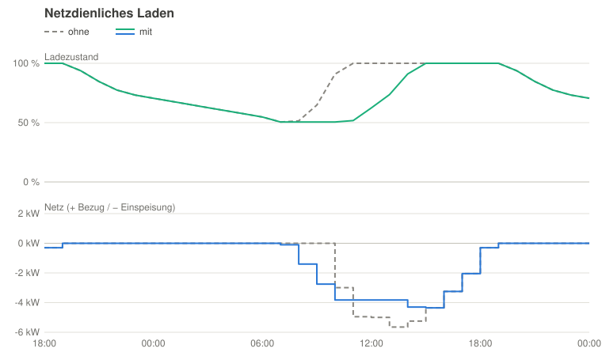
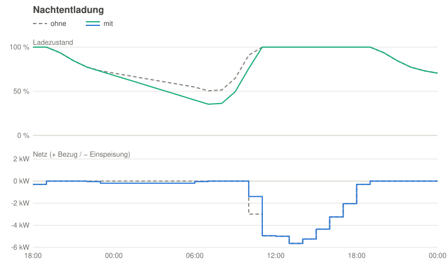
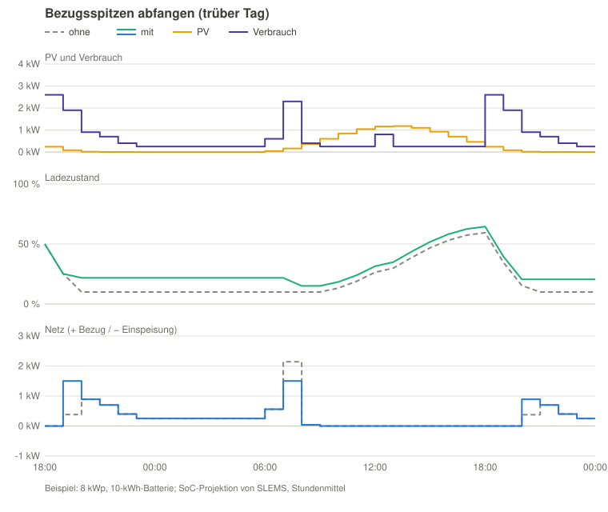
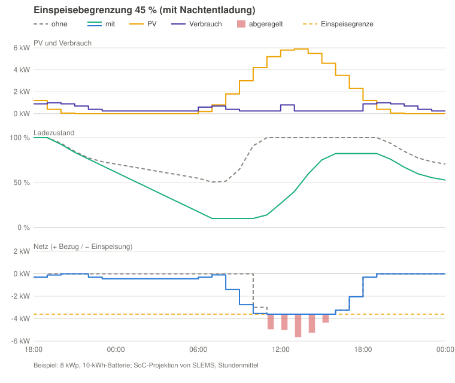

# Betrieb und Regelung

[Zurück zur README](../../README.de.md#betrieb-und-regelung) · [English](control.md)

## Schlechtwetter-Modus

Kommt schlechtes Wetter, speichert der Schalter **Schlechtwetter-Modus** (auch
im Menü des SLEMS-Logos im Energiefluss) möglichst viel des heutigen
Überschusses und behält ihn über die nächste Nacht:

- Die Batterien laden jeden Überschuss sofort, statt netzdienlich zu laden,
  und die Nachtentladung ist aus.
- Ziel-Netzüberschuss, Einspeisebegrenzung und die Grenzen der Batterien
  bleiben.
- Er endet von selbst am Morgen nach dem nächsten Abend: tagsüber
  eingeschaltet am nächsten Morgen, nachts eingeschaltet (nach dem Abend oder
  vor dem Morgen) am übernächsten Morgen.
- Der Abend ist das Ende der letzten Stunde, in der die PV-Prognose über der
  Verbrauchsprognose liegt (ohne eine solche Stunde der Sonnenuntergang). Der
  Morgen ist der Beginn der ersten Stunde danach, in der die PV-Prognose
  wieder über der Verbrauchsprognose liegt, denn bis dahin plant die
  Nachtentladung.
- Ohne eine solche Stunde in der Prognose (mehrere trübe Tage) läuft er
  weiter bis zum Sonnenaufgang nach dem Ende der Prognose. Das Ende folgt
  jeder neuen Prognose; das Attribut `until` zeigt es.
- Solange er an ist, trägt das Logo eine Regenwolke; Prognose-Diagramm und
  erwartete Einspeisung berücksichtigen ihn.

## So funktioniert die Regelung

Im Betriebsmodus **Aktiv** reagiert SLEMS auf jeden neuen Wert des Smart Meters:

1. Aus der Energiebilanz berechnet es, welche Batterieleistung die
   Netzleistung genau auf den Zielwert bringen würde (z. B. 100 W Einspeisung
   beim Laden).
2. Es berücksichtigt nur Batteriebefehle, die der Smart Meter bereits zeigen
   kann. Ein neuer Befehl braucht eine Weile, bis er im Zählerwert auftaucht;
   diese **Reaktionszeit** lernt SLEMS und zählt einen Befehl nicht doppelt.
   Dasselbe gilt für die gesteuerten Verbraucher: Bis ein Befehl den Zähler
   erreicht (**Reaktionszeit am Zähler**, je Verbraucher gelernt), zählt die
   Leistung davor, danach die gemessene, oder die befohlene, solange der
   eigene Sensor des Verbrauchers noch nicht nachgezogen hat. So beschreiben
   Zählerwert, Batterien und Verbraucher immer denselben Zeitpunkt.
3. Es springt nicht sofort auf den berechneten Wert, sondern geht pro Zyklus
   einen Teil des Weges, die **Regelverstärkung**. Bei 0,5 wird pro Zyklus die
   Hälfte der verbleibenden Abweichung korrigiert. Eine hohe Verstärkung
   reagiert schneller, eine zu hohe schießt über und lässt die Netzleistung
   hin- und herschwingen.

**Automatische Regelverstärkung** (Schalter, standardmäßig an): Die
eingestellte **Regelverstärkung** ist die Obergrenze; SLEMS senkt sie nur, wenn
die Regelung schwingt:

- SLEMS beobachtet den Smart Meter: Pendelt die Netzleistung dreimal
  hintereinander um das Ziel zwischen Bezug und Einspeisung, jeweils kurz
  nachdem die Regelung ihre Richtung gewechselt hat, und werden die
  Ausschläge nicht kleiner, schwingt die Regelung: Die Verstärkung wird
  sofort verringert (× 0,8, bis 0,2).
- Nach jeweils 5 Minuten ohne Schwingen steigt sie in kleinen Schritten (+
  0,05) wieder bis zur eingestellten Regelverstärkung.
- Nach einer Verringerung wartet SLEMS 30 Sekunden, um die Wirkung zu sehen.
  Normale Laständerungen (Wasserkocher, Wolke, ein taktender Herd, die kurzen
  Pulse einer Kaffeemaschine) werden nicht als Schwingen gewertet: Dort
  springt der Zähler stärker, als die Batterien ihn ändern können, oder der
  Zähler bewegt sich zuerst und die Regelung folgt. Der gelernte Wert bleibt
  über Neustarts erhalten.

Eine höhere Verstärkung macht die Batterien nicht schneller, denn ihre
Reaktionszeit ist schon eingerechnet. Sie lässt die Regelung nur stärker auf
Fehler reagieren, z. B. auf eine falsch gelernte Reaktionszeit. Meldet der
Smart Meter schnell (z. B. über Modbus alle 0,5 s), ist 0,5 ein guter Wert;
meldet er nur alle paar Sekunden, darf sie höher sein (z. B. 0,7).

Die gerade verwendete Verstärkung zeigt der Sensor **Aktuelle
Regelverstärkung**. Ist die Automatik ausgeschaltet, gilt die
**Regelverstärkung** als fester Wert; wird sie wieder eingeschaltet, macht die
Anpassung mit der zuletzt gelernten Verstärkung weiter, höchstens mit der
eingestellten. Das
**Regelintervall** (Standard 1 s) begrenzt, wie oft SLEMS Befehle sendet.

Diagnose-Sensoren zeigen, was SLEMS gelernt hat:

| Sensor | Bedeutung |
|---|---|
| **Aktuelle Regelverstärkung** | die gerade verwendete Verstärkung |
| **Aktualisierungsintervall Smart Meter** | wie oft der Smart Meter meldet; Attribut `source`: Modbus oder Entität |
| **Reaktionszeit Batterie** | Zeit von einem Batteriebefehl, bis der Smart Meter ihn zeigt, für alle Batterien gemeinsam; je Batterie (aus Schritten, die sie weitgehend allein macht) unter **Details** der Batterie, von der Regelung genutzt, sobald gelernt |
| **Geplante Leistung** eines Verbrauchers, Attribut `response_time_s` | Zeit von einem Befehl, bis der eigene Leistungssensor des Verbrauchers reagiert |

Die Automatik nur ausschalten, wenn sich die Verstärkung ständig deutlich
ändert, z. B. weil der Smart Meter sehr unregelmäßig meldet; dann einen festen
Wert setzen (0,3–0,5 ist ein guter Start).

## Welche Option wann?

Alle Optionen sind optional und lassen sich kombinieren. Die Diagramme zeigen
dasselbe Beispiel ohne und mit der jeweiligen Option: 8 kWp PV an einem
sonnigen Tag, ein Haushalt mit Morgen- und Abendspitze, eine 10-kWh-Batterie,
von 18:00 bis Mitternacht des nächsten Tages. Berechnet sind sie mit der
SoC-Projektion von SLEMS (Stundenmittel); sie zeigen also, wie SLEMS plant,
die echten Kurven hängen von deinen Prognosen ab. Oben: PV-Erzeugung und
Verbrauch (ohne und mit der Option gleich); Mitte: Gesamt-Ladezustand; unten:
Netzleistung (+ Bezug / − Einspeisung); grau gestrichelt ohne, farbig mit der
Option.

**Netzdienliches Laden** (standardmäßig an)

Ohne sind die Batterien schon vor Mittag voll, und die ganze Mittagsspitze
geht ins Netz (hier 5,7 kW). Mit laden sie mit dem Überschuss über einer
Einspeisegrenze und sind am Nachmittag trotzdem voll; die Spitze sinkt auf
etwa 4,4 kW. Sinnvoll, wann immer viele PV-Anlagen gleichzeitig einspeisen
(Netz, Energiegemeinschaft). Ausschalten, wenn die Batterien möglichst früh
voll sein sollen, z. B. für die Notstromversorgung.

**Nachtentladung**

Energie, die morgens noch in den Batterien ist, wird über Nacht eingespeist,
bis auf eine Reserve, die die PV-Prognose am nächsten Tag wieder auffüllen
kann (hier **Morgenreserve** 10 %: etwa 2,9 kWh werden über Nacht
eingespeist und mittags 3,2 kWh weniger, weil die Batterien mehr Platz für die
PV haben). Sinnvoll, wenn die Batterien morgens noch gut geladen sind (große
Batterie, wenig Verbrauch in der Nacht, Sommer):

- In einer **Energiegemeinschaft** findet deine Energie nachts eher einen
  Abnehmer: tagsüber erzeugen die meisten Mitglieder selbst, nachts
  verbrauchen sie. Die Nachtentladung verschiebt einen Teil deines
  Überschusses von Mittag in die Nacht.
- Sie wirkt gut mit der **Einspeisebegrenzung** zusammen: Die Batterien
  starten mit Platz für die Energie über der Grenze in den Tag, SLEMS muss
  dann selten kurz vor der Spitze einspeisen.

Die nachts eingespeiste Energie geht zweimal durch die Batterie (Lade- und
Entladeverluste, etwa 10 %), und bis zur nächsten Ladung bleibt weniger
Energie für einen Stromausfall. Ausschalten, wenn die Batterien als
Notstromreserve dienen sollen.

**Bezugsspitzen abfangen** (sinnvoll an Tagen mit wenig PV, z. B. im Winter)

Ohne deckt die Batterie alles, bis sie am Abend leer ist; die Morgenspitze
kommt dann voll aus dem Netz (hier 2,1 kW). Mit deckt sie unter der
Ladezustand-Schwelle nur die Leistung über der Bezugsgrenze: Die Grundlast
kommt aus dem Netz, die Batterie hält ihre Energie für die Spitzen (hier
höchstens 1,5 kW). Manche Spitzen werden höher als ohne (hier um 19:00 1,5
statt 0,4 kW, weil die Batterie nicht mehr alles deckt), aber keine geht über
die Bezugsgrenze, die höchste Spitze sinkt also. Sinnvoll bei einem
leistungsabhängigen Tarif oder Netzentgelt oder bei einem schwachen
Netzanschluss. Etwas mehr Energie kommt aus dem Netz (hier 1 kWh), sie ist am
Ende aber noch in der Batterie: Die Spitzen sinken, die Energiebilanz bleibt
etwa gleich.

**Einspeisebegrenzung** (wenn die Einspeisung begrenzt ist, z. B. auf 60 % der
Spitzenleistung)

Ohne sind die Batterien mittags voll, und der Wechselrichter regelt alles über
der Grenze ab (rot, hier 7,2 kWh bei einer Grenze von 45 %). Mit hält SLEMS
genug Platz frei; hier schafft die Nachtentladung den Platz, und die Batterien
nehmen die Energie über der Grenze auf. Nötig, sobald dein Netzbetreiber die
Einspeisung begrenzt; sie hat Vorrang vor den anderen Optionen.

## Netzdienliches Laden

Wird geladen, sobald Überschuss da ist, sind die Batterien schon am Vormittag
voll, und die PV-Einspeisespitze zu Mittag geht vollständig ins Netz. Mit
**Netzdienliches Laden** (Schalter, standardmäßig an) verschiebt SLEMS das Laden
in die Spitze:

- Aus PV- und Verbrauchsprognose berechnet es eine **Einspeisegrenze**: die
  höchste Einspeisung, bei der der Überschuss darüber die Batterien bis
  Tagesende trotzdem füllt (Ladeverluste, maximale Ladeleistung und **Puffer
  netzdienliches Laden** eingerechnet; Standard 1 kWh, ein größerer Puffer
  senkt die Grenze und macht die Batterien früher und zuverlässiger voll, wenn
  die Prognose zu optimistisch ist). Ohne Grenze zeigt die Kachel in der
  Übersicht den Grund: **keine – sofort laden** (der Überschuss reicht nicht),
  **aus (Schlechtwetter-Modus)** oder **keine Prognose**; bei ausgeschaltetem
  netzdienlichem Laden ist die Kachel ausgeblendet. Der Sensor hat dann keinen
  Wert und den Grund im Attribut `reason`.
- Die Batterien laden nur mit dem Überschuss oberhalb dieser Grenze; darunter
  geht die Leistung an die Verbraucher oder ins Netz. Gekappt werden die
  höchsten Stunden des Tages, egal wohin die Wolken sie schieben.
- Die Grenze wird laufend aus dem aktuellen Ladezustand und der restlichen
  Prognose neu berechnet. Hinkt das Laden hinterher (z. B. mehr Wolken als
  vorhergesagt), sinkt sie von selbst.
- Die PV-Prognose wird mit der tatsächlichen Erzeugung des Tages korrigiert
  (Diagnose-Sensor **Korrektur PV-Prognose**: Verhältnis der Erzeugung zur
  Prognose bis jetzt, 50–120 %). Ein Morgen sagt wenig über den ganzen Tag
  (Nebel, ein Hügel, der die ersten Stunden abschattet), deshalb wirkt das
  Verhältnis gewichtet: auf die laufende Stunde zu 80 %, über zwei Stunden
  auslaufend, und auf den Rest des Tages erst, wenn 15 % der prognostizierten
  Tagesenergie vorbei sind, voll ab 50 % (Attribute des Sensors). Nach einem
  Neustart übernimmt SLEMS die bisherige Erzeugung aus den Statistiken des
  PV-Sensors, es geht also nichts verloren.
- Solange die Ladung nicht gesichert ist (Ladezustand unter **Batterievorrang
  unter Ladezustand** oder die Prognose reicht nicht), lädt SLEMS wie bisher
  sofort.

Wie viel der Spitze abgefangen werden kann, hängt von der Batteriegröße im
Verhältnis zum Tagesüberschuss ab: An einem klaren Sommertag mit großem
Überschuss nimmt eine 10-kWh-Batterie etwa das oberste Kilowatt der Spitze ab,
an Tagen mit weniger Überschuss einen deutlich größeren Anteil.

## Einspeisebegrenzung

Manche Netzbetreiber oder Vorschriften erlauben einer PV-Anlage nur, einen
Teil ihrer Spitzenleistung einzuspeisen (z. B. 60 %); der Wechselrichter
regelt alles darüber ab. Mit **Einspeisebegrenzung** (Schalter, standardmäßig
aus) speichert SLEMS diese Energie stattdessen in den Batterien. Die Grenze
ist **PV-Spitzenleistung** (kWp) × **Grenze der Einspeisebegrenzung** (%),
gemessen am Netzanschlusspunkt (Einspeisung, nach dem Hausverbrauch).

- **Planung**: Aus der PV-Prognose in ihrer feinsten Auflösung (15/30/60 min,
  damit kurze Spitzen nicht weggemittelt werden) und der Verbrauchsprognose
  berechnet SLEMS bis Ende morgen, wie viel Energie über der Grenze liegt und
  wie viel freien Platz die Batterien dafür brauchen. Mehrere Spitzen am Tag
  (Wolken dazwischen) und Spitzen heute und morgen werden berücksichtigt: Eine
  Wolkenlücke oder die Nacht dazwischen, in der die Batterien das Haus
  versorgen, schafft wieder Platz; ein Überschuss unter der Grenze nicht.
- **Puffer**: **Puffer der Einspeisebegrenzung** (Standard +20 %, negative Werte
  planen mit weniger) kommt auf die aufzunehmende Energie. Mit **Puffer der
  Einspeisebegrenzung automatisch** verwendet SLEMS stattdessen die
  aufgezeichneten Abweichungen der PV-Prognose (siehe **Prognosegüte**): Von den
  Tagen mit mehr PV als prognostiziert hebt die Unterschätzung, die an 80 %
  davon nicht überschritten wurde, die PV-Prognose an. Das braucht 14
  aufgezeichnete Tage; bis dahin gilt der feste Puffer. Zusätzlich bleibt je
  Spitze auf jeden Fall ein fester Mindestpuffer von 5 % der
  PV-Spitzenleistung als Energie einer Stunde frei (0,5 kWh bei 10 kWp): Er
  deckt Fehler bei Zeitpunkt und Höhe einer Spitze ab, die in den
  Tagesabweichungen nicht sichtbar sind, und kleine Spitzen, bei denen der
  prozentuale Puffer winzig ist. Die Einstellungen zeigen die Grenze, den
  verwendeten Puffer und den Mindestpuffer.
- **Platz schaffen**: Mit Überschuss unter der Grenze wird nur geladen,
  solange der später nötige Platz frei bleibt; über der Grenze laden die
  Batterien immer. Die Nachtentladung (falls eingeschaltet) entlädt so weit,
  dass der Platz frei ist. Reichen Hausverbrauch und Nachtentladung nicht,
  speist SLEMS vor der Spitze Batterieenergie ein, möglichst spät: geplant so,
  dass es eine Stunde vor der Spitze mit 70 % der möglichen Leistung fertig
  ist, nie über der Grenze. Dafür darf es **Maximale Einspeisung beim Entladen**
  überschreiten.
- **Reihenfolge in der Spitze**: Der Überschuss über der Grenze geht an die
  Batterien (unabhängig von Batterievorrang, Batterieanteil und netzdienlichem
  Laden), dann an die Verbraucher mit dem Einsatz **Unterstützend**, dann an die
  mit **Normal**; erst der Rest wird abgeregelt. Zeigt die Prognose, dass eine
  Spitze nicht in die Batterien passt (zu klein oder zu spät für Platz, mit
  den Puffern), plant SLEMS die unterstützenden Verbraucher für den Teil, der
  nicht passt, ab Beginn der Spitze ein: Ein Verbraucher mit wenig Leistung
  würde sonst erst anfangen, wenn die Batterien voll sind, und könnte dann
  viel weniger als den Überschuss aufnehmen. Mit Temperaturfühlern plant SLEMS
  ihn nur so weit ein, wie sein Speicher noch Energie aufnehmen kann. Die
  Einspeisebegrenzung hat Vorrang vor netzdienlichem Laden (dessen
  Einspeisegrenze liegt nie über der Begrenzung), Nachtentladung und
  Batterievorrang; die Schwelle des Spitzenabfangs bleibt beim Einspeisen eine
  Untergrenze.
- **Übersicht**: Die Kachel **Einspeisebegrenzung** zeigt die nächste Spitze,
  die Energie, die die Batterien aufnehmen müssen, und falls nötig die
  Energie, die davor einzuspeisen ist, und bis wann. Das Tagesdiagramm zeigt
  die **PV-Grenze der Einspeisebegrenzung** als orange-grau gestrichelte Linie:
  erwarteter Verbrauch + Grenze, also die PV-Leistung, ab der die Einspeisung
  über der Grenze läge (die Grenze gilt nach dem Hausverbrauch, deshalb folgt
  die Linie der Verbrauchsprognose). Die Energie darüber steht als Balken auf
  dieser Linie; rot der Teil, der laut Plan trotzdem verloren geht, weil die
  Batterien voll sind oder zu langsam laden (den Grund zeigt der Tooltip;
  Verbraucher, die Überschuss über der Grenze aufnehmen, sind berücksichtigt).
  Die Kennzahl **Abgeregelt** in der Simulation ist dieselbe Energie.
- **Warnungen** (Übersicht und Benachrichtigungen): Batterien zu klein für den
  nötigen Platz, zu wenig Zeit oder Leistung, um vor der Spitze einzuspeisen,
  Ladeleistung zu gering für den Überschuss über der Grenze, und Einspeisung
  seit mehr als 5 Minuten über der Grenze. **Batterien zu klein** heißt, dass
  schon die Prognose nicht hineinpasst; passt nur der Sicherheitspuffer nicht
  vollständig, zeigt die Übersicht stattdessen den Hinweis **Prognose im
  Pufferbereich** (ohne Benachrichtigung). Energie, die nicht in die Batterien
  passt (zu klein oder zu spät für Platz), gilt nicht als Problem, soweit die
  unterstützenden und normalen Verbraucher sie in der Spitze aufnehmen können;
  die Übersicht zeigt dann den Hinweis **Verbraucher übernehmen den Rest** mit
  der Energie und den Verbrauchern. Batterien, die gerade nicht in der Planung
  sind (Zellausgleich, Kommunikation pausiert, deaktiviert, reagiert nicht),
  nennen die Texte.

Sensoren: **Einspeisebegrenzung: aufzunehmende Energie** (am Tag der nächsten
Spitze, mit den Spitzen, dem nötigen Platz, dem Einspeiseplan und dem Puffer
als Attribute) und **Einspeisebegrenzung: vor der Spitze einzuspeisen**.

## Bezugsspitzen abfangen und Leistungspreis

**Bezugsspitzen abfangen** (Schalter, standardmäßig aus) hält Energie in den
Batterien für Verbrauchsspitzen zurück: bei einem Tarif mit Leistungspreis
(z. B. die österreichischen Netztarife ab 2027, die die höchste Viertelstunde
des Monats verrechnen) oder bei einem schwachen Netzanschluss.

**Grundprinzip.** Zwei Werte bestimmen es:

- **Bezugsgrenze für Spitzenabfang**: Bezug bis zu dieser Leistung kommt aus
  dem Netz, darüber decken die Batterien.
- **Ladezustand-Schwelle für Spitzenabfang**: Ab diesem Ladezustand (aller
  Batterien zusammen) abwärts decken die Batterien *nur noch* den Bezug über
  der Grenze. Die Energie zwischen dem minimalen Ladezustand (z. B. 12 % bei
  der Venus) und der Schwelle ist damit für Spitzen reserviert. Darüber
  arbeiten die Batterien wie sonst und decken den Bezug über der Grenze auch,
  wenn sie sonst nicht entladen würden (Preisplan, Netzladen, Verbraucher
  ohne Batterie-Unterstützung). Netzladen bleibt unter der Grenze.

**Modus Spitzenabfang** wählt, was SLEMS davon berechnet:

| Modus | Du stellst ein | SLEMS berechnet |
|---|---|---|
| **Wirtschaftlich** (Standard, nur mit Leistungspreis) | – | Grenze und Schwelle mit den niedrigsten erwarteten Kosten |
| **Automatische Grenze** | Schwelle | die niedrigste Grenze, für die die Energie unter der Schwelle reicht |
| **Automatische Schwelle** | Grenze | die Schwelle, deren Energie die Spitzen über der Grenze deckt |
| **Manuell** | Grenze und Schwelle | – |

Ohne Leistungspreis im aktuellen Tarif ist **Wirtschaftlich** in den
Einstellungen ausgegraut und arbeitet wie **Automatische Grenze**. Berechnete
Werte zeigen die Einstellungen als Anzeige mit „(automatisch)“, der Sensor
**Wirksame Bezugsgrenze Spitzenabfang** die verwendete Grenze.

**Erwartete Spitzen.** Die Stundenprognose mittelt kurze Spitzen (Backofen,
Wasserkocher) weg. SLEMS nimmt deshalb die 5-Minuten-Statistik des
Hausverbrauchs der letzten etwa 10 Tage: je Stunde des Tages, wie viel Energie
über einer Leistung lag. Ohne Leistungspreis zählt der Mittelwert der Tage,
mit Leistungspreis der zweitschlechteste Tag (eine einzige verfehlte
Viertelstunde kostet den ganzen Monat). Die Energie muss bis zum Nachladen
reichen: bis der prognostizierte PV-Überschuss die Batterien vom minimalen
Ladezustand wieder bis zur Schwelle füllt (etwas Überschuss an einem
Regentag zählt nicht), höchstens 36 Stunden, gezählt nur die Stunden ohne
Überschuss. **Sicherheitsreserve Spitzenabfang** (Standard 20 %) hält
zusätzlich einen Teil zurück, gegen mehr Verbrauch als in den letzten Tagen.
Grenze und Schwelle werden laufend neu berechnet; über der Schwelle so, als
wäre sie erreicht, tagsüber für den kommenden Abend und die Nacht.

**Mit Leistungspreis** (Tarifposten mit „pro kW und Monat“, siehe
[Tarife](../../README.de.md#tarife-optional)) arbeitet SLEMS mit dem, was die Rechnung zählt:

- **Viertelstunden-Budget**: Die Grenze gilt im Mittel über die Viertelstunde
  (oder Stunde), die der Tarif misst, nach der Uhr wie beim Smart Meter. Eine
  kurze Spitze, z. B. während die Batterien an ihrer Leistungsgrenze sind
  (eine Balkonbatterie bei 800 W), gleicht SLEMS mit weniger Bezug im Rest der
  Viertelstunde aus; solange Budget übrig ist, darf eine kurze Spitze über die
  Grenze gehen. Einspeisung zählt nicht gegen den Bezug, SLEMS speist also nie
  zum Ausgleich ein.
- **Was schon bezahlt ist**: Die Grenze liegt nie unter dem, was die
  Monatsspitze schon kostet (die bisher verrechnete Leistung, mindestens die
  Mindestleistung, aufgerundet wie im Tarif, minus 200 W Puffer gegen die
  Abweichung zwischen deinem Zähler und dem Smart Meter des Netzbetreibers).
  Weniger Bezug spart bis Monatsende nichts.
- **Zeitfenster**: Hat der Leistungspreis eines, zählen Viertelstunden
  außerhalb nicht; die Batterien heben ihre Energie für das Fenster auf.
- **Verbraucher treten zurück**: Können die Batterien den Bezug über der
  Grenze nicht decken, werden Verbraucher gedrosselt, die für ein Tagesziel
  laufen, die niedrigste Priorität zuerst: leistungsgeregelte bis auf ihre
  Mindestleistung, danach schalten die außerhalb ihrer Mindestlaufzeit ab.
  Das Tagesziel holt das später nach.

**Für Spitzenabfang aus dem Netz laden** (Schalter, standardmäßig an, nur mit
Leistungspreis sichtbar): Bezug unter der Grenze kostet keinen
Leistungspreis. Liegt der Ladezustand unter der Schwelle, laden die Batterien
deshalb vor der nächsten erwarteten Spitze aus dem Netz nach, bis zur
Schwelle: in den günstigsten Viertelstunden (mit dynamischem Tarif), mit
festem Preis möglichst spät (Heimspeicher altern vor allem mit der Zeit bei
hohem Ladezustand), und nur so weit, dass der prognostizierte Bezug unter der
Grenze bleibt; ein PV-Überschuss davor zählt mit. Die Energie für Spitzen
muss dann nur bis zum Ende des nächsten Spitzenblocks reichen (zwei Stunden
ohne erwartete Spitze beenden ihn) statt bis zum Nachladen durch PV. Die
Strategie zeigt dann **Spitzenabfang: Netzladen**.

**Wirtschaftlichkeitsrechnung** (Modus **Wirtschaftlich**): SLEMS probiert
Grenzen in 100-W-Schritten, ab dem, was der Monat schon kostet, bis zur
höchsten erwarteten Spitze, jede mit ihrer Schwelle, und rechnet die
erwarteten Kosten bis Monatsende:

- **Leistungspreis** des Monats für die Grenze (mit Abgaben und USt.),
- **zurückgehaltene Energie**, die beim Nachladen noch übrig ist (Reserve,
  Verluste): Sie nimmt dem PV-Überschuss Platz, der dann eingespeist wird,
  statt später Bezug zu ersetzen, je verbleibendem Tag mit Bezugspreis minus
  Einspeisevergütung,
- mit Nachladen aus dem Netz die **Lade- und Entladeverluste** und der
  **Verschleiß** der täglich nachgeladenen Spitzenenergie.

Die Grenze mit den niedrigsten Kosten gewinnt. Grenzen, deren höchste
erwartete Spitze über der Entladeleistung der Batterien liegt oder deren
Schwelle den maximalen Ladezustand erreichen würde, scheiden aus. Beispiel:
Ein kW weniger Spitze spart mit 2,46 € pro kW und Monat netto (mit 20 % USt.
2,95 €) knapp 3 € im Monat; 2 kWh täglich für die Abendspitzen nachzuladen
kostet bei 25 ct/kWh und 90 % Wirkungsgrad je Richtung etwa 12 ct am Tag,
gut 3,50 € im Monat (ohne Verschleiß). Es lohnt sich also, wenn die Spitze
dadurch um mehr als gut 1 kW sinkt.

**Anzeige**:

- Die Kachel **Leistungsspitze diesen Monat** in der Übersicht (nur mit
  Leistungspreis) zeigt die bisher verrechnete Leistung, wann die höchste
  Viertelstunde war, bis zu welcher Leistung eine Viertelstunde nichts mehr
  kostet, die Mehrkosten des Monats über der Mindestleistung und die laufende
  Viertelstunde mit dem Bezug, der für ihren Rest noch erlaubt ist.
- Der **Tarifvergleich** schätzt für Tarife mit Leistungspreis je Monat, was
  Spitzenabfang gespart hätte und bei welcher Grenze, aus den aufgezeichneten
  Viertelstunden (die niedrigste Grenze, die die Batterien mit ihrer
  Entladeleistung und ihrer nutzbaren Energie je Tag hätten halten können,
  abzüglich Verlusten und Verschleiß). So lässt sich mit einem
  Vergleichstarif schon vor einem Leistungspreis sehen, was er kosten würde
  und was Spitzenabfang bringt.
- Die Einstellungen weisen darauf hin, wenn die Schwelle den maximalen
  Ladezustand erreicht (die Grenze ist voraussichtlich nicht zu halten) oder
  die Monatsspitze die eingestellte Grenze anhebt.
- Die Diagnose enthält die Monatsspitze, das Budget der laufenden
  Viertelstunde, die geprüften Grenzen der Wirtschaftlichkeitsrechnung und
  den Nachladeplan; das Debug-Log nennt jede neue wirtschaftliche Grenze und
  jedes geplante Nachladen.

## Gelernte Werte

Jeder dieser Werte hat einen Schalter **… automatisch** (bzw. **Gelernte …
verwenden**). SLEMS lernt immer, unabhängig vom Schalter; er entscheidet nur,
was verwendet wird. Aus gilt dein eingestellter Wert; an verwendet SLEMS den
gelernten, sobald genug Daten vorliegen, bis dahin weiter deinen. Die Schalter
sind standardmäßig an (eine bestehende Installation behält ihre Schalter, wie
sie sind). Die Einstellungen zeigen den gelernten Wert (**gelernt**) oder den
Hinweis, dass noch Daten fehlen; der Diagnose-Sensor **Gelernte Werte in
Verwendung** enthält alle gelernten Werte als Attribute.

| Wert | Gelernt aus | Braucht |
|---|---|---|
| Puffer netzdienliches Laden | aufgezeichneten PV-Prognosen: der Anteil, um den die PV-Prognose zu hoch war, nicht überschritten für 85 % der prognostizierten Energie aller Tage (ein Tag mit mindestens der prognostizierten PV zählt mit 0, jeder Tag mit seiner Prognose gewichtet: trübe Tage mit kleiner Prognose bestimmen so nicht den Puffer eines klaren Tages), angewendet auf die heute noch erwartete PV; dazu, sobald gelernt, der Anteil zu niedriger Verbrauchsprognose wie beim Sicherheitspuffer, angewendet auf den Verbrauch, solange heute noch PV erzeugt wird | 14 aufgezeichnete Tage |
| Sicherheitspuffer gesicherte Ladung (auch Ziel der Nachtentladung) | dasselbe für die PV plus zu niedrige Verbrauchsprognose (Rückrechnung: von den Tagen mit zu niedriger Prognose die Abweichung, die an 85 % davon nicht überschritten wurde), angewendet auf den restlichen Tag bzw. die nächsten 24 Stunden; solange nur ein Teil gelernt ist, der größere Wert aus diesem und dem eingestellten Puffer | 14 PV-Tage, 7 Verbrauchstage |
| Ziel-Netzüberschuss beim Laden und Entladen | wie weit die Netzleistung Richtung Bezug schwankt, während die Batterien regeln; Laden: das Ziel hält das Netz 90 % der Zeit auf der Einspeiseseite (20–1000 W); Entladen: das Netz schwankt um das Ziel, je die Hälfte der Zeit auf jeder Seite (−100 bis 300 W, mit **Kein negativer Ziel-Netzüberschuss** 0 bis 300 W), weil ein kurzer Bezug dort wenig kostet, dauerhaftes Einspeisen aber Batterieenergie verschenkt | etwas Regelbetrieb im Modus **Aktiv** |
| Regelintervall und Mittelungsfenster | dem gelernten Meldeintervall des Smart Meters (0,8 × und 3 ×) | einige Meldungen des Zählers |
| Nutzbare Kapazität (je Batterie, **Gelernte Kapazität verwenden**) | Lade- und Entladevorgängen über mindestens 20 % Ladezustand: DC-Energie / Änderung des Ladezustands (Vorgänge mit einem Sprung des Ladezustands werden verworfen), Median der letzten zehn | drei Vorgänge |
| Leistung eines Ein/Aus-Verbrauchers nach der Außentemperatur | mittlerer Leistung und Außentemperatur (eigener Fühler, sonst Wetter-Entität) jedes Laufs ab 10 Minuten, die letzten 60 Läufe; eine Gerade, nur genutzt bei mindestens 8 K Spanne und mindestens 10 % Änderung der Leistung darüber (eine Sole-Wärmepumpe oder ein Heizstab zeigt keine, dann wirkt es nicht); Attribute des Sensors **Gelernte Leistung** | 6 Läufe |
| Morgenreserve (**Deckung der Morgenreserve** bestimmt, wie vorsichtig; nur sichtbar, solange die Reserve automatisch ist) | der Morgenlücke: Energie, die das Haus zwischen der geplanten Übernahme durch die PV (Ende der Nachtentladung) und der tatsächlichen (PV deckt den Verbrauch 15 Minuten lang) aus Batterie oder Netz brauchte, in % des prognostizierten Tagesverbrauchs; die Reserve deckt den gewählten Anteil der Morgen (90 % = 9 von 10), über 100 % die größte Lücke mal dem Wert (110 % = 10 % mehr als der schlechteste Morgen) | 14 gemessene Morgen (gemessen wird auch bei ausgeschalteter Nachtentladung) |
| Leistung und Thermostat eines Verbrauchers (je Verbraucher, **Gelernte Werte verwenden**) | der Leistung im eingeschalteten Zustand (Ein/Aus-Verbraucher: ersetzt die Nennleistung; leistungsgeregelte Verbraucher: die typische Leistung bei Volllast, gemessen bei einer Vorgabe ab 90 % der maximalen Leistung seit mindestens 15 s bzw. der doppelten Reaktionszeit, für die Planung: Prognose, Tagesziel, Einspeisebegrenzung; angesteuert wird weiter bis zur maximalen Leistung) und Pausen des eigenen Thermostats trotz Vorgabe von 30 s bis 10 min (zwei innerhalb von 30 Tagen: der eigene Thermostat taktet, siehe **Eigener Thermostat**; gilt auch ohne **Gelernte Werte verwenden**; längere Pausen, z. B. ein Luftentfeuchter bei erreichter Zielfeuchte, zählen nicht) | 30 Messwerte, zwei Pausen |

### Phase von Batterien und Verbrauchern

Misst dein Smart Meter jede Phase, wähle in den SLEMS-Einstellungen seine
**Netzleistung L1**, **L2** und **L3** aus (vorgeschlagen aus dem Gerät des
Smart Meters, mit demselben Vorzeichen wie die Netzleistung). SLEMS lernt dann
die Phase jedes Verbrauchers hinter dem Smart Meter, und die jeder Batterie in
ihrem Selbsttest und ihrem Probeschritt:

- **Verbraucher**: SLEMS vergleicht die Leistung aller Batterien, Verbraucher
  und der PV-Anlage mit den Phasen des Smart Meters, jeweils über zwei Minuten
  gemittelt. Eine Änderung der Leistung eines Verbrauchers zeigt sich an einer
  Phase in etwa gleicher Größe, bei einem dreiphasigen Gerät zu einem Drittel
  an jeder Phase, auch wenn die Batterien sie gleichzeitig ausgleichen. SLEMS
  beginnt mit den letzten zwei Tagen aus dem Verlauf von Home Assistant und
  rechnet dann mit den aktuellen Werten weiter; ein Verbraucher, der in dieser
  Zeit ein paarmal geschaltet hat, bekommt seine Phase also sofort. Sensoren,
  die bis zu einer Minute verzögert melden, sind kein Problem.
- **Batterien**: Die Regelung bewegt die Batterien gemeinsam und gegen jede
  andere Last, daher lässt sich ihre Phase im normalen Betrieb nicht erkennen.
  Der [Selbsttest](batteries.de.md#selbsttest-einer-batterie) zeigt sie: Die anderen
  Batterien und die Verbraucher werden dabei festgehalten. Ebenso der
  [Probeschritt](batteries.de.md#reaktionszeit-und-phase-messen), wenn der Smart Meter seine
  Phasen so schnell meldet wie die Gesamtleistung.

Der Sensor **Phase** des Geräts zeigt das Ergebnis (**L1**, **L2**, **L3** oder
**Dreiphasig**), sein Attribut *shares* den gemessenen Anteil je Phase. Bei
einer Wallbox, deren aktive Phasen eine Entität nennt, lernt SLEMS nur die eine
Phase, mit der sie einphasig lädt. Die Phase steht in den **Details** der
Batterie und des Verbrauchers. Sie wird nur angezeigt und geprüft; die
Regelung verwendet sie noch nicht.

- **Wechsel**: Zeigt sich ein Verbraucher deutlich an einer anderen Phase
  (z. B. ein Heizlüfter in einer anderen Steckdose; ältere Werte verblassen
  über einige Tage), oder misst ein Selbsttest eine andere Phase, fragt
  **Einstellungen → Reparaturen**, an welcher Phase das Gerät hängt; die
  gemessene ist vorausgewählt.
- **Phase neu lernen** (Button des Geräts, **Neu lernen** neben der Phase in
  den **Details** oder im Menü (⋮) eines Verbrauchers, nach einer Rückfrage): verwirft die Phase und lernt sie neu aus dem Verlauf; bei einer
  Batterie danach einen Selbsttest machen. Kommt wieder dieselbe heraus, fragt
  Reparaturen, ob sie stimmt oder welche Phase stattdessen gelten soll. Eine
  andere als die gemessene Phase, die du gewählt hast, bleibt erhalten; ein
  Wechsel wird weiter gemeldet.

## Weitere Einstellungen (Entitäten)

- **Urlaub** (Schalter): Der Haushalt ist abwesend; manuell oder per Automation
  schalten. Tage, an denen der Schalter irgendwann an war, lässt SLEMS ganz aus
  dem gelernten Verbrauch heraus (Verbrauchsprognose samt Wärmepumpe,
  Sicherheitspuffer, Bezugsspitzen, Reserve der Nachtentladung, übliche
  Tagesenergie der Verbraucher), damit die Prognose nach der Rückkehr nicht
  wochenlang zu tief liegt. Blieben in den letzten 56 Tagen weniger als 7 Tage
  übrig, zählen alle Tage.
- **Batterievorrang unter Ladezustand** (Standard 30 %), **Sicherheitspuffer
  gesicherte Ladung** (Standard 1 kWh) und **Batterieanteil bei gesicherter
  Ladung** (Standard 75 %): Die Batterien bekommen den gesamten Überschuss, bis
  ihre Ladung gesichert ist, d. h. der Ladezustand über der Schwelle liegt und
  der erwartete PV-Überschuss des Tages die Energie bis zur Vollladung plus
  Sicherheitspuffer deckt. Danach wird aufgeteilt, der Anteil der Verbraucher
  geht nach Priorität; ein laufender Ein/Aus-Verbraucher behält seine Leistung
  vor leistungsgeregelten Verbrauchern höherer Priorität (die nehmen dafür
  weniger, damit er nicht aus- und wieder eingeschaltet wird). Was eine Seite
  nicht nutzen kann, bekommt die andere. Der Anteil gilt nur ohne
  **Netzdienliches Laden** (und wird nur dann angezeigt): Mit ihm bekommen die
  Batterien den Überschuss über seiner Einspeisegrenze, die Verbraucher den
  darunter.
- **Ziel-Netzüberschuss beim Laden** (0–5000 W, Standard 100 W): Die Batterien
  laden nur aus dem Überschuss oberhalb dieses Werts.
- **Ziel-Netzüberschuss beim Entladen** (−1000…+1000 W, Standard 50 W; positiv =
  Einspeisung, negativ = Bezug): der Netzwert, auf den die entladenden
  Batterien regeln. Zwischen den beiden Zielwerten sind die Batterien im
  Standby.
- **Maximale Einspeisung beim Entladen** (0 bis Summe der maximalen
  Entladeleistung aller Batterien, Standard 5000 W): Das Entladen verursacht
  nie mehr Einspeisung als diesen Wert. 0 W heißt, nie Batterieenergie
  einspeisen; das Maximum schaltet die Grenze ab. Liegt sie unter dem
  **Ziel-Netzüberschuss beim Entladen**, gilt sie (das Dashboard zeigt einen
  Hinweis).
- **Morgenreserve** (Standard 25 % des prognostizierten Verbrauchs von morgen):
  Energie, die morgens über dem minimalen Ladezustand bleiben soll, für
  Morgen, an denen die PV später übernimmt als prognostiziert; genutzt von der
  Nachtentladung und der [Batterie-Unterstützung](consumers.de.md#batterie-unterstützung).
- **Nachtentladung** (Schalter, standardmäßig aus): Über Nacht
  entladen die Batterien gleichmäßig bis zur Reserve (nutzbare Energie über
  dem minimalen Ladezustand der Batterien), bis die PV-Erzeugung den Verbrauch
  wieder übersteigt; der Ziel-Netzüberschuss beim Entladen wird dabei
  ignoriert (die maximale Einspeisung gilt weiter). Reicht die PV-Prognose für
  morgen nicht, um die Batterien von der Reserve aus wieder zu füllen, bleibt
  eine höhere Reserve; beim Nachladen zählt je Stunde höchstens die
  Ladeleistung der Batterien, und der Überschuss, den Tagesziele von
  Verbrauchern an dem Tag voraussichtlich nehmen, muss daneben Platz haben.
  Mit preisbewusster Steuerung lässt sie die Energie in den Batterien, die
  der Preisplan noch für teure Stunden braucht (z. B. den nächsten Abend
  nach einem trüben Tag). Benötigt die Verbrauchsprognose.
- **Mittelungsfenster Überschuss** (0–300 s, Standard 5 s, 0 = aus): Gemittelt
  wird, was Haus und PV ohne die Batterien tun; es gilt der ungünstigere Wert
  aus Mittelwert und aktuellem Wert, damit die Regelung bei schwankender PV
  nicht überschießt. Ein Anstieg des Verbrauchs (oder ein Einbruch der PV)
  zählt erst, wenn er doppelt so lange anhält wie die Reaktionszeit der
  Batterien (höchstens 2 s): Kurze Lastspitzen, z. B. einer Kaffeemaschine,
  die ihre Heizung warm hält, sind vorbei, bevor eine Batterie ihnen folgen
  könnte.
- **Bezugsspitzen abfangen** (Schalter, standardmäßig aus) mit **Modus
  Spitzenabfang**, **Bezugsgrenze für Spitzenabfang**, **Ladezustand-Schwelle
  für Spitzenabfang**, **Sicherheitsreserve Spitzenabfang** und **Für
  Spitzenabfang aus dem Netz laden**: siehe
  [Bezugsspitzen abfangen und Leistungspreis](#bezugsspitzen-abfangen-und-leistungspreis).

## Probleme und Benachrichtigungen

Laufende Probleme erscheinen unter **Einstellungen → Reparaturen** und
verschwinden von selbst, sobald sie behoben sind:

- eine Batterie reagiert nicht (ausgeschlossen, siehe oben),
- eine Batterie kann seit mehr als 5 Minuten nicht gelesen werden,
- eine deaktivierte Batterie mit dem Zustand **Automatik** bei der Freigabe
  kann seit mehr als 5 Minuten nicht gelesen werden (sie zählt mit 0 W, der
  Hausverbrauch ist ungenau),
- eine Batterie konnte seit mehr als 5 Minuten nicht an ihre eigene Logik
  zurückgegeben werden (sie läuft womöglich noch mit der letzten Vorgabe;
  SLEMS versucht es laufend erneut, jede Freigabe wird durch Zurücklesen
  bestätigt),
- der Smart Meter meldet nicht, während SLEMS im Betriebsmodus **Aktiv** ist,
- der Smart Meter kann seit mehr als 5 Minuten nicht per Modbus gelesen werden
  (SLEMS nutzt bis dahin die Entität),
- die Verbraucher hinter dem Smart Meter melden seit mehr als 15 Minuten
  zusammen deutlich mehr Leistung als das ganze Haus (ein Verbraucher misst
  falsch oder hängt nicht hinter dem Zähler; Grundverbrauch und
  Verbrauchsprognose stimmen so lange nicht),
- der aktuelle Tarif hängt vom Börsenpreis ab, Home Assistant ist aber auf eine
  andere Währung als Euro eingestellt (siehe Börsenpreise),
- eine Batterie oder ein Verbraucher scheint an einer anderen Phase zu hängen,
  oder das Neu-Lernen der Phase hat wieder dieselbe ergeben (mit einem Dialog
  zum Beantworten, siehe **Phasen**),
- die Energiezähler des Smart Meters saldieren nicht über die Phasen: In
  mehreren Viertelstunden sind Bezugs- und Einspeisezähler beide um etwa
  denselben Betrag mehr gelaufen, als die Netzleistung zeigt (z. B. ein Shelly
  Pro 3EM, der je Phase zählt, während Zähler der Netzbetreiber in Deutschland
  und Österreich saldieren). Tarife und Rechnungen würden Energie zählen, die
  nie über den Zähler ging. Für einen Shelly Pro 3EM liefert
  [Shelly Phase Netting](https://github.com/gojux/shelly_phase_netting)
  saldierte Zähler; sonst die Netzleistung mit Template-Sensoren und Helfern
  **Integral** aufteilen oder die Zähler entfernen (SLEMS verwendet dann seine
  eigenen saldierten Werte). Ignoriere den Hinweis, wenn auch dein Zähler des
  Netzbetreibers je Phase zählt.

Das Dashboard zeigt sie ebenfalls: ein roter Hinweis auf der Batteriekarte
(**nicht lesbar**, **reagiert nicht**), im Energiefluss und für den Smart Meter
oben in der Übersicht. Das Ende eines aktiven Zellausgleichs (im normalen
Bereich, ohne weiteren Fortschritt, nach 24 Stunden oder mit einem Fehler)
erzeugt eine
Benachrichtigung mit dem Zell-Delta vorher und nachher und der Dauer; ein
selbst abgebrochener Ausgleich nicht. Für eine Fehlermeldung speichert
**Einstellungen → Geräte & Dienste → SLEMS → ⋮ → Diagnosedaten herunterladen**
(oder dasselbe bei einem Batterie-Gerät) die Konfiguration und den internen
Zustand als Datei: Messwerte, Pläne, Grenzen der Batterien, die letzten
Registerwerte, den Stand der Zell-Delta-Messung und eines Zellausgleichs. IP-
und MAC-Adressen werden entfernt. Die Warnungen der Einspeisebegrenzung
(Batterien zu klein, zu wenig Zeit für Platz, Ladeleistung zu gering,
Einspeisung über der Grenze, siehe **Einspeisebegrenzung**) sind ebenfalls
Benachrichtigungen; sie verschwinden von selbst, sobald das Problem behoben
ist.
