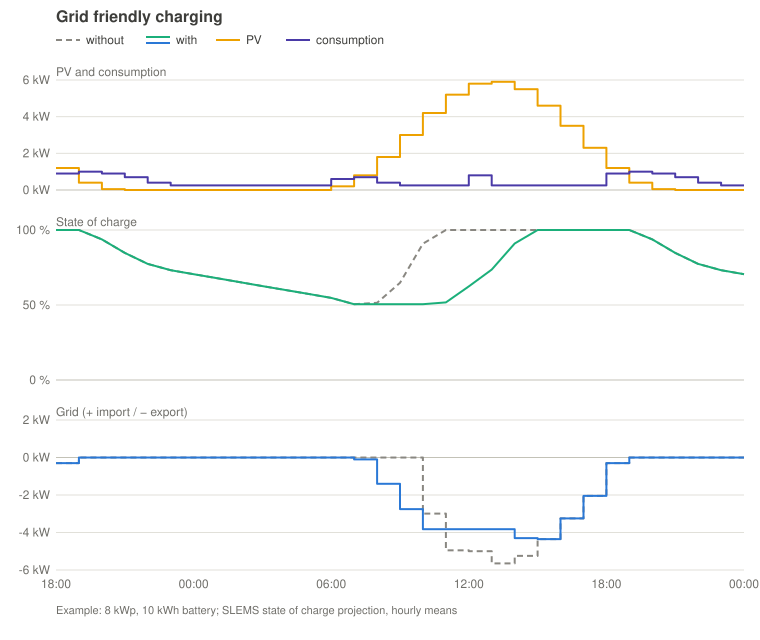
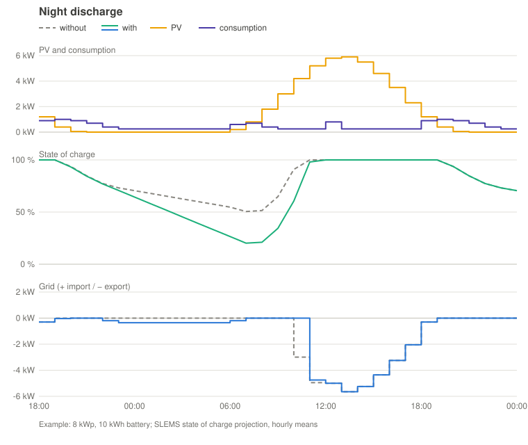
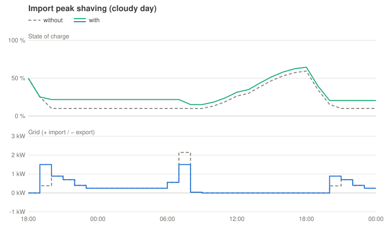
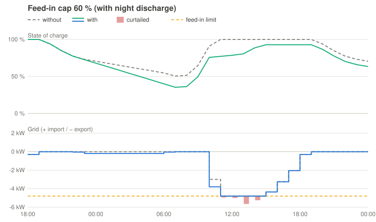

# Operation and control

[Back to the README](../../README.md#operation-and-control) · [Deutsch](control.de.md)

<!-- toc -->

- [Bad weather mode](#bad-weather-mode)
- [How the control works](#how-the-control-works)
- [Which option when?](#which-option-when)
- [Grid friendly charging](#grid-friendly-charging)
- [Feed-in cap](#feed-in-cap)
- [Import peak shaving and power price](#import-peak-shaving-and-power-price)
- [Learned values](#learned-values)
  - [Phase of batteries and consumers](#phase-of-batteries-and-consumers)
- [Further settings (entities)](#further-settings-entities)
- [Problems and notifications](#problems-and-notifications)

<!-- /toc -->

## Bad weather mode

When bad weather is coming, the switch **Bad weather mode** (also in the menu
of the SLEMS logo in the energy flow) stores as much of today's surplus as
possible and keeps it over the next night:

- The batteries charge every surplus at once instead of charging grid
  friendly, and the night discharge is off.
- The target grid surplus, the feed-in cap and the battery limits stay.
- It ends by itself in the morning after the next evening: switched on during
  the day the next morning, switched on at night (after the evening or before
  the morning) the morning after next.
- The evening is the end of the last hour in which the PV forecast is above
  the consumption forecast (without such an hour the sunset). The morning is
  the start of the first hour after it in which the PV forecast is above the
  consumption forecast again, as the night discharge plans until then.
- Without such an hour in the forecast (several dull days) it goes on until
  the sunrise after the end of the forecast. The end follows every new
  forecast; the attribute `until` shows it.
- While it is on, the logo carries a rain cloud; the forecast chart and the
  expected export follow it.

## How the control works

In operating mode **active** SLEMS reacts to every new value of the smart meter:

1. From the energy balance it calculates which battery power would bring the
   grid power exactly to the target (e.g. 100 W export while charging).
2. It only counts battery commands that the smart meter can already show. A
   new command needs some time until it appears in the meter value; SLEMS
   learns this **response time** and does not count a command twice. The same
   applies to the controlled consumers: until a command reaches the meter
   (**response time at the meter**, learned per consumer) the power before it
   counts, afterwards the measured power, or the commanded one while the
   consumer's own sensor has not caught up yet. So meter value, batteries and
   consumers always describe the same moment.
3. It does not jump to the calculated value at once but moves a share of the
   way per cycle, the **control gain**. With 0.5, half of the remaining
   deviation is corrected per cycle. A high gain reacts faster, a too high
   gain overshoots and makes the grid power swing back and forth.

**Automatic control gain** (switch, on by default): the set **Control gain**
is the upper limit; SLEMS only lowers it when the control swings:

- SLEMS watches the smart meter: if the grid power swings from import to
  export and back around the target three times in a row, each time shortly
  after the control changed its direction, and the swings do not get
  smaller, the control swings: the gain is lowered at once (× 0.8, down to
  0.2).
- After every 5 minutes without swinging it rises again in small steps
  (+ 0.05) up to the set control gain.
- After a reduction SLEMS waits 30 seconds to see its effect. Normal load
  changes (a kettle, a cloud, a cycling stove, the short pulses of a coffee
  machine) are not mistaken for swinging: there the meter jumps by more than
  the batteries can change it, or the meter moves first and the control
  follows. The learned value is kept across restarts.

A higher gain does not make the batteries faster, as their response time is
already taken into account. It only makes the control react harder to errors,
e.g. to a wrongly learned response time. With a fast smart meter (e.g. over
Modbus every 0.5 s) 0.5 is a good value; if it reports only every few seconds,
it may be higher (e.g. 0.7).

The sensor **Current control gain** shows the gain used right now. Switched
off, **Control gain** is used as a fixed value; switched on again, the
adjustment goes on from the gain it learned last, at most the set one. **Control interval**
(default 1 s) limits how often SLEMS sends commands.

Diagnostic sensors show what SLEMS has learned:

| Sensor | Meaning |
|---|---|
| **Current control gain** | gain used right now |
| **Smart meter update interval** | how often the smart meter reports; attribute `source`: Modbus or entity |
| **Battery response time** | time from a battery command until the smart meter shows it, for all batteries together; per battery (from steps it makes mostly alone) in **Details** of the battery, used by the control once learned |
| **Planned power** of a consumer, attribute `response_time_s` | time from a command until the consumer's own power sensor reacts |

Switch the automatic adjustment off only if the gain keeps changing
noticeably, e.g. because the smart meter reports very irregularly; then set a
fixed value (0.3–0.5 is a good start).

## Which option when?

All options are optional and can be combined. The charts show the same example
with and without each option: 8 kWp PV on a sunny day, a household with
morning and evening peaks, a 10 kWh battery, from 18:00 until midnight of the
next day. They are calculated with the SLEMS state of charge projection
(hourly means), so they show how SLEMS plans; the real curves depend on your
forecasts. Top: PV production and consumption (the same with and without the
option); middle: total state of charge; bottom: grid power (+ import / −
export); grey dashed without, coloured with the option.

**Grid friendly charging** (on by default)

Without it the batteries are full before noon and the whole midday peak goes
to the grid (here 5.7 kW). With it they charge with the surplus above a
feed-in limit and are still full in the afternoon; the peak drops to about 4.4
kW. Useful whenever many PV systems feed in at the same time (grid, energy
community). Switch it off if the batteries should be full as early as
possible, e.g. for backup power.

**Night discharge**

Energy still in the batteries in the morning is fed in over night, down to a
reserve that the PV forecast can refill the next day (here **Morning reserve**
10 %: about 2.9 kWh are fed in over night, and 3.2 kWh less at noon,
because the batteries have more room for the PV). Useful if the batteries are
still well charged in the morning (large battery, low night consumption,
summer):

- In an **energy community** your energy is more likely to find a buyer at
  night: during the day most members produce themselves, at night they
  consume. Night discharge shifts part of your surplus from noon to the night.
- It works well together with the **feed-in cap**: the batteries start the day
  with room for the energy above the limit, so SLEMS rarely has to feed in
  shortly before the peak.

The energy fed in at night passes the battery twice (charge and discharge
losses, about 10 %), and less energy is left for a power outage until the next
charge. Switch it off if the batteries are meant as a backup supply.

**Import peak shaving** (useful on days with little PV, e.g. in winter)

Without it the battery covers everything until it is empty in the evening; the
morning peak then comes from the grid in full (here 2.1 kW). With it, below
the state of charge threshold the battery only covers the power above the
import limit: the base load comes from the grid, the battery keeps its energy
for the peaks (here 1.5 kW at most). Some peaks become higher than without
(here at 19:00, 1.5 instead of 0.4 kW, because the battery no longer covers
everything), but none goes above the import limit, so the highest peak drops.
Useful with a power based tariff or grid fee, or if the grid connection is
weak. Somewhat more energy comes from the grid (here 1 kWh), but it is still
in the battery at the end: the peaks are lower, the energy balance stays about
the same.

**Feed-in cap** (if the feed-in is limited, e.g. to 60 % of the peak power)

Without it the batteries are full at noon and the inverter curtails everything
above the limit (red, here 7.2 kWh at a limit of 45 %). With it SLEMS keeps
enough room free; here the night discharge makes the room and the batteries
absorb the energy above the limit. Needed whenever your grid operator limits
the feed-in; it takes precedence over the other options.

## Grid friendly charging

Charging as soon as there is surplus fills the batteries in the morning, and
the PV feed-in peak around noon then goes to the grid in full. With **Grid
friendly charging** (switch, on by default) SLEMS shifts charging into the
peak:

- From the PV and consumption forecasts it calculates a **Feed-in limit**: the
  highest grid export at which the surplus above it still fills the batteries
  by the end of the day (charge losses, maximum charge power and **Grid
  friendly charging buffer** included; default 1 kWh, a larger buffer lowers
  the limit and makes the batteries full earlier and more reliably when the
  forecast is too optimistic). Without a limit the overview tile shows the
  reason: **none – charge at once** (the surplus is not enough), **off (bad
  weather mode)** or **no forecast**; with grid friendly charging switched off
  the tile is hidden. The sensor then has no value and the reason in its
  attribute `reason`.
- The batteries only charge with the surplus above this limit; below it the
  power goes to the consumers or to the grid. The highest hours of the day are
  cut, wherever the clouds put them.
- The limit is recalculated continuously from the current state of charge and
  the remaining forecast. If charging falls behind (e.g. more clouds than
  forecast), the limit drops by itself.
- The PV forecast is corrected with today's actual production (diagnostic
  sensor **PV forecast correction**: the ratio of the production to the forecast
  until now, 50–120 %). A morning says little about the whole day (fog, a hill
  shading the first hours), so the ratio is applied with a weight: the current
  hour at 80 %, fading out over two hours, and the rest of the day only once
  15 % of the day's forecast energy has passed, fully from 50 % on (attributes
  of the sensor). After a restart SLEMS takes the production so far from the
  statistics of the PV sensor, so nothing is lost.
- As long as the charge is not secured (state of charge below **Battery
  priority below state of charge** or the forecast is not sufficient), SLEMS
  charges at once as before.

How much of the peak can be absorbed depends on the battery size compared to
the day's surplus: on a clear summer day with a large surplus a 10 kWh battery
takes about the top kilowatt of the peak, on days with less surplus a much
larger share.

## Feed-in cap

Some grid operators or regulations only allow a PV system to feed in a share
of its peak power (e.g. 60 %); the inverter curtails everything above it. With
**Feed-in cap** (switch, off by default) SLEMS stores that energy in the
batteries instead of losing it. The limit is **PV peak power** (kWp) × **Feed-in
cap limit** (%), measured at the grid connection point (grid export, after the
house consumption).

- **Planning**: from the PV forecast in its finest resolution (15/30/60 min,
  so short peaks are not averaged away) and the consumption forecast, SLEMS
  calculates until the end of tomorrow how much energy lies above the limit
  and how much free space the batteries need for it. Several peaks per day
  (clouds in between) and peaks today and tomorrow are covered: a cloud dip or
  the night in between, in which the batteries supply the house, makes room
  again; a surplus below the limit does not.
- **Buffer**: **Feed-in cap buffer** (default +20 %, negative values plan with
  less) is added to the energy to absorb. With **Automatic feed-in cap buffer**
  SLEMS uses the recorded PV forecast errors instead (see **Forecast
  accuracy**): of the days with more PV than forecast, the underestimation not
  exceeded on 80 % of them raises the PV forecast. This needs 14 recorded
  days; until then the fixed buffer applies. In addition a fixed minimum
  buffer of 5 % of the PV peak power as energy of one hour (0.5 kWh at 10 kWp)
  stays free per peak in any case: it covers errors in the timing and height
  of a peak that the daily forecast errors do not show, and small peaks for
  which the percentage buffer is tiny. The settings show the limit, the buffer
  in use and the minimum buffer.
- **Making room**: charging with surplus below the limit only happens as long
  as the space needed later stays free; above the limit the batteries always
  charge. The night discharge (if enabled) stops early enough to leave the
  space. If the house consumption and the night discharge are not enough,
  SLEMS feeds battery energy into the grid before the peak, as late as
  possible: it is planned to be finished one hour before the peak with 70 % of
  the possible power, never above the limit. For this it may exceed **Maximum
  grid export while discharging**.
- **Order during the peak**: the surplus above the limit goes to the batteries
  (regardless of battery priority, battery share and grid friendly charging),
  then to the consumers with the role **Supporting**, then to those with
  **Normal**, and only the rest is curtailed. If the forecast shows that a peak
  does not fit into the batteries (too small, or too late to make room, with
  the buffers), SLEMS plans the supporting consumers from the start of the
  peak for the part that does not fit: a consumer with little power would
  otherwise only start when the batteries are full and could then take far
  less than the surplus. With temperature sensors it plans them only as far as
  their storage can still take energy. The feed-in cap takes precedence over
  grid friendly charging (its feed-in limit never lies above the cap), night
  discharge and battery priority; the peak shaving threshold stays a floor for
  feeding in.
- **Overview**: the tile **Feed-in cap** shows the next peak, the energy the
  batteries have to absorb and, if needed, the energy to feed in before it and
  by when. The day chart shows the **PV limit of the feed-in cap** as an orange
  grey dashed line: expected consumption + limit, the PV power above which the
  export would exceed the limit (the limit applies after the house
  consumption, so the line follows the consumption forecast). The energy above
  it is shown as a bar on that line; in red the part that is still lost
  according to the plan, because the batteries are full or charge too slowly
  (the reason is shown in the tooltip; consumers set to take surplus above the
  limit are taken into account). The key figure **Curtailed** in the simulation
  is the same energy.
- **Warnings** (overview and notifications): batteries too small for the space
  needed, not enough time or power left to feed in before the peak, charge
  power too low for the surplus above the limit, and feed-in above the limit
  for more than 5 minutes. **Batteries too small** means the forecast itself
  does not fit; if only the safety buffer does not fit completely, the
  overview shows the note **forecast within the buffer zone** instead (no
  notification). Energy that does not fit into the batteries (too small, or
  too late to make room) does not count as a problem as far as the supporting
  and normal consumers can take it during the peak; the overview then shows
  the note **consumers take the rest** with the energy and the consumers.
  Batteries left out of the planning (cell balancing, communication paused,
  disabled, not responding) are named in the texts.

Sensors: **Feed-in cap energy to absorb** (on the day of the next peak, with the
peaks, the space needed, the export plan and the buffer as attributes) and
**Feed-in cap export before the peak**.

## Import peak shaving and power price

**Import peak shaving** (switch, off by default) keeps energy in the batteries
for consumption peaks: with a tariff with a power price (e.g. the Austrian
grid tariffs from 2027, which bill the highest quarter hour of the month) or
with a weak grid connection.

**Principle.** Two values decide:

- **Peak shaving grid import limit**: import up to this power comes from the
  grid, the batteries cover what is above.
- **Peak shaving state of charge threshold**: from this state of charge (of
  all batteries together) down, the batteries *only* cover the import above
  the limit. The energy between the minimum state of charge (e.g. 12 % on the
  Venus) and the threshold is reserved for peaks. Above it the batteries work
  as usual and cover the import above the limit also when they would not
  discharge otherwise (price plan, grid charging, consumers without battery
  support). Grid charging stays below the limit.

**Peak shaving mode** chooses what SLEMS calculates:

| Mode | You set | SLEMS calculates |
|---|---|---|
| **Economic** (default, only with a power price) | – | limit and threshold with the lowest expected cost |
| **Automatic limit** | threshold | the lowest limit the energy below the threshold lasts for |
| **Automatic threshold** | limit | the threshold whose energy covers the peaks above the limit |
| **Manual** | limit and threshold | – |

Without a power price in the current tariff **Economic** is greyed out in the
settings and works as **Automatic limit**. The settings show calculated
values read only with "(automatic)", the sensor **Peak shaving import limit
in effect** the limit used.

**Expected peaks.** The hourly forecast averages short peaks (oven, kettle)
away. SLEMS therefore takes the 5 minute statistics of the house consumption
of the last about 10 days: per hour of the day, how much energy was above a
power. Without a power price the mean of the days counts, with one the second
worst day (a single missed quarter hour costs the whole month). The energy
has to last until the refill: until the forecast PV surplus fills the
batteries from the minimum state of charge back to the threshold (a little
surplus on a rainy day does not count), at most 36 hours, counting only the
hours without surplus. **Peak shaving safety reserve** (default 20 %) keeps a
share on top, against more consumption than in the last days. Limit and
threshold are recalculated continuously; above the threshold as if it were
reached, during the day for the coming evening and night.

**With a power price** (a tariff line "per kW and month", see
[Tariffs](../../README.md#tariffs-optional)) SLEMS works with what the bill counts:

- **Quarter hour budget**: the limit holds on average over the quarter hour
  (or hour) the tariff measures, on the wall clock as the smart meter counts.
  A short peak, e.g. while the batteries are at their power limit (a plug-in
  battery at 800 W), is made up for by importing less in the rest of the
  quarter hour; while budget is left a short peak may go above the limit.
  Feed-in does not count against import, so SLEMS never feeds in to make up.
- **What is paid already**: the limit never lies below what this month's
  peak already costs (the power billed so far, at least the minimum power,
  rounded up as in the tariff, minus a 200 W buffer against the difference
  between your meter and the grid operator's smart meter). A lower import
  saves nothing until the month ends.
- **Time window**: if the power price has one, quarter hours outside it do
  not count; the batteries keep their energy for the window.
- **Consumers give way**: when the batteries cannot cover the import above
  the limit, consumers running for a daily target are throttled, the lowest
  priority first: power controlled ones down to their minimum power, then
  those outside their minimum runtime switch off. The daily target catches up
  later.

**Charge from the grid for peak shaving** (switch, on by default, shown only
with a power price): import below the limit costs no power price. Below the
threshold the batteries are therefore topped up from the grid before the next
expected peak, up to the threshold: in the cheapest quarter hours (with a
dynamic tariff), with a fixed price as late as possible (home storage ages
mostly with time at a high state of charge), and only as far as the forecast
import stays below the limit; a PV surplus before counts. The energy for
peaks then only has to last until the end of the next block of peaks (two
hours without an expected peak end it) instead of until PV refills the
batteries. The strategy then shows **Peak shaving: charging from the grid**.

**Economic calculation** (mode **Economic**): SLEMS tries limits in 100 W
steps, from what the month already costs up to the highest expected peak,
each with its threshold, and adds up the expected costs until the end of the
month:

- the **power price** of the month for the limit (with levies and VAT),
- the **energy held back** that is still there at the refill (reserve,
  losses): it takes room from the PV surplus, which is then fed in instead of
  replacing import later, per remaining day at the import price minus the
  feed-in credit,
- with charging from the grid, the **conversion losses** and the **wear** of
  the peak energy charged back every day.

The limit with the lowest cost wins. Limits whose highest expected peak is
above the discharge power of the batteries, or whose threshold would reach the
maximum state of charge, are left out. Example: one kW less peak saves at
2.46 € per kW and month net (2.95 € with 20 % VAT) almost 3 € a month;
charging back 2 kWh a day for the evening peaks costs at 25 ct/kWh and 90 %
efficiency each way about 12 ct a day, a little over 3.50 € a month (without
wear). It pays when the peak drops by more than a little over 1 kW.

**Display**:

- The tile **Peak power this month** in the overview (only with a power
  price) shows the power billed so far, when the highest quarter hour was,
  up to which power a quarter hour costs nothing more, the extra cost of the
  month above the minimum power and the running quarter hour with the import
  still allowed for its rest.
- The **tariff comparison** estimates per month for tariffs with a power
  price what peak shaving would have saved and at which limit, from the
  recorded quarter hours (the lowest limit the batteries could have held with
  their discharge power and their usable energy per day, minus losses and
  wear). With a comparison tariff this shows before a power price applies
  what it would cost and what peak shaving brings.
- The settings note when the threshold reaches the maximum state of charge
  (the limit can probably not be held) or the month's peak raises the set
  limit.
- The diagnostics contain the month's peak, the budget of the running
  quarter hour, the limits the economic calculation tried and the charging
  plan; the debug log names every new economic limit and every planned
  charge.

## Learned values

Each of these values has a switch **… automatic** (or **Use learned …**). SLEMS
always learns, whatever the switch; it only decides what is used. Off, the
value you set applies; on, SLEMS uses the learned value as soon as there is
enough data, until then still yours. The switches are on by default (an
existing installation keeps its switches as they are). The settings show the
learned value (**learned**) or the note that there is not enough data yet; the
diagnostic sensor **Learned values in use** has all learned values as
attributes.

| Value | Learned from | Needs |
|---|---|---|
| Grid friendly charging buffer | recorded PV forecasts: the share by which the PV forecast was too high, not exceeded for 85 % of the forecast energy of all days (a day with at least the forecast PV counts with 0, every day weighted by its forecast: dull days with a small forecast so do not set the buffer of a clear day), applied to the PV still expected today; plus, once learned, the share of the consumption forecast being too low as for the safety buffer, applied to the consumption while PV is still produced today | 14 recorded days |
| Charge secured safety buffer (also the night discharge target) | the same for the PV plus the consumption forecast being too low (backtest: of the days with a too low forecast the error not exceeded on 85 % of them), applied to the rest of the day or the next 24 hours; while only one part is learned, the larger of it and the set buffer | 14 PV days, 7 consumption days |
| Grid surplus targets while charging and discharging | how far the grid power swings towards import while the batteries control it; charging: the target keeps the grid on the export side 90 % of the time (20–1000 W); discharging: the grid swings around the target, half of the time each side (−100 to 300 W, with **No negative grid surplus target** 0 to 300 W), as a short import costs little there but a permanent export gives battery energy away | some controlling in operating mode **active** |
| Control interval and surplus averaging window | the learned report interval of the smart meter (0.8 × and 3 ×) | a few meter reports |
| Usable capacity (per battery, **Use learned capacity**) | charge and discharge legs over at least 20 % state of charge: DC energy / change of the state of charge (legs with a jump of the state of charge are discarded), median of the last ten | three legs |
| Power of an on/off consumer by the outdoor temperature | the mean power and outdoor temperature (own sensor, else the weather entity) of each run of 10 minutes or more, the last 60 runs; a straight line, used only with a span of at least 8 K and a change of the power of at least 10 % over it (a ground source heat pump or a heating rod shows none, then it has no effect); attributes of the sensor **Learned power** | 6 runs |
| Morning reserve (**Morning reserve coverage** sets how cautious; shown only while the reserve is automatic) | the morning gap: energy the house needed from battery or grid between the planned takeover of PV (end of the night discharge) and the real one (PV covering the consumption for 15 minutes), in % of the day's forecast consumption; the reserve covers the chosen share of the mornings (90 % = 9 of 10), above 100 % the largest gap times the value (110 % = 10 % more than the worst morning) | 14 measured mornings (also measured while the night discharge is off) |
| Power and thermostat of a consumer (per consumer, **Use learned values**) | the power while switched on (on/off consumers: replaces the nominal power; power controlled consumers: the typical power at full load, measured while commanded at ≥ 90 % of the maximum power for at least 15 s or twice its response time, used for planning: forecast, daily target, feed-in cap; it is still commanded up to its maximum power) and pauses of its own thermostat while it is commanded, lasting 30 s to 10 min (two within 30 days: its own thermostat cycles, see **Own thermostat**; applies also without **Use learned values**; longer pauses, e.g. a dehumidifier at its target humidity, do not count) | 30 samples, two pauses |

### Phase of batteries and consumers

If your smart meter measures each phase, select its **Grid power L1**, **L2**
and **L3** in the SLEMS settings (suggested from the smart meter's device, same
sign as the grid power). SLEMS then learns the phase of every consumer behind
the smart meter, and of every battery in its self-test and its probe step:

- **Consumers**: SLEMS compares the power of all batteries, consumers and the
  PV system with the smart meter's phases, averaged over two minutes each. A
  change of a consumer's power shows up on one phase with about the same size,
  or a third on each phase for a three phase device, even while the batteries
  compensate it at the same time. SLEMS starts with the last two days of the
  Home Assistant history and then goes on with the live values, so a consumer
  that switched a few times in this period gets its phase right away.
  Sensors that report up to a minute late are no problem.
- **Batteries**: the control moves the batteries together and against every
  other load, so their phase cannot be told from normal operation. The
  [self-test](batteries.md#self-test-of-a-battery) shows it: the other batteries and the
  consumers are held meanwhile. So does the
  [probe step](batteries.md#measuring-response-time-and-phase) if the smart meter reports
  its phases as fast as the total power.

The sensor **Phase** of the device shows the result (**L1**, **L2**, **L3** or
**Three phases**), its attribute *shares* the measured share per phase. For a
wallbox whose active phases come from an entity, only the one phase it uses
while charging on one phase is learned. The phase appears in **Details** of the
battery or consumer. It is shown and checked only; the control
does not use it yet.

- **Change**: if a consumer clearly shows up on another phase (e.g. a heater
  moved to another socket; older values fade over a few days), or a self-test
  measures another phase, **Settings → Repairs** asks which phase it is
  connected to; the measured one is preselected.
- **Learn phase again** (button of the device, **Learn again** next to the
  phase in **Details** or in the menu (⋮) of a consumer, after a confirmation): forgets the phase and learns it anew from the history; for a
  battery run a self-test afterwards. If the same phase comes out again,
  Repairs asks whether it is right or which phase to take instead. A phase you
  chose other than the measured one is kept; a change is still reported.

## Further settings (entities)

- **Vacation** (switch) – the household is away; switch manually or by an
  automation. Days on which the switch was on at some time are left out of the
  learned consumption entirely (consumption forecast including the heat pump,
  safety buffer, import peaks, reserve of the night discharge, usual daily
  energy of the consumers), so the forecast is not too low for weeks after the
  return. With fewer than 7 days left within the last 56 days, all days count.
- **Battery priority below state of charge** (default 30 %), **Charge secured
  safety buffer** (default 1 kWh) and **Battery share when charge is secured**
  (default 75 %) – the batteries get all surplus until their charge is
  secured: the state of charge is above the threshold and the expected PV
  surplus of the day covers the energy to fill them plus the safety buffer.
  Afterwards the surplus is split, the consumers' share is distributed by
  priority; a running on/off consumer keeps its power before power controlled
  consumers of higher priority (they take less instead, so the on/off one is
  not switched off and on again). Power one side cannot use goes to the other.
  The share only applies without **Grid friendly charging** (and is only shown
  then): with it the batteries take the surplus above its feed-in limit, the
  consumers the surplus below it.
- **Grid surplus target while charging** (0–5000 W, default 100 W) – the
  batteries only charge from the surplus above this value.
- **Grid surplus target while discharging** (−1000…+1000 W, default 50 W;
  positive = export, negative = import) – the grid power the discharging
  batteries aim at. Between the two targets the batteries stay idle.
- **Maximum grid export while discharging** (0 up to the sum of the maximum
  discharge power of all batteries, default 5000 W) – discharging never causes
  more export than this. 0 W means never feeding battery energy into the grid,
  the maximum switches the limit off. Below the **grid surplus target while
  discharging** it wins (the dashboard shows a note).
- **Morning reserve** (default 25 % of tomorrow's forecast consumption): energy
  that should remain above the minimum state of charge in the morning, for
  mornings when PV takes over later than forecast; used by the night
  discharge and the [battery support](consumers.md#battery-support).
- **Night discharge** (switch, off by default) – over night the batteries
  discharge evenly down to the reserve (usable energy above the minimum state
  of charge of the batteries) until PV production exceeds the consumption
  again, ignoring the discharge grid target (the maximum grid export still
  applies). If tomorrow's PV forecast cannot refill the batteries from the
  reserve, a higher reserve is kept; the refill counts per hour at most the
  charge power of the batteries, and the surplus that daily targets of
  consumers are expected to take that day must fit besides it. With price
  aware control it leaves the energy the price plan still needs for
  expensive hours (e.g. the next evening after a dull day). Requires the
  consumption forecast.
- **Surplus averaging window** (0–300 s, default 5 s, 0 = off) – what the
  house and the PV do without the batteries is averaged; the less favourable
  of average and current value is used, so the control does not overshoot
  with fluctuating PV. A rise of the consumption (or a PV drop) only counts
  once it has lasted twice the response time of the batteries (at most 2 s):
  short load pulses, e.g. of a coffee machine keeping its heater warm, are
  over before a battery could follow them.
- **Import peak shaving** (switch, off by default) with **Peak shaving
  mode**, **Peak shaving grid import limit**, **Peak shaving state of charge
  threshold**, **Peak shaving safety reserve** and **Charge from the grid for
  peak shaving**: see
  [Import peak shaving and power price](#import-peak-shaving-and-power-price).

## Problems and notifications

Ongoing problems appear under **Settings → Repairs** and disappear by themselves
when they are solved:

- a battery does not respond (excluded, see above),
- a battery could not be read for more than 5 minutes,
- a disabled battery in release state **Automatic** could not be read for more
  than 5 minutes (it counts with 0 W, so the house consumption is inaccurate),
- a battery could not be handed back to its own logic for more than 5
  minutes (it may still run with the last set point; SLEMS keeps trying,
  every release is confirmed by reading the battery back),
- the smart meter does not report while SLEMS is in operating mode **active**,
- the smart meter could not be read over Modbus for more than 5 minutes
  (SLEMS uses the entity meanwhile),
- the consumers behind the smart meter report clearly more power together
  than the whole house for more than 15 minutes (a consumer measures wrong or
  is not behind the meter; base load and consumption forecast are wrong
  meanwhile),
- the current tariff follows the market price while Home Assistant is set to
  another currency than euro (see market prices),
- a battery or consumer seems to be on another phase, or learning its phase
  anew gave the same one (with a dialog to answer, see **Phases**),
- the energy counters of the smart meter do not net the phases: in several
  quarter hours the import and the export counter both ran by about the same
  amount more than the grid power shows (e.g. a Shelly Pro 3EM, which counts
  per phase, while utility meters in Germany and Austria net the phases).
  Tariffs and bills would count energy that never crossed the meter. For a
  Shelly Pro 3EM, [Shelly Phase Netting](https://github.com/gojux/shelly_phase_netting)
  provides netted counters; otherwise split the grid power with template
  sensors and **Integral** helpers, or remove the counters (SLEMS then uses its
  own netted values). Ignore it if your utility meter counts per phase too.

The dashboard also shows them: a red note on the battery card (**cannot be
read**, **not responding**), in the energy flow and, for the smart meter, at the
top of the overview. The end of an active cell balancing run (in the normal
range, without further progress, after 24 hours or with an error) creates a notification with
the cell delta before and after and the duration; cancelling it yourself does
not.

For a problem report, **Settings → Devices & services → SLEMS → ⋮ → Download
diagnostics** (or the same on a battery device) saves the configuration and the
internal state as a file: measurements, plans, battery limits, the last
register values, the state of the cell delta measurement and of a balancing
run. IP and MAC addresses are removed. The warnings of the feed-in cap
(batteries too small, not enough time to make room, charge power too low,
feed-in above the limit, see **Feed-in cap**) are notifications too; they
disappear by themselves when the problem is gone.
