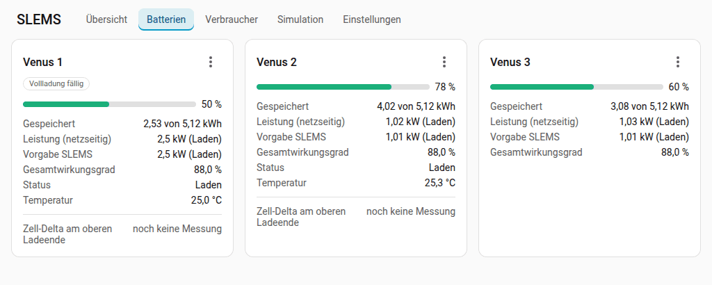
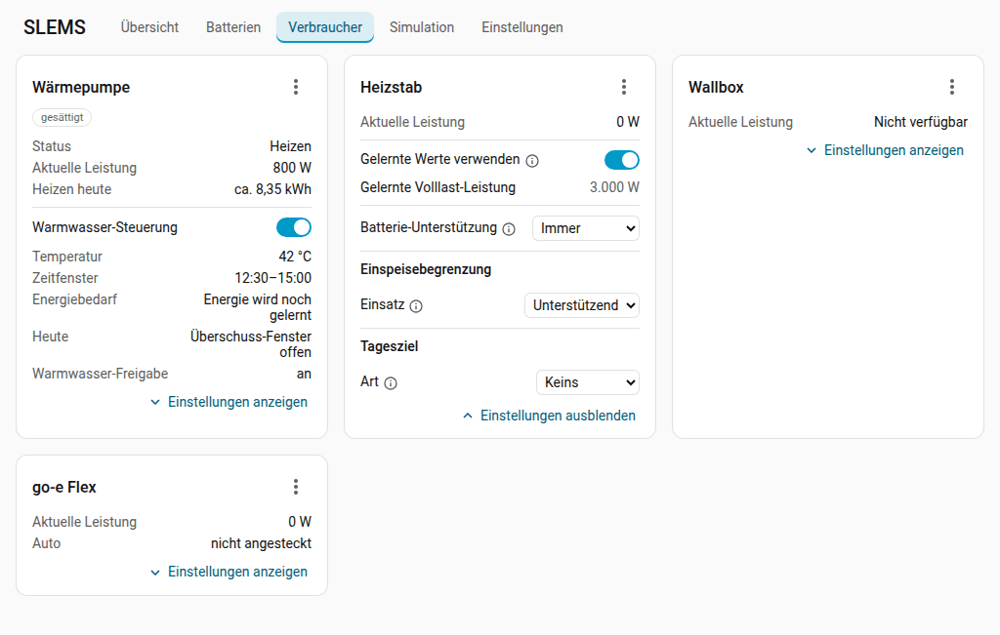
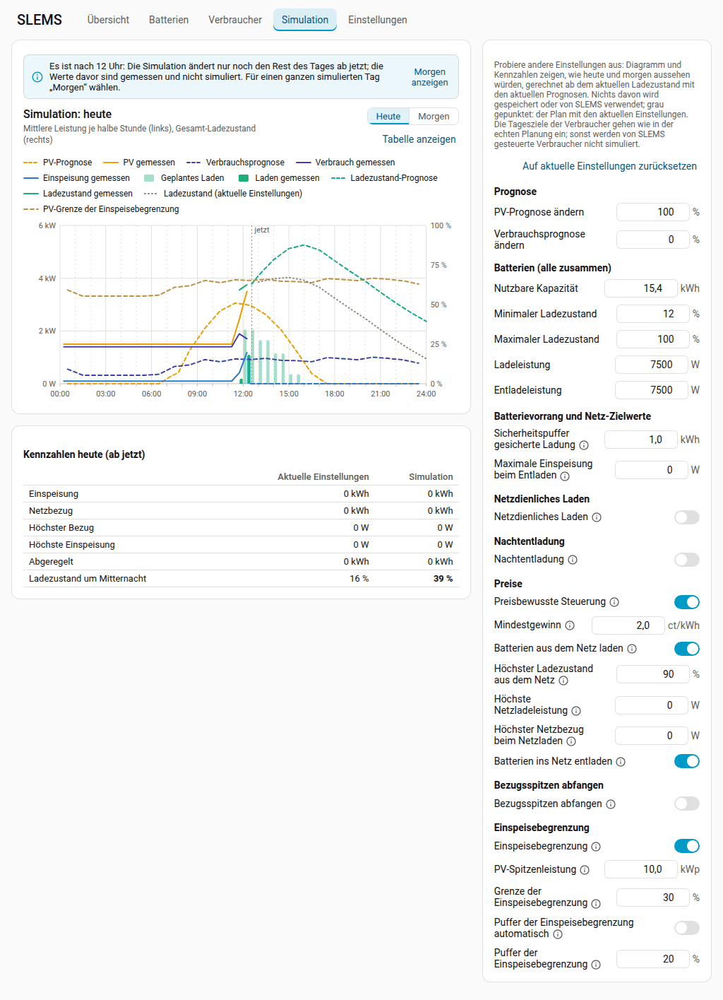

# Dashboard

[Zurück zur README](../../README.de.md#dashboard) · [English](dashboard.md)

SLEMS fügt der Seitenleiste von Home Assistant den Eintrag **SLEMS** hinzu.

## Übersicht

- **Energiefluss** zwischen Netz, PV, Haus, jeder Batterie (mit ihrem
  Ladezustand) und den Verbrauchern; die animierten Punkte laufen in
  Flussrichtung, je höher die Leistung, desto schneller und auf einer dickeren
  Linie. Das SLEMS-Logo in der Mitte öffnet ein Menü: den
  [Schlechtwetter-Modus](control.de.md#schlechtwetter-modus) und die **Details der
  Regelung** (Status, Regelverstärkung, Regelintervall und Mittelungsfenster,
  Quelle und Aktualisierungsintervall des Smart Meters, bei Modbus mit
  Antwortzeit, Fehlern und der Zeit über die Entität heute, und die
  Reaktionszeiten der Batterien).
  Mit einer Batterie mit eigener PV (Hybrid-Wechselrichter, Balkonkraftwerk
  mit Batterie) kannst du oben rechts zwischen **Summiert** und **Nach
  Geräten** wählen; die Wahl merkt sich der Browser. **Summiert** zeigt alle
  PV in einer Box, die Batterie mit der Leistung, die ihr Wechselrichter
  einschließlich ihrer PV aufnimmt. **Nach Geräten** zeigt jede PV-Anlage
  einzeln und eine solche Batterie so, wie die Energie fließt: ihren
  Wechselrichter mit der Leistung an seinem Anschluss (**Abgabe** ins Haus
  oder **Aufnahme** aus dem Haus), darunter ihre PV und die Batterie mit
  ihrer Leistung auf der DC-Seite. Was dabei fehlt, sind die Verluste des
  Wechselrichters.
- **Kennzahlen**: Status (zuerst Probleme – Smart Meter ohne Werte, Batterie
  nicht lesbar oder reagiert nicht –, sonst der Betriebsmodus), Strategie
  (ein Wechsel erscheint erst, wenn er 30 Sekunden besteht; die Regelung
  wechselt sofort), Ladezustand, gespeicherte Energie und Kapazität, Einspeisegrenze, Prognosen
  und die **erwartete Einspeisung heute**: die seit Mitternacht gemessene
  Einspeisung plus die, die der Plan noch erwartet (die blaue Linie des
  Diagramms).
- **Prognose-Diagramm** (mittlere Leistung je halbe Stunde in kW):
  - **Heute** zeigt PV- und Verbrauchsprognose (gestrichelt), die bisher
    gemessenen Werte (durchgezogen), die erwartete und die gemessene
    Einspeisung ins Netz (blau; die erwartete aus dem Plan, einschließlich
    Nachtentladung, höchstens bis zur Einspeisebegrenzung), den erwarteten und
    den gemessenen Netzbezug (blau, unter der Nulllinie; nur wenn es welchen
    gibt), das geplante Laden
    der Batterien (helle Balken) und das gemessene Laden (kräftige Balken), die
    geplante Last der Tagesziele der Verbraucher (rosa, gestrichelt; Teil der
    Verbrauchsprognose), dazu den prognostizierten Gesamt-Ladezustand
    (gestrichelt) und den gemessenen (durchgezogen) mit ihrer Skala in %
    rechts.
  - **Grenzlinien**, je in der Farbe der Kurve, die sie begrenzen, gedämpft
    und mit eigener Strichart: die **PV-Grenze der Einspeisebegrenzung**
    (orange-grau), die **Grenze netzdienliches Laden** (grün-grau, heute ab
    jetzt, solange PV erwartet wird: Darüber laden die Batterien) und die
    **Grenze Bezugsspitzen** (blau-grau, unter der Nulllinie). Sind mehrere
    davon aktiv, sind alle ausgeblendet, bis man sie in der Legende einschaltet;
    eine einzelne ist sichtbar. Die Auswahl in der Legende merkt sich der
    Browser. Die Simulation zeichnet die Grenzen mit ihren eigenen
    Einstellungen.
  - Laden aus dem Netz ist blau: beim geplanten Laden der Teil aus dem Netz
    oben auf dem Teil aus PV. Das gemessene Laden ist grün, wenn es fast nur
    aus PV kam, blau, wenn es fast nur aus dem Netz kam (geladen bei
    gleichzeitigem Netzbezug), und grün-blau gestreift, wenn beides zugleich
    lud. Der Netzanteil wird aus 5-Minuten-Mittelwerten geschätzt und bei
    schwankender Leistung überschätzt; unter 20 % oder unter 50 Wh je halbe
    Stunde gilt das Laden daher als PV.
  - **Morgen** zeigt Prognosen, geplantes Laden und Ladezustand des nächsten
    Tages, fortgeführt aus der Prognose von heute.
  - Die Prognose folgt der Planung: Laden nur mit dem geplanten Überschuss,
    Defizite aus den Batterien, Bezugsspitzen abfangen und Nachtentladung,
    falls aktiviert.
  - Beim Überfahren erscheinen die Werte einer halben Stunde (am Handy durch
    Antippen, Tippen daneben schließt sie); das Auswählen eines Eintrags der
    Legende blendet diese Kurve aus oder ein (die Skala folgt den angezeigten
    Kurven; der Browser merkt sich die Auswahl; **PV über der Grenze** der
    Einspeisebegrenzung ist ausgeblendet, bis man es einschaltet); **Tabelle
    anzeigen** schaltet auf eine Tabelle um.
- **Preisdiagramm** (nur mit einem [Tarif](../../README.de.md#tarife-optional), dessen Preise
  sich über den Tag ändern, mit Börsenpreisen oder mit preisbewusster
  Steuerung), unter dem
  Prognose-Diagramm auf derselben Zeitachse: je Viertelstunde der Preis einer
  bezogenen kWh mit dem aktuellen Tarif und die Einspeisevergütung (ct/kWh
  inkl. USt., mit Zeitfenstern und dynamischen Preisen, ohne Grundgebühren)
  und der Börsenpreis, wenn Börsenpreise abgerufen werden, mit seiner Quelle.

## Reiter Batterien

Ladezustand, gespeicherte Energie und Kapazität (kWh), netzseitige Leistung
(AC) mit Richtung (eine stehende Batterie ist **Voll** oder **Leer**, wenn SLEMS
sie wegen ihres Ladezustands oder ihres BMS nicht weiter lädt oder entlädt,
sonst **Standby**), die Vorgabe von SLEMS, Wirkungsgrad, Status und der
Schalter **Aktiviert** jeder Batterie (das Deaktivieren muss bestätigt werden),
das Zell-Delta mit seinem Status, eine Empfehlung für den aktiven
Zellausgleich und die Phase eines laufenden Ausgleichs.

## Reiter Verbraucher

Eine Karte je Verbraucher mit den wichtigen Werten: aktuelle Leistung,
Temperatur, **Zeitfenster** (das geplante Fenster, sonst die eingestellte Zeit),
**Energiebedarf** (der noch nötige, bei erreichtem Ziel der der nächsten
Periode), Stand des Tagesziels und die Freigabe; bei einer Wallbox das Auto.
Eine Wärmepumpe zeigt oben ihren **Status** und die Prognose des Tages (mit
gesteuertem Warmwasser **Heizen heute**: ohne die Warmwasser-Energie, nur bei
einer einzigen Wärmepumpe) und die Werte des Warmwassers im Abschnitt
**Warmwasser-Steuerung**. Über **Einstellungen anzeigen** klappt die Karte auf
(der Browser merkt sich die Auswahl).

Das Menü (⋮) neben dem Namen, das auch eine Verbraucher-Box im Energiefluss
öffnet, schaltet die Steuerung, startet oder beendet **Sofort laden**, lernt die
Phase neu und öffnet den **Verlauf** und die Geräteseite. Seine **Details**
zeigen die geplante Leistung, die Phase, die gelernten Reaktionszeiten beim Ein-
und Ausschalten (eigener Sensor und am Zähler; das Einschalten enthält eine
Anlaufverzögerung des Geräts, z. B. eines Kompressors), den ganzen Stand und
Plan des Tagesziels und die Batterie-Unterstützung.

## Simulation

Andere Einstellungen ausprobieren, ohne etwas zu ändern.

- **Was sich ändern lässt**: Neben dem Tagesdiagramm (heute ab jetzt oder
  morgen) lassen sich netzdienliches Laden, Nachtentladung, Bezugsspitzen
  abfangen und Einspeisebegrenzung ein- und ausschalten; ihre Werte erscheinen
  wie in den Einstellungen unter dem jeweiligen Schalter. Auch die Batterien
  (Kapazität, minimaler/maximaler Ladezustand, Lade- und Entladeleistung;
  vorgegeben ist die Leistung der Batterien ohne die momentanen Grenzen durch
  den Ladezustand), der
  Sicherheitspuffer der Nachtentladung, die maximale Einspeisung beim Entladen
  und die PV- und Verbrauchsprognose (±%) lassen sich ändern. Mit
  Vergleichstarifen ([Tarife](../../README.de.md#tarife-optional)) wählt die Gruppe **Tarif**
  ganz oben einen anderen **Tarif für Bezug** und **Tarif für Einspeisung**
  (z. B. einen dynamischen Tarif, einen mit günstigerem Netzpreis zu Mittag
  oder einen mit Leistungspreis). Alles, was Preise nutzt, plant damit: die
  preisbewusste Steuerung, die Läufe der Tagesziele im günstigsten Fenster
  und Bezugsspitzen abfangen mit Leistungspreis; das Preisdiagramm zeigt dann
  deren Preise.
- **Ergebnis**: SLEMS rechnet die Tagespläne wie die echten, ab dem aktuellen
  Ladezustand mit den aktuellen Prognosen; der Plan mit den aktuellen
  Einstellungen ist zum Vergleich grau gepunktet, darunter stehen Kennzahlen
  nebeneinander (Einspeisung, Netzbezug, höchster Bezug und höchste
  Einspeisung, abgeregelte Energie, Ladezustand um Mitternacht; mit einem
  Tarif auch Bezugskosten, Einspeisevergütung und beides zusammen, aus den
  Preisen je kWh inkl. USt. ohne Jahresgebühren; mit Leistungspreis die
  höchste geplante Stunde und eine Schätzung der verrechneten Leistung und
  des Leistungspreises des Monats, weil der Plan in Stunden rechnet).
- **Nichts davon wird gespeichert** oder für die Regelung verwendet; jeder
  Besuch beginnt mit den aktuellen Einstellungen.
- **Heute** wird ab jetzt simuliert (die Werte davor sind gemessen); am
  Nachmittag schlägt ein Hinweis **Morgen** für einen ganzen simulierten Tag
  vor.
- Die Tagesziele der Verbraucher werden mit den simulierten Einstellungen und
  dem simulierten Tarif neu geplant (z. B. ein Lauf im günstigeren Fenster
  eines anderen Tarifs); sonst
  werden von SLEMS gesteuerte Verbraucher und der Batterievorrang (er wirkt in
  der Echtzeit-Verteilung) nicht simuliert.

**Tarifvergleich**: Mit [Tarifen](../../README.de.md#tarife-optional) zeigt der Reiter
Simulation für jeden Monat des letzten Jahres (und den laufenden Monat bis
heute) den aufgezeichneten Netzbezug und die Einspeisung und je Tarif
inklusive Umsatzsteuer die Kosten des Bezugs und die Vergütung der Einspeisung
(abzüglich ihrer Gebühren; ein Schalter zeigt beides summiert), unter jedem
Vergleichstarif die Differenz zum aktuellen (grün besser, rot schlechter). Die Vergleichstarife lassen sich durch Auswählen
ihres Namens ein- und ausblenden (im Browser gemerkt).
Es ist ein passiver Vergleich: die aufgezeichnete Energie anders bepreist,
nicht das, was SLEMS mit einem anderen Tarif anders gemacht hätte (z. B. die
Batterien in günstigen Stunden laden). Dynamische Tarife nutzen die
gespeicherten Börsenpreise; Energie ohne Börsenpreis wird markiert. Mit
Batterien steht unter den Kosten eines Tarifs eine Schätzung, was die
[preisbewusste Steuerung](../../README.de.md#tarife-optional) gespart hätte: Aufgezeichneter
Hausverbrauch und PV laufen stündlich durch ein einfaches Batteriemodell,
einmal wie üblich und einmal geplant wie die preisbewusste Steuerung (mit
Laden aus dem Netz, wenn es eingeschaltet ist). Der Plan kennt Verbrauch und
PV genau, die Schätzung ist daher eine Obergrenze. Tarife, bei denen die
Steuerung nichts spart (Fixpreis), haben keine solche Zeile.

## Reiter Einstellungen

Alle Einstellwerte gruppiert und direkt änderbar; wird ein Wert gelernt
(Schalter **… automatisch**), steht dort der gelernte Wert. Die Karte
**Regelung** zeigt auch das Aktualisierungsintervall des Smart Meters und die
Reaktionszeit der Batterie. Einstellungen, die gerade nichts bewirken (kein
Tarif, keine steuerbare Batterie, für den Batteriewechsel weniger als zwei),
folgen am Ende unter **Aktuell nicht nutzbar**: ausgegraut, gesperrt und mit dem
Hinweis, was sie brauchen.

## Bedienung des Dashboards

Das Auswählen eines Werts (Kachel, Kasten im Energiefluss außer dem eines
Verbrauchers, der sein Menü öffnet, Zeile einer Karte) öffnet den Home-Assistant-Dialog der zugehörigen Entität mit Verlauf und
Einstellungen.

Das Dashboard folgt der Sprache und dem hellen/dunklen Design von Home
Assistant und funktioniert auch am Handy (bei wenig Platz stehen die Batterien
im Energiefluss untereinander).
