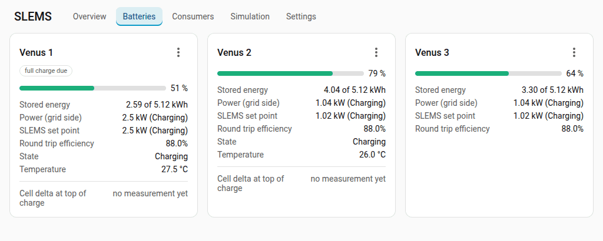
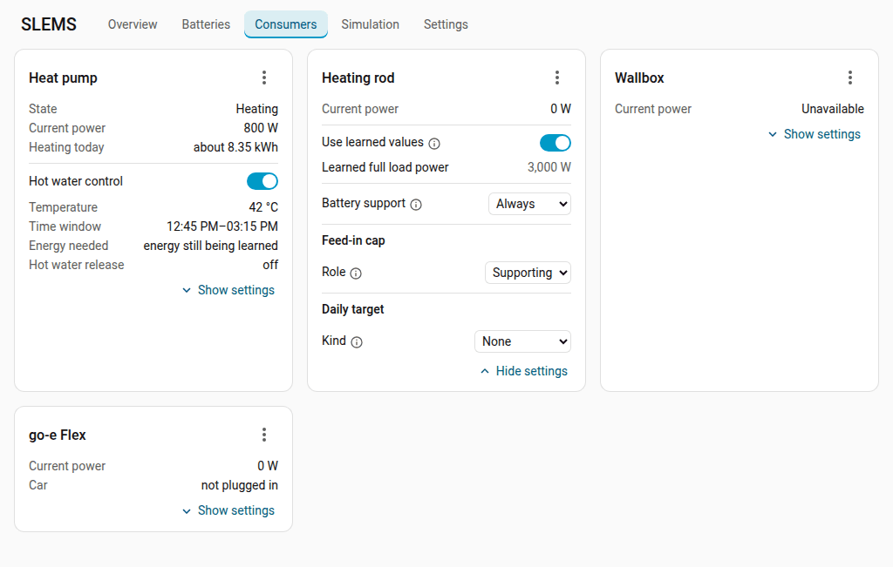
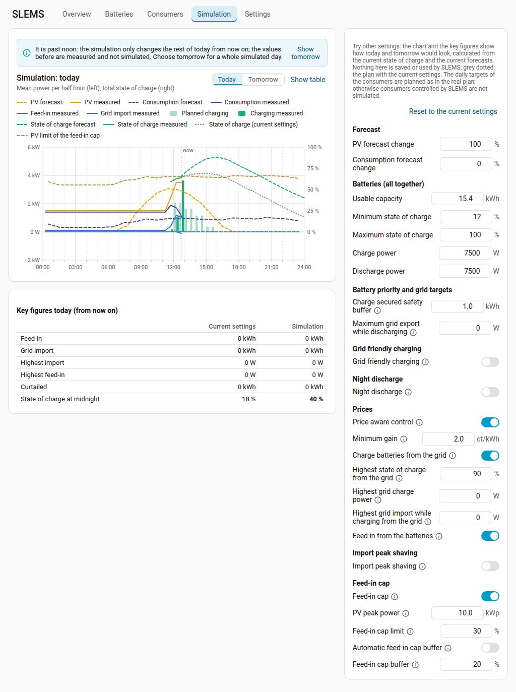

# Dashboard

[Back to the README](../../README.md#dashboard) · [Deutsch](dashboard.de.md)

SLEMS adds the entry **SLEMS** to the Home Assistant sidebar.

## Overview

- **Energy flow** between grid, PV, house, every battery (with its state of
  charge) and the consumers; the animated dots run in the direction of the
  flow, faster and on a thicker line the higher the power. The SLEMS logo in
  the middle opens a menu: the [bad weather mode](control.md#bad-weather-mode) and the
  **control details** (status, control gain, control interval and averaging
  window, source and update interval of the smart meter, with Modbus its
  round trip, errors and the time on the entity today, and the battery
  response times).
  With a battery that has its own PV (hybrid inverter, balcony solar with a
  battery) you can choose **Summed** or **By device** at the top right; the
  browser remembers the choice. **Summed** shows all PV in one box and the
  battery with the power its inverter takes including its PV. **By device**
  shows every PV system on its own and such a battery the way the energy
  flows: its inverter with the power at its connection (**Output** into the
  house or **Input** from the house), below it its PV and the battery with
  its power on the DC side. What is missing between them are the losses of
  the inverter.
- **Key figures**: status (problems first – smart meter without values,
  battery unreadable or not responding – otherwise the operating mode),
  strategy (a change shows once it lasted 30 seconds; the control switches
  at once), state of charge, feed-in limit, stored energy and capacity,
  forecasts, and the **expected export today**: the export measured since
  midnight plus the export the plan still expects (the blue line of the chart).
- **Forecast chart** (mean power per half hour in kW):
  - **Today** shows PV and consumption forecast (dashed), the measured values so
    far (solid), the expected and the measured feed-in into the grid (blue;
    the expected one from the plan, including night discharge, at most the
    feed-in cap), the expected and the measured grid import (blue, below the
    zero line; only where there is any), the planned battery charging (light
    bars) and the measured
    charging (solid bars), the planned load of the consumers' daily targets
    (pink, dashed; part of the consumption forecast), plus the projected total
    state of charge (dashed) and the measured one (solid) with their scale in %
    on the right.
  - **Limit lines**, each in the colour of the series it limits, greyed and
    with its own dash: the **PV limit of the feed-in cap** (orange grey), the
    **Limit of grid friendly charging** (green grey, today from now on while
    PV is forecast: the batteries charge above it) and the **Peak shaving
    limit** (blue grey, below the zero line). While more than one of them is
    active they are all hidden until switched on in the legend; a single one
    is shown. The browser keeps the choice made in the legend. The simulation
    draws the limits with its own settings.
  - Charging from the grid is blue: in the planned charging the part from the
    grid on top of the part from PV. The measured charging is green when it
    came almost only from PV, blue when it came almost only from the grid
    (charged while importing), and striped green and blue when both charged
    at once. The grid part is estimated from 5 minute means and overstated
    while the power fluctuates; below 20 % or below 50 Wh per half hour the
    charging therefore counts as PV.
  - **Tomorrow** shows the forecasts, planned charging and state of charge of
    the next day, continued from today's projection.
  - The projection follows the planning: charging only with the planned
    surplus, deficits covered by the batteries, import peak shaving and night
    discharge if enabled.
  - Hovering (on a phone: tapping, a tap elsewhere closes it) shows the values
    of a half hour; selecting an entry of the legend hides or shows that
    series (the scale follows the series shown; the browser keeps the choice;
    **PV above the limit** of the feed-in cap is hidden until switched on);
    **Show table** switches to a table.
- **Price chart** (only with a [tariff](../../README.md#tariffs-optional) whose prices change
  over the day, with market prices or with price aware control), below the
  forecast chart on the same time axis: per quarter hour the price of an
  imported kWh with the current tariff and the feed-in credit (ct/kWh incl.
  VAT, with time windows and dynamic prices, without fixed fees) and the
  market price if market prices are fetched, with its source.

## Batteries tab

State of charge, stored energy and capacity (kWh), power on the grid side (AC)
with its direction (an idle battery is **Full** or **Empty** when SLEMS
charges or discharges it no further because of its state of charge or its
BMS, otherwise **Idle**), the SLEMS set point, efficiency, state and the **Enabled**
switch of every battery (disabling asks for confirmation), the cell delta with
its balance status, a recommendation for active cell balancing and the phase
of a running one.

## Consumers tab

One card per consumer with the important values: current power, temperature,
**Time window** (the planned window, otherwise the set time), **Energy needed**
(what is still missing, with a reached target that of the coming period), state
of the daily target and the release; for a wallbox the car. A heat pump shows
its **Status** and today's forecast at the top (with controlled hot water
**Heating today**: without the hot water energy, only with a single heat pump)
and the values of the hot water in the section **Hot water control**. **Show
settings** expands the card (the browser keeps the choice).

The menu (⋮) next to the name, which a consumer's box in the energy flow opens
as well, switches the control, starts or stops **Charge now**, learns the phase
again and opens the **History** and the device page. Its **Details** show the
planned power, the phase, the learned response times for switching on and off
(own sensor and at the meter; switching on includes a start delay of the device,
e.g. a compressor), the whole state and plan of the daily target and the battery
support.

## Simulation

Try other settings without changing anything.

- **What can be changed**: next to the day chart (today from now on or
  tomorrow) grid friendly charging, night discharge, import peak shaving and
  the feed-in cap can be switched on and off; their values appear below each
  switch as in the settings. The batteries (capacity, minimum/maximum state of
  charge, charge and discharge power; the default is the power of the
  batteries without the momentary limits of their state of charge), the night
  discharge buffer, the maximum
  grid export while discharging and the PV and consumption forecasts (±%) can
  be changed too. With comparison [tariffs](../../README.md#tariffs-optional) the group
  **Tariff** at the top chooses another **Tariff for import** and **Tariff
  for feed-in** (e.g. a dynamic tariff, one with a reduced grid price at noon
  or one with a power price). Everything that uses prices plans with it: the
  price aware control, the runs of the daily targets in the cheapest window
  and import peak shaving with a power price; the price chart then shows
  their prices.
- **Result**: SLEMS calculates the day plans like the real ones, from the
  current state of charge and the current forecasts; the plan with the current
  settings is shown grey dotted for comparison, key figures (feed-in, grid
  import, highest import and feed-in, curtailed energy, state of charge at
  midnight; with a tariff also the import costs, the feed-in credit and both
  together, from the per kWh prices incl. VAT without yearly fees; with a
  power price the highest planned hour and an estimate of the billed power
  and the power price of the month, as the plan works in hours) side by side
  below.
- **Nothing is saved** or used for the control; every visit starts with the
  current settings.
- **Today** is simulated from now on (the values before are measured); in the
  afternoon a note suggests **Tomorrow** for a whole simulated day.
- The daily targets of the consumers are planned anew with the simulated
  settings and tariff (e.g. a run in the cheaper window of another tariff);
  otherwise consumers controlled by SLEMS and the battery priority (which acts
  in the real-time distribution) are not simulated.

**Tariff comparison**: with [tariffs](../../README.md#tariffs-optional) the simulation tab
shows per month of the last year (and the current month to date) the recorded
grid import and feed-in and, per tariff including VAT, the costs of the
import and the credit for the feed-in (less its fees; a switch shows both
summed), below each comparison tariff its difference to the current one
(green better, red worse). The comparison tariffs can be shown or
hidden by selecting their names (remembered in the browser). It is a passive comparison: the recorded energy priced
differently, not what SLEMS would have done with another tariff (e.g. charging
the batteries in cheap hours). Dynamic tariffs use the stored market prices;
energy without a market price is marked. With batteries a line below the
costs of a tariff adds an estimate of what the [price aware control](../../README.md#tariffs-optional) would
have saved: the recorded hourly house consumption and PV are played through a
simple battery model, once as usual and once planned like the price aware
control (with charging from the grid if it is switched on). The plan knows
consumption and PV exactly, so the estimate is an upper bound. Tariffs where
the control saves nothing (a fixed price) have no such line.

## Settings tab

All settings grouped and editable directly; while a value is learned (switch
**… automatic**), the learned value is shown instead. The **Control** card also
shows the smart meter update interval and the battery response time. Settings
that have no effect right now (no tariff, no controllable battery, fewer than
two for the change of batteries) follow at the end under **Currently not
usable**: greyed out, locked and with what they need.

## Using the dashboard

Selecting a value (tile, box in the energy flow except a consumer's, which opens
its menu, row of a card) opens the
Home Assistant dialog of its entity with history and settings.

The dashboard follows the language and the light/dark theme of Home Assistant
and works on phones (with little space the batteries in the energy flow are
shown one below the other).
