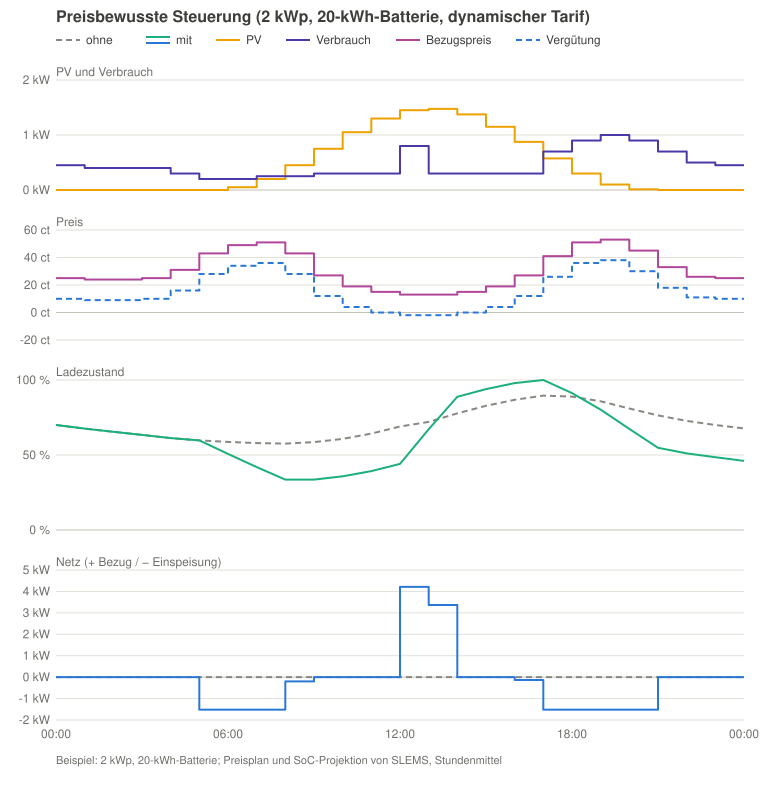

# Tarife und Preise

[Zurück zur README](../../README.de.md#tarife-optional) · [English](tariffs.md)

<!-- toc -->

- [Tarif eintragen](#tarif-eintragen)
- [Import und Export als YAML](#import-und-export-als-yaml)
- [Vorlagen](#vorlagen)
  - [Eigene Vorlagen](#eigene-vorlagen)
  - [Schweiz](#schweiz)
  - [Österreich](#österreich)
  - [Dynamischer Tarif (Österreich und Deutschland)](#dynamischer-tarif-österreich-und-deutschland)
  - [Deutschland](#deutschland)
- [Woher die Energie kommt](#woher-die-energie-kommt)
- [Leistungspreis](#leistungspreis)
- [Dynamische Tarife und Börsenpreise](#dynamische-tarife-und-börsenpreise)
- [Preisbewusste Steuerung](#preisbewusste-steuerung)
  - [Geschätzte Preise](#geschätzte-preise)
  - [Batterien aus dem Netz laden](#batterien-aus-dem-netz-laden)
  - [Überschussstunden und negative Preise](#überschussstunden-und-negative-preise)
  - [Batterien ins Netz entladen](#batterien-ins-netz-entladen)
  - [Gemessene Ersparnis](#gemessene-ersparnis)

<!-- /toc -->

## Tarif eintragen

Mit **Tarif hinzufügen** auf der Seite der SLEMS-Integration trägst du deinen
Stromtarif so ein, wie ihn deine Rechnung zeigt; die Werte bleiben in deinem
Home Assistant. Preise gelten in der Währung, die in Home Assistant unter
**Einstellungen → System → Allgemein** eingestellt ist (Hundertstel je kWh, z. B.
ct oder Rp., und ganze Beträge je Jahr); Börsenpreise kommen in Euro.

1. Name, Rolle (**aktueller Tarif** oder **Vergleichstarif**) und Umsatzsteuer:
   für die Bezugsrechnung, für die eingespeiste Energie (bei privaten
   PV-Anlagen oft 0 %) und für die anderen Einspeise-Posten. Getrennte
   Verträge für Bezug und Einspeisung: beide als **aktueller Tarif** anlegen, sie
   zählen zusammen als einer. Ein Vergleichstarif mit Posten nur für eine Seite
   (z. B. ein dynamischer Stromtarif) übernimmt die andere Seite von den
   aktuellen Tarifen, der Vergleich zeigt so immer die Gesamtkosten.
2. Die Posten der Rechnung einzeln: Name, Seite (**Bezug** oder
   **Einspeisung**), Gruppe (**Energie**, **Netz**, **Abgaben**) und Nettopreis (ohne
   USt.; SLEMS rechnet die USt. aus Schritt 1 dazu) in ct/kWh oder €/Jahr (je
   Tag verrechnet; ein Rabatt ist negativ). Zeigt die Rechnung nur
   Bruttopreise, diese eingeben und die USt. auf 0 % setzen. Optional nur in
   bestimmten Monaten, an bestimmten Wochentagen oder in einem Zeitfenster
   des Tages, z. B. ein günstigerer Netzpreis zu Mittag im Sommer: Ein Posten
   mit Fenster ersetzt in seinem Fenster den gleichnamigen Posten. Eine
   Preisänderung ist derselbe Posten noch einmal mit **Gültig ab**. Auf der
   Einspeiseseite ist der Energiepreis deine Vergütung.
3. **Mit einer Rechnung vergleichen**: Zeitraum und Beträge der Rechnung
   eingeben; SLEMS rechnet den Zeitraum mit dem Tarif und deinem
   aufgezeichneten Netzbezug und deiner Einspeisung nach und zeigt beide
   Beträge und die Abweichung, je Seite und Gruppe.

## Import und Export als YAML

Statt die Posten einzutippen, nimmt **Tarif
hinzufügen → YAML einfügen** eine Tarifdatei (Format `slems-tariff` mit
Versionsnummer; Preise netto, dazu optional Lieferant, Gültigkeit von/bis und
Quelle). **Als YAML exportieren** im Menü der Posten zeigt einen Tarif als
solche Datei, z. B. zum Sichern oder für ein anderes SLEMS. Eine KI kann eine
Rechnung in eine solche Datei umwandeln:
[Prompt und Anleitung](../tariff-prompt.de.md). Eine Datei mit neuerer
Formatversion lehnt SLEMS mit dem Hinweis ab, SLEMS zu aktualisieren; ältere
Versionen werden umgewandelt.

## Vorlagen

**Tarif hinzufügen → Aus Vorlagen** bietet Tarife mit
öffentlichen Listenpreisen an, je Land und Teil der Rechnung: die Energie
eines Lieferanten, die Netzentgelte eines Netzgebiets, die Abgaben. Zuerst
wählst du den Energietarif; der Netztarif, mit dem er meist kombiniert wird
(Haushalte), und die Abgaben des Landes sind dann vorausgewählt, jeweils mit
den heute gültigen Preisen, und SLEMS setzt alles zu einem Tarif zusammen
(danach mit einer Rechnung vergleichen). Das Ergebnis ist ein normaler Tarif,
den du bearbeiten kannst; spätere Änderungen einer Vorlage berühren ihn
nicht. Optionen eines Preisblatts (z. B. ein Ökostrom-Upgrade, ein Bonus für
die Online-Rechnung, das Messentgelt der Einspeiserichtung) wählst du in einem
eigenen Schritt. Ein eigener Einspeisetarif ist eine eigene Vorlage und wird
als weiterer aktueller Tarif angelegt (SLEMS zählt alle aktuellen Tarife als
einen Vertrag).

Ein Tarif aus Vorlagen merkt sich seine Vorlagen: Bringt ein Update von SLEMS (oder
eine eigene Vorlage) neuere Preise oder einen Nachfolgetarif, meldet das ein
Reparaturhinweis, ebenso wenn ein aktueller Tarif abgelaufen ist. **Auf neue
Preise aktualisieren** im Menü der Posten übernimmt sie (bei mehreren
Nachfolgern wählst du einen oder keinen): Die aktuellen Posten enden am Tag
davor, die neuen gelten ab dann, die alten Preise bleiben für die
Vergangenheit und eigene Posten bleiben, wie sie sind. Eine korrigierte
Vorlage (z. B. ein verrutschtes Komma, gleiche Daten) bietet SLEMS genauso
an: Die Werte werden an Ort und Stelle korrigiert, auch für die
Vergangenheit; selbst geänderte Posten bleiben. **Auf Vorlagenwerte
zurücksetzen** nimmt eigene Änderungen an den Vorlagen-Posten zurück.

### Eigene Vorlagen

YAML-Dateien im Ordner `slems_tariff_templates` deiner
Home-Assistant-Konfiguration. Eine Vorlage für alle schlägst du als
[Issue](https://github.com/gojux/SLEMS/issues) mit der Quelle der Preise vor.

### Schweiz

**Tarif hinzufügen → Von der ElCom** fragt die
offenen Daten der ElCom (ld.admin.ch) nach dem Tarif deiner Gemeinde und
Verbrauchskategorie ab (Energie, Netz und Abgaben, ohne MWST, als Mittel der
Kategorie; Hoch- und Niedertarifzeiten sind darin gemittelt); das im September
veröffentlichte Folgejahr bietet SLEMS als neue Preise an, im Hintergrund nur
mit eingeschaltetem **Börsenpreise abrufen**.

### Österreich

Die Netzentgelte aller Netzbereiche (Netzebene 7, aus der Systemnutzungsentgelte-Verordnung, mit dem günstigeren
Preis von April bis September 10–16 Uhr) und die bundesweiten Abgaben; das
Messentgelt steht mit dem gesetzlichen Höchstpreis drin (dein Netzbetreiber
kann weniger verrechnen), Gemeindeabgaben (z. B. die Gebrauchsabgabe in Wien)
fehlen.

### Dynamischer Tarif (Österreich und Deutschland)

Eine allgemeine Vorlage **Dynamischer Tarif** (Energie zum Day-Ahead-Börsenpreis je Viertelstunde); den Aufschlag und
die Monatsgebühr deines Vertrags trägst du danach in ihren Posten ein, weil
Anbieter dynamischer Tarife sie meist nur je Postleitzahl veröffentlichen.

### Deutschland

Die bundesweiten Abgaben (Stromsteuer, Umlagen und die
Konzessionsabgabe nach Gemeindegröße mit ihrem gesetzlichen Höchstbetrag), die
Netzentgelte der größten Netzbetreiber (Westnetz, Bayernwerk, E.DIS, Avacon,
Netze BW, Schleswig-Holstein Netz, Stromnetz Berlin, Hamburger Energienetze,
EWE NETZ, N-ERGIE Netz, SWM Infrastruktur, RheinNetz, enercity Netz,
Thüringer Energienetze, Netze ODR, LEW Verteilnetz, Westfalen Weser Netz, Syna,
Mainnetz; auch mit § 14a Modul 1 und Modul 1 + 3 mit zeitvariablen Preisen für
steuerbare Verbrauchseinrichtungen; der Messstellenbetrieb als Option mit dem
gesetzlichen Höchstpreis nach Zählerart und Verbrauch) und die
EEG-Einspeisevergütung von PV-Anlagen bis 10 kWp je Inbetriebnahme-Zeitraum;
für Anlagen ab 25. Februar 2025 ist die Vergütung 0, solange der
Day-Ahead-Preis negativ ist (**Börsenpreise abrufen** nötig). Ein Posten kann
dafür **Null bei negativen Börsenpreisen** haben.

Ein Posten kann auch **Prozent der Gruppe** sein (z. B. eine Gebrauchsabgabe
von 7 % auf die Energie).

## Woher die Energie kommt

SLEMS zeichnet Netzbezug und Einspeisung aus jedem
Netzwert selbst je Viertelstunde auf (400 Tage lang), damit sich Bezug und
Einspeisung innerhalb einer Stunde nicht aufheben und dynamische Preise je
Viertelstunde gelten. Für genaue Summen in den SLEMS-Optionen die
Energiezähler des Smart Meters wählen (**Netzbezug (Zähler)** /
**Netzeinspeisung (Zähler)**): Die aufgezeichneten Viertelstunden werden dann auf
den Zähler jeder Stunde skaliert. Stunden vor der Aufzeichnung nutzen die
Zähler, ohne Zähler das Stundenmittel der Netzleistung (ungenauer).

## Leistungspreis

Ein Posten mit **€ pro kW und Monat
(Spitzenleistung)** verrechnet den höchsten Bezug jedes Kalendermonats, wie
die österreichischen Netztarife ab 2027: die mittlere Leistung der höchsten
Viertelstunde (oder Stunde) im Monat oder den Mittelwert mehrerer höchster,
mindestens **Mindestens verrechnete Leistung** (z. B. 2 kW) und aufgerundet
auf **Aufgerundet auf**, wenn der Tarif das tut. **Verrechnet ab** /
**Verrechnet bis** teilen sie in Stufen mit eigenem Preis, z. B. ein zweiter
Posten mit dem höheren Preis über 10 kW. Die Spitze kommt aus den
aufgezeichneten Viertelstunden; Stunden vor der Aufzeichnung haben nur ihr
Stundenmittel, das niedriger ist als ihre höchste Viertelstunde, deshalb
markiert der Vergleich Monate, in denen eine solche Stunde eine Viertelstunde
über der verrechneten Leistung verbergen könnte (ihr Mittel × 4 liegt
darüber). Wie SLEMS die Spitze niedrig hält: siehe
[Bezugsspitzen abfangen und Leistungspreis](control.de.md#bezugsspitzen-abfangen-und-leistungspreis).

## Dynamische Tarife und Börsenpreise

Ein Posten kann auch dem
Day-Ahead-Markt folgen: **Börsenpreis (stündlich)** oder **Monatsmarktpreis**,
jeweils als Marktpreis + Aufschlag in % seines Betrags + Preis in ct/kWh, z. B.
„Börsenpreis + 5 % + 1,2 ct“ oder „Monatsmarktpreis − 0,5 ct“ für die
Einspeisung; ein Aufschlag in % bleibt auch bei negativem Marktpreis ein
Aufschlag. **Börsenpreis höchstens** begrenzt den Marktpreis vor den
Aufschlägen (z. B. 60 ct/kWh netto bei Salzburg AG FlexSpot). Veröffentlichte Monatsmarktpreise lassen sich je Monat eintragen
(z. B. „2026-08: 7,1“); Monate ohne Wert nutzen das Mittel der Börsenpreise,
gewichtet mit deiner Einspeisung. Folgt der Preis einem offiziellen
Monatswert, wählst du ihn beim Posten als **Monatswert** (Österreich: der
Referenzmarktwert PV, Wind oder Wasserkraft der E-Control nach § 13 EAG);
SLEMS holt ihn dann mit den Börsenpreisen, bis zur Veröffentlichung gilt das
gewichtete Mittel.

SLEMS ruft Börsenpreise erst aus dem Internet ab, wenn du **Börsenpreise
abrufen** einschaltest (standardmäßig aus). **Preisquelle** wählt woher: APG
(Österreich), SMARD der Bundesnetzagentur (Deutschland/Luxemburg) oder
Energy-Charts des Fraunhofer ISE (Österreich, Deutschland/Luxemburg und
Schweiz); voreingestellt nach dem in Home Assistant eingestellten Land.
Schweizer Börsenpreise sind wie alle Börsenpreise in Euro. SLEMS unterstützt
zum aktuellen Zeitpunkt nur Börsenpreise in Euro: Ist in Home Assistant eine
andere Währung eingestellt, lassen Tarifvergleich und **Mit einer Rechnung
vergleichen** Tarife aus, die vom Börsenpreis abhängen; hängt der aktuelle
Tarif davon ab, weist eine Reparaturmeldung darauf hin. SLEMS lädt dann einmal die letzten
12 Monate, speichert sie lokal und holt nach der Day-Ahead-Auktion (ab 13 Uhr)
den nächsten Tag. Der Sensor **Börsenpreis** zeigt den Preis der aktuellen
Viertelstunde in ct/kWh ohne Gebühren und Steuern, mit der Quelle als
Quellenangabe.

## Preisbewusste Steuerung

Im Beispiel hat das Haus eine kleine PV-Anlage (2 kWp) und eine große Batterie
(20 kWh), einen dynamischen Tarif und eine Einspeisevergütung, die dem
Börsenpreis folgt; **Batterien aus dem Netz laden** und **Batterien ins Netz
entladen** sind an. Ohne preisbewusste Steuerung deckt die Batterie nur den
Verbrauch des Hauses, das Netz bleibt bei null. Mit versorgt sie nachts das
Haus wie sonst auch, speist bei der Preisspitze am Morgen ein, lädt zu Mittag
aus dem Netz, wenn der Strom am billigsten ist, und danach mit der Sonne. Am
Abend versorgt sie das Haus und speist bei der Preisspitze etwas ein; danach
ist sie wieder gut halb voll für den nächsten Morgen.

**Preisbewusste Steuerung** (Schalter, standardmäßig aus; braucht einen
Tarif): Reicht die gespeicherte Energie nicht für alle Stunden, bis die PV die
Batterien wieder füllt (ein Tag, dessen prognostizierter PV-Überschuss sie
vom minimalen bis zum maximalen Ladezustand füllt; etwas Überschuss an einem
trüben Tag zählt nicht), decken sie die Stunden mit dem höchsten Bezugspreis
des aktuellen Tarifs und halten ihre Energie in Stunden zurück, die um
mindestens den **Mindestgewinn** (Standard 2 ct/kWh) günstiger sind; dort
bezieht das Haus aus dem Netz. Der Netzbezug bleibt gleich, er wandert nur in
günstigere Stunden – kein Laden aus dem Netz und keine Einspeisung aus den
Batterien. Jeder zeitabhängige Preis zählt: Börsenpreise oder Zeitfenster
eines festen Tarifs. Bezugsspitzen abfangen gilt weiter. Die Strategie zeigt
**Für teure Stunden halten** mit den betroffenen Stunden, Tagesdiagramm und
Simulation berücksichtigen es. Die Preispläne arbeiten in Viertelstunden
(Börsenpreise wechseln je Viertelstunde): Die stündliche Verbrauchsprognose
wird gleichmäßig auf ihre Viertelstunden verteilt, die PV kommt aus der
Prognose; das Tagesdiagramm zeigt ihre Stundenmittel. Tagesziele mit der Quelle **+ Netz**: Reicht der
prognostizierte Überschuss ohnehin nicht, startet der erzwungene Lauf im
Fenster mit den niedrigsten Kosten vor der Frist (um mindestens den
Mindestgewinn je kWh günstiger als zum spätesten Start); die
Verbraucherkarte zeigt **ab … im günstigsten Fenster**. Die Kosten je
Viertelstunde: Was der prognostizierte Überschuss deckt, zählt mit der
Einspeisevergütung, der Rest mit dem Bezugspreis. Bei einem
Ein/Aus-Verbraucher, dessen Leistung deutlich von der Außentemperatur
abhängt (z. B. die Warmwasserladung einer Luft-Wärmepumpe), zählt seine
gelernte Leistung bei der prognostizierten Temperatur der Stunde: Ein warmer
Nachmittag kann so einen kalten Morgen mit billigerem Strom schlagen.

### Geschätzte Preise

Die Day-Ahead-Preise des nächsten Tages erscheinen
gegen 13 Uhr. Für die Viertelstunden nach dem letzten bekannten Preis plant
die preisbewusste Steuerung mit Schätzungen: je Uhrzeit der Median der
letzten 14 Tage derselben Art (Werktag, oder Wochenende und Feiertag des
Marktgebiets; in der Schweiz die Feiertage von mindestens der Hälfte der
Kantone), sein Ausschlag um das Tagesmittel als Sicherheitsabschlag
halbiert. So werden die Nacht und ein
trüber Folgetag schon geplant, bevor die echten Preise bekannt sind; sobald
sie da sind, wird neu geplant. Nur bekannte negative Preise lösen die Planung
für negative Preise aus. Das Preisdiagramm zeigt die Schätzungen blass.

### Batterien aus dem Netz laden

**Batterien aus dem Netz laden** (Schalter, standardmäßig aus; nur mit
preisbewusster Steuerung): SLEMS plant bis zum Nachladen durch PV (wie oben;
höchstens bis zum letzten bekannten Preis, danach mit den geschätzten), in
welchen Stunden die Batterien decken, halten oder aus dem Netz laden. Ein
kleinerer PV-Überschuss davor ist Teil des Plans: Die Batterien nehmen ihn,
und nur was für die teuren Stunden noch fehlt, wird aus dem Netz geladen
(z. B. an einem günstigen Mittag vor einem teuren Abend nach einem trüben
Tag). Laden muss sich nach
Lade- und Entladeverlusten, den
[Verschleißkosten](batteries.de.md#verschleißkosten-der-batterie) und dem Mindestgewinn
lohnen; bei gleichen Kosten gewinnt das spätere Laden, weil Heimspeicher vor
allem mit der Zeit bei hohem Ladezustand altern. Grenzen: **Höchster
Ladezustand aus dem Netz** (Standard 90 %), **Höchste Netzladeleistung** (0 =
Ladeleistung der Batterien), die Bezugsgrenze von Bezugsspitzen abfangen und
der Platz, den die Einspeisebegrenzung zur PV-Übernahme braucht. Dein
eigener PV-Überschuss geht vor. Der Plan schließt das Halten ein;
die Strategie zeigt
**Netzladen** mit Energie, Beginn und erwarteter Ersparnis, das Tagesdiagramm
das geplante Laden.

### Überschussstunden und negative Preise

Mit preisbewusster Steuerung und
einer Einspeisevergütung, die stündlich dem Börsenpreis folgt, oder einem
negativen Bezugspreis bzw. einer negativen Vergütung innerhalb der bekannten
Preise plant SLEMS auch die Überschussstunden, ohne dass dafür ein weiterer
Schalter nötig ist: Die Batterien halten Platz für den PV-Überschuss der
Stunden mit niedrigerer oder negativer Vergütung frei (sie nehmen davor nur
einen Teil des Überschusses auf und speisen den Rest zur höheren Vergütung
ein; Strategie **Platz für günstigere Stunden**). Mit **Batterien aus dem Netz
laden** laden sie auch aus dem Netz, wenn der Bezugspreis samt allen
Entgelten negativ ist. Der eigene PV-Überschuss geht dabei vor. **Höchster
Netzbezug beim Netzladen** (Summe aller Phasen, 0 = keine Grenze, z. B. für
die vereinbarte Anschlussleistung; schützt keine einzelne Phase und nicht die
Hauptsicherung) und die Bezugsgrenze von Bezugsspitzen abfangen begrenzen
den Bezug. Der Plan reicht dann bis zum letzten bekannten Preis (höchstens 36
Stunden) und wird im Hintergrund gerechnet; bis er fertig ist, gilt der
vorige.

### Batterien ins Netz entladen

**Batterien ins Netz entladen** (Schalter, standardmäßig aus; nur mit
preisbewusster Steuerung): Derselbe Plan darf über den Bedarf des Hauses
hinaus aus den Batterien einspeisen, wenn die Vergütung der Stunde höher ist
als der spätere Wert der Energie plus Mindestgewinn und Verschleißkosten der
Batterien (die Energie wird meist später wieder geladen, ein zusätzlicher
Zyklus) – späterer Netzbezug wird dafür in Kauf genommen. Nicht unter die Morgenreserve, höchstens die maximale
Einspeisung beim Entladen und die Einspeisebegrenzung. Das lohnt nur mit
einer Einspeisevergütung, die stündlich dem Börsenpreis folgt; mit fester
oder monatlicher Vergütung zeigt die Strategie, dass die Option ohne Wirkung
ist. Vorher Vertrag und Förderung prüfen: Manche erlauben nicht, aus dem Netz
geladene Energie wieder einzuspeisen.

### Gemessene Ersparnis

Der Sensor **Ersparnis Preissteuerung** summiert je
Monat, was die preisbewusste Steuerung gespart hat: Nach jeder Nacht (oder
anderen Phase bis zur PV-Übernahme), in der sie gehalten, geladen oder
eingespeist hat, vergleicht SLEMS die aufgezeichneten Kosten mit denselben
Stunden *wie üblich*, gerechnet mit dem Batteriemodell ab dem gemessenen
Ladezustand. Nächte ohne solche Aktion zählen nichts. Der Tarifvergleich
zeigt den Wert neben der Schätzung.
