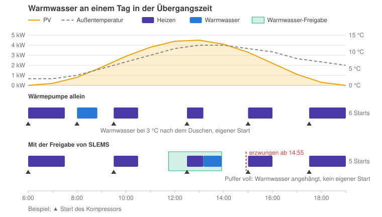
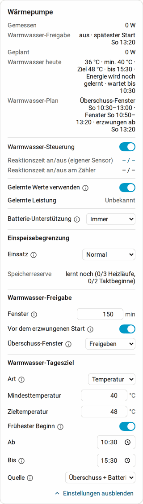
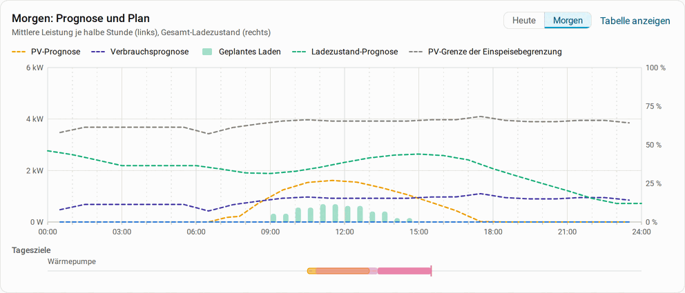

# Warmwasser einer Wärmepumpe mit PV-Überschuss laden

[English](heat-pump-hot-water.md)

Diese Anleitung zeigt, wie eine Wärmepumpe den Warmwasserspeicher (Boiler) mit
PV-Überschuss lädt: SLEMS sagt, **wann** geladen werden darf und spätestens
muss, eine eigene Automation wählt den Moment, der für die Wärmepumpe passt,
und startet die Ladung. Das Beispiel stammt aus einer echten Anlage
(Luft-Wasser-Wärmepumpe mit Pufferspeicher und Warmwasser-Offset); die
Entitäten und Zustände heißen bei jeder Wärmepumpe anders, deshalb erklärt die
Anleitung, worauf es ankommt, und du passt die Automation an deine an.

## Vorteile

- **Warmwasser aus PV statt aus dem Netz.** Ohne Abstimmung lädt die
  Wärmepumpe, wenn der Boiler abgekühlt ist oder ihr Zeitprogramm es sagt,
  oft am Morgen nach dem Duschen. Mit SLEMS lädt sie, wenn Überschuss da ist.
- **Bessere Leistungszahl.** Wenn die Sonne scheint, ist meist auch die Luft
  wärmer: Eine Luft-Wärmepumpe braucht mittags bei 12 °C deutlich weniger
  Strom für dieselbe Wärme als morgens bei 2 °C.
- **Sicher warm.** Reicht der Überschuss nicht, gibt SLEMS die Ladung so
  rechtzeitig frei, dass der Boiler sein Minimum bis zur Frist erreicht.
- **Nebenbei weniger Starts.** In der Übergangszeit heizt die Wärmepumpe in
  kurzen Takten. Hängt die Automation die Warmwasserladung an einen Heiztakt
  an, spart das manchmal einen eigenen Start des Kompressors, in der
  Beispielanlage etwa jeden zweiten Tag einen. Das ist wenig, kostet aber
  nichts.



## Freigabe und erzwungener Lauf

SLEMS schaltet die Wärmepumpe mit der Steuerung **Freigabe** nicht selbst. Es
stellt zwei Binärsensoren bereit, auf die deine Automation reagiert:

| | **Warmwasser-Freigabe** | **Erzwungene Warmwasserladung** |
|---|---|---|
| Bedeutung | Die Ladung **darf** jetzt starten. | Die Ladung **muss** jetzt starten. |
| An, wenn | genug Überschuss da ist oder SLEMS sie ohne Überschuss offen hält | der späteste Start des Tagesziels erreicht ist |
| Die Automation | wartet auf einen guten Moment | startet sofort |

Warum wartet die Automation bei der Freigabe? Eine Wärmepumpe ist kein
Heizstab: Ob ein Start gerade gut passt, hängt von ihrem Zustand ab, den
SLEMS nicht kennt. Läuft der Kompressor ohnehin und ist das Haus warm genug,
kann sie ohne eigenen Start auf Warmwasser wechseln; kommt sie gerade aus dem
Abtauen oder einer Sperrzeit, wartet sie besser. Damit die Automation warten
kann, hält die **Freigabedauer** die Freigabe eine Zeit lang offen, auch wenn der
Überschuss kurz fehlt. Findet sich bis zum spätesten Start kein guter Moment,
schaltet SLEMS **Erzwungene Warmwasserladung** ein, und die Automation startet
die Ladung trotzdem.

## Schritt 1: die Wärmepumpe in SLEMS

**Einstellungen** → **Geräte & Dienste** → **SLEMS** → **Verbraucher
hinzufügen** (oder den bestehenden Verbraucher der Wärmepumpe neu
konfigurieren):

- **Typ**: **Wärmepumpe**, **Heizt einen Warmwasserspeicher**: an.
- **Steuerung**: **Freigabe**.
- **Betriebsmodus**: der Sensor, der zeigt, was die Wärmepumpe gerade tut
  (oft **Status** oder **Betriebsart**), und im nächsten Schritt die Zustände,
  die Warmwasser bedeuten (z. B. `hot_water`, `dhw`). Nur in diesen Zuständen
  zählt ihre Leistung als gesteuert; das Heizen bleibt eine ungesteuerte Last.
- **Temperaturfühler des Speichers**: der Fühler des Boilers, dazu ein
  **Zweiter Temperaturfühler**, wenn der Boiler oben und unten einen hat.
- **Leistung im eingeschalteten Zustand**: ein Startwert, z. B. 3.000 W. Mit
  **Gelernte Werte verwenden** lernt SLEMS die Leistung im Warmwasserbetrieb.

Siehe [Verbraucher](guide/consumers.de.md) für alle Einstellungen.

## Schritt 2: Tagesziel und Freigabe einstellen

Im SLEMS-Dashboard unter **Verbraucher** auf der Karte der Wärmepumpe:



**Warmwasser-Tagesziel**

- **Art**: **Temperatur**, z. B. **Mindesttemperatur** 40 °C,
  **Zieltemperatur** 48 °C.
- **Frühester Beginn**: z. B. 10:30. Vorher lädt SLEMS nicht, auch nicht mit
  Überschuss: Morgens ist die Luft kalt und der Überschuss klein.
- **Bis**: z. B. 15:30, die Frist für die Mindesttemperatur.
- **Quelle**: **Überschuss + Batterie** oder **Überschuss + Batterie + Netz**.
  Nur damit gibt es einen erzwungenen Lauf; mit **Nur Überschuss** bleibt der
  Boiler an trüben Tagen kalt, bis die Wärmepumpe selbst lädt.

**Was SLEMS dabei lernt:** Aus der Boilertemperatur und der gemessenen
Leistung im Warmwasserbetrieb lernt SLEMS, wie viel elektrische Energie die
Wärmepumpe je Grad braucht (ab 3 Ladungen mit mindestens 3 K Anstieg; bis
dahin zeigt die Karte „Energie wird noch gelernt“). Weil das elektrisch
gemessen wird, steckt die Leistungszahl schon darin. Daraus rechnet SLEMS
aus, wie viele kWh bis zur Zieltemperatur fehlen. Weil Zapfungen und
Wärmeverluste darin nicht enthalten sind, rechnet es mindestens mit dem
mittleren Tagesverbrauch der letzten Tage. Mit der gelernten Leistung ergibt
das die Dauer der Ladung: Danach legt SLEMS das Überschuss-Fenster,
berechnet den spätesten Start und plant die Ladung in die Prognose von
Verbrauch und Batterien ein.

Außerdem lernt SLEMS, wie schnell der Boiler abkühlt, und plant den
erzwungenen Lauf auch dann, wenn er erst bis zur Frist unter das Minimum
fallen würde. Die Zeile **Warmwasser-Plan** zeigt das, z. B. „ohne Heizen um 15:30 ca. 30 °C ·
Überschuss-Fenster 10:30–13:00 · Freigabe 12:25–14:55 · erzwungen ab 14:55“.

**Warmwasser-Freigabe**

- **Freigabedauer**: z. B. 150 Minuten. So lange bleibt die Freigabe mindestens
  offen, damit die Automation auf einen guten Moment warten kann.
- **Überschuss-Fenster**: **Nach Prognose**. SLEMS legt das Fenster aus PV- und
  Verbrauchsprognose in die Zeit, in der der Überschuss die Ladung am besten
  deckt, und gibt in dieser Zeit frei, auch wenn der Überschuss kurz fehlt.
  Mit **Nach Überschuss** gibt SLEMS frei, sobald genug Überschuss da ist, und
  hält die Freigabe für die **Freigabedauer** offen; ein Fenster wird nicht geplant.
- **Vor dem erzwungenen Start**: an. Die Freigabe öffnet dann zusätzlich um die
  **Freigabedauer** vor dem spätesten Start: Hat die Automation bis dahin keinen guten Moment gefunden,
  bekommt sie vor dem erzwungenen Lauf noch einmal die Chance dazu.

**Batterie-Unterstützung** bestimmt, ob die Batterien Lücken im Überschuss
während der Ladung decken (**Immer**), nur mit dem, was sie übrig haben
(**Automatisch**), oder nie. Siehe
[Batterie-Unterstützung](guide/consumers.de.md#batterie-unterstützung).

Das Tagesdiagramm zeigt unter **Tagesziele** das Überschuss-Fenster (orange
umrandet), die Freigabe vor dem erzwungenen Start (hell) und den erzwungenen
Lauf (kräftig); fährst du darüber, nennt es die Zeiten:



## Schritt 3: Warmwasser-Offset statt Solltemperatur

Die Automation startet die Ladung nicht über die Warmwasser-Solltemperatur,
sondern über einen **Offset**, den viele Wärmepumpen für SG Ready oder ihre
PV-Funktion haben: Er hebt die Solltemperatur vorübergehend an, die
Wärmepumpe lädt bis dahin und hört von selbst auf.

Warum nicht die Solltemperatur selbst? Manche Wärmepumpen speichern sie
dauerhaft in einem EEPROM, das nur eine begrenzte Zahl von Schreibvorgängen
verträgt. Eine Automation, die sie täglich mehrmals ändert, kann es mit den
Jahren verschleißen. Der Offset ist für häufiges Ändern gedacht. Schau in der
Anleitung deiner Wärmepumpe oder Integration nach, ob das bei dir zutrifft.

- Stell die normale **Solltemperatur** so niedrig ein, dass die Wärmepumpe
  selbst nur lädt, wenn SLEMS oder Home Assistant ausfallen: Sie ist die
  Rückfallebene. Ein Legionellenprogramm der Wärmepumpe bleibt davon
  unberührt.
- Wähle den **Offset** so, dass Solltemperatur + Offset etwa die
  **Zieltemperatur** des Tagesziels ergibt (z. B. 15 °C + 33 K = 48 °C). Misst
  die Wärmepumpe an einer anderen Stelle als der Fühler in SLEMS, gleich das
  mit etwas Spielraum aus.
- Manche Wärmepumpen nehmen den Offset nur in einer bestimmten Betriebsart an
  (z. B. SG Ready), die nach einem Stromausfall verloren gehen kann. Dann setzt
  die Automation diese Betriebsart am besten vor dem Offset jedes Mal neu.

## Schritt 4: die Automation

Die Automation wartet bei offener Freigabe auf einen Moment, in dem der
Kompressor ohnehin läuft, und startet bei einem erzwungenen Lauf sofort.

```yaml
alias: Warmwasser mit der SLEMS-Freigabe laden
mode: single
triggers:
  # Heizbedarf gedeckt: Der Puffer ist wärmer als der Vorlauf soll, der
  # Kompressor würde gleich abschalten.
  - trigger: numeric_state
    entity_id: sensor.waermepumpe_puffertemperatur
    above: sensor.waermepumpe_vorlauf_soll
    for:
      minutes: 1
    id: heating_done
  # Der Kompressor heizt nach einer Pause (z. B. Abtauen) wieder stabil.
  - trigger: state
    entity_id: sensor.waermepumpe_status
    to: heating
    for:
      minutes: 30
    id: heating_stable
  - trigger: state
    entity_id: binary_sensor.waermepumpe_warmwasser_freigabe
    from: "off"
    to: "on"
    for:
      minutes: 5
    id: release
  - trigger: state
    entity_id: binary_sensor.waermepumpe_erzwungene_warmwasserladung
    to: "on"
    for:
      minutes: 1
    id: forced
conditions:
  - condition: state
    entity_id: binary_sensor.waermepumpe_warmwasser_freigabe
    state: "on"
  - or:
      - condition: trigger
        id: forced
      - and:
          - condition: trigger
            id:
              - heating_done
              - heating_stable
          - condition: state
            entity_id: sensor.waermepumpe_status
            state: heating
      - and:
          - condition: trigger
            id: release
          - or:
              # Der Kompressor heizt schon lange, das Haus ist warm.
              - condition: state
                entity_id: sensor.waermepumpe_status
                state: heating
                for:
                  hours: 2
              # Seit Stunden kein Heizen (Sommer): Ein Start ist ohnehin nötig.
              - condition: state
                entity_id: sensor.waermepumpe_status
                state: standby
                for:
                  hours: 4
actions:
  - action: number.set_value
    target:
      entity_id: number.waermepumpe_warmwasser_offset
    data:
      value: 33
  # Startet die Ladung nicht (z. B. Boiler schon warm genug), gleich zurück.
  - wait_template: "{{ is_state('sensor.waermepumpe_status', 'hot_water') }}"
    timeout: "00:15:00"
  - if:
      - condition: template
        value_template: "{{ wait.completed }}"
    then:
      # Ende der Ladung: 10 Minuten nicht mehr im Warmwasserbetrieb (ein
      # kurzes Abtauen dazwischen zählt nicht), höchstens 2 Stunden.
      - wait_for_trigger:
          - trigger: template
            value_template: "{{ not is_state('sensor.waermepumpe_status', 'hot_water') }}"
            for:
              minutes: 10
        timeout: "02:00:00"
  - action: number.set_value
    target:
      entity_id: number.waermepumpe_warmwasser_offset
    data:
      value: 0
```

**Die Trigger im Einzelnen**

- **heating_done** (Puffer über Vorlauf-Soll): der wichtigste Moment in der
  Übergangszeit. Der Heiztakt ist fertig, der Kompressor würde abschalten und
  später für das Warmwasser neu starten. Stattdessen lädt er gleich weiter.
  Ohne Pufferspeicher kann z. B. die Rücklauftemperatur zeigen, dass der
  Heiztakt endet.
- **heating_stable** (30 Minuten Heizen nach einer Pause): Der Kompressor läuft
  wieder ruhig, z. B. nach dem Abtauen.
- **release** (Freigabe seit 5 Minuten an): Heizt die Wärmepumpe schon lange,
  ist das Haus warm und der Wechsel kostet keinen Start. Steht sie seit
  Stunden still (Sommer, kein Heizbetrieb), ist ein Start ohnehin nötig, dann
  startet die Ladung gleich. Zwischen zwei Heiztakten der Übergangszeit steht
  sie kürzer still; dort wartet die Automation auf das Ende des nächsten
  Heiztakts. Die 5 Minuten überbrücken eine Freigabe, die nur kurz an ist.
- **forced** (erzwungene Ladung): sofort, ohne weitere Bedingung.

**An deine Wärmepumpe anpassen**

- **Zustände**: `heating`, `hot_water` und `standby` heißen bei deiner
  Wärmepumpe anders. Schau in **Entwicklerwerkzeuge** → **Zustände** nach,
  welche Werte dein Status-Sensor annimmt, und beobachte ihn ein paar Tage:
  Viele Wärmepumpen haben Zwischenzustände wie eine Sperrzeit nach dem
  Warmwasser oder dem Abtauen, bevor sie wieder heizen dürfen. Ein Moment, in
  dem der Kompressor gerade eine Pause erzwingt, ist kein guter Start.
- **Puffer und Vorlauf-Soll**: Die Namen der Sensoren hängen von der
  Integration ab; manche Wärmepumpen zeigen auch direkt, ob der Kompressor
  läuft.
- **Weitere Bedingungen**: z. B. dass das Warmwasser an der Wärmepumpe
  eingeschaltet ist, damit die Automation nicht im Urlaubsmodus startet.
- **Ohne Heizbetrieb im Sommer**, z. B. wenn dann ein Heizstab den Boiler
  übernimmt: die Bedingung `standby` weglassen. Heizt deine Wärmepumpe in der
  Übergangszeit seltener als alle 4 Stunden, die Dauer verlängern.

## Was SLEMS dabei tut

- Solange die Freigabe an ist, aber die Wärmepumpe noch nicht lädt, nimmt sie
  nichts ab: SLEMS gibt den Überschuss so lange den Batterien. Mit **Nur
  Überschuss** schließt die Freigabe dabei, sobald der Überschuss nicht mehr
  reicht; das Warten geht also nur mit einer Quelle über den Überschuss hinaus
  ohne Unterbrechung.
- Die Leistung der Wärmepumpe zählt nur im Warmwasserbetrieb als gesteuert;
  in dieser Zeit lernt SLEMS ihre Leistung, sie folgt so der Leistungszahl.
- Erreicht der Boiler die Zieltemperatur, schließt die Freigabe für den Rest
  des Tages. Fällt er unter das Minimum (z. B. nach dem Duschen), ist das Ziel
  wieder offen.
- Schließt die Freigabe, während die Wärmepumpe noch lädt, muss die
  Automation die Ladung nicht abbrechen: SLEMS sieht, dass die Wärmepumpe
  eigenständig weiterläuft, und plant sie als Last ein, bis die Ladung endet.

## Fehlersuche

- **Die Freigabe ist an, aber die Ladung startet nicht**: Passen die Zustände
  in den Bedingungen zu deinem Status-Sensor? Die Ablaufverfolgung der
  Automation (**Einstellungen** → **Automationen & Szenen** → Automation →
  **Traces**) zeigt, an welcher Bedingung sie gescheitert ist.
- **Der Offset ist gesetzt, die Wärmepumpe lädt nicht**: Ist der Boiler schon
  wärmer als Solltemperatur + Offset? Braucht der Offset eine bestimmte
  Betriebsart, die nach einem Stromausfall verloren ging?
- **Die Ladung wird fast jeden Tag erzwungen**: Die Freigabedauer ist zu kurz für
  deine Bedingungen, oder der früheste Beginn liegt zu spät. Eine längere
  **Freigabedauer** oder **Überschuss-Fenster** **Nach Prognose** gibt der Automation
  mehr Zeit.
- **Nach dem Ende startet gleich eine zweite Ladung**: Der Offset steht noch;
  er muss nach der Ladung wieder auf 0.
