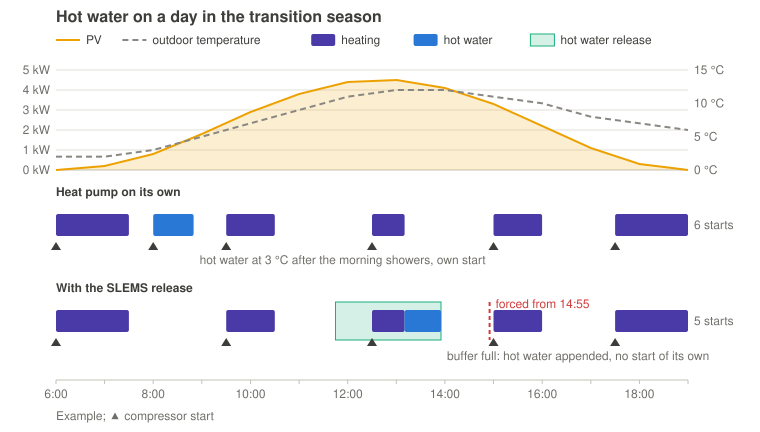
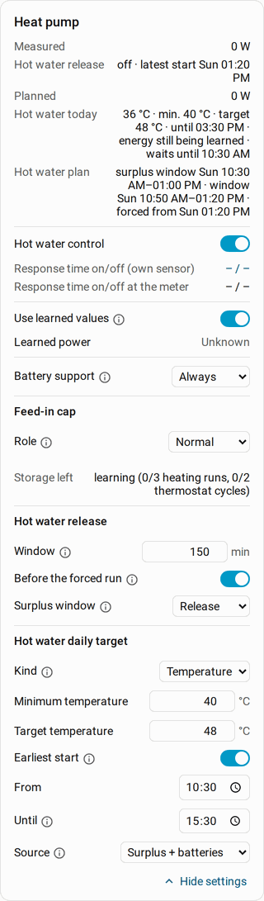
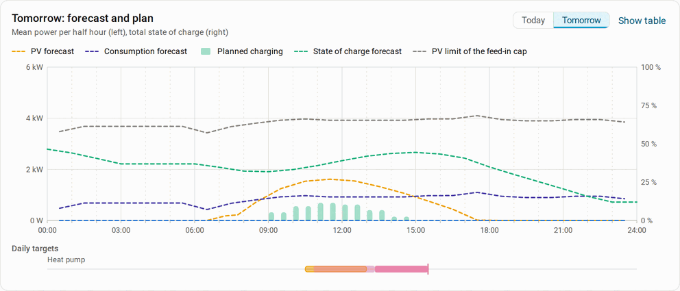

# Charging the hot water of a heat pump from PV surplus

[Deutsch](heat-pump-hot-water.de.md)

This guide shows how a heat pump charges its hot water storage (boiler) from
PV surplus: SLEMS says **when** the charge may start and when it must start at
the latest, an automation of your own picks the moment that suits the heat
pump and starts the charge. The example comes from a real installation (an
air-to-water heat pump with a buffer tank and a hot water offset); entities
and states are named differently on every heat pump, so the guide explains
what matters and you adapt the automation to yours.

## Benefits

- **Hot water from PV instead of the grid.** On its own the heat pump charges
  when the boiler has cooled down or its timer says so, often in the morning
  after the showers. With SLEMS it charges when there is surplus.
- **A better coefficient of performance.** When the sun shines, the air is
  usually warmer as well: an air-source heat pump needs clearly less power
  for the same heat at noon at 12 °C than in the morning at 2 °C.
- **Reliably warm.** If the surplus falls short, SLEMS releases the charge in
  time for the boiler to reach its minimum by the deadline.
- **Fewer starts on the side.** In the transition season the heat pump heats
  in short cycles. If the automation appends the hot water charge to a
  heating cycle, this sometimes saves a start of the compressor, in the
  example installation about one every second day. That is little, but it
  costs nothing.



## Release and forced run

With the control **Release** SLEMS does not switch the heat pump itself. It
provides two binary sensors your automation reacts to:

| | **Hot water release** | **Hot water forced run** |
|---|---|---|
| Meaning | The charge **may** start now. | The charge **must** start now. |
| On when | there is enough surplus or a window is open | the latest start of the daily target is reached |
| The automation | waits for a good moment | starts at once |

Why does the automation wait on a release? A heat pump is not a heating rod:
whether a start suits it right now depends on its state, which SLEMS does not
know. If the compressor is running anyway and the house is warm enough, it
can switch to hot water without a start of its own; if it has just come out
of defrosting or a lockout time, it had better wait. So that the automation
can wait, the **Window** keeps the release open for a while, also while the
surplus dips. If no good moment comes up until the latest start, SLEMS turns
on **Hot water forced run** and the automation starts the charge anyway.

## Step 1: the heat pump in SLEMS

**Settings** → **Devices & services** → **SLEMS** → **Add consumer** (or
reconfigure the existing consumer of the heat pump):

- **Type**: **Heat pump**, **Heats a hot water storage**: on.
- **Control**: **Release**.
- **Operating mode**: the sensor that shows what the heat pump is doing
  (often **Status** or **Operating mode**) and, in the next step, the states
  that mean hot water (e.g. `hot_water`, `dhw`). Only in these states its
  power counts as controlled; the heating stays an uncontrolled load.
- **Temperature sensor of the storage**: the boiler's sensor, plus a
  **Second temperature sensor** if the boiler has one at the top and one at
  the bottom.
- **Power when on**: a starting value, e.g. 3,000 W. With **Use learned
  values** SLEMS learns the power in hot water mode.

See [Consumers](../README.md#consumers) for all settings.

## Step 2: daily target and release

In the SLEMS dashboard under **Consumers**, on the card of the heat pump:



**Hot water daily target**

- **Kind**: **Temperature**, e.g. **Minimum temperature** 40 °C, **Target
  temperature** 48 °C.
- **Earliest start**: e.g. 10:30. Before it SLEMS does not charge, not even
  with surplus: in the morning the air is cold and the surplus small.
- **Until**: e.g. 15:30, the deadline for the minimum temperature.
- **Source**: **Surplus + batteries** or **Surplus + batteries + grid**. Only
  with these there is a forced run; with **Surplus only** the boiler stays
  cold on dull days until the heat pump charges by itself.

**What SLEMS learns:** from the boiler temperature and the measured power
in hot water mode SLEMS learns how much electrical energy the heat pump
needs per degree (from 3 charges with a rise of at least 3 K; until then the
card shows "energy still being learned"). As this is measured electrically,
it already includes the coefficient of performance. From it SLEMS works out
how many kWh are missing up to the target temperature. As water draws and
heat losses are not included, it counts at least the mean daily energy of
the last days. With the learned power this gives the duration of the charge:
by it SLEMS places the surplus window, works out the latest start and plans
the charge into the forecast of consumption and batteries.

SLEMS also learns how fast the boiler cools down and plans the forced run
also when it would only fall below the minimum by the deadline. The line **Hot
water plan** shows this, e.g. "without heating at 15:30 approx. 30 °C ·
surplus window 10:30–13:00 · window 12:25–14:55 · forced from 14:55".

**Hot water release**

- **Window**: e.g. 150 minutes. The release stays open at least this long, so
  the automation can wait for a good moment.
- **Surplus window**: **By forecast**. From the PV and consumption forecast SLEMS
  places the window in the time the surplus covers the charge best, and
  releases during that time, also while the surplus dips. With **By surplus** SLEMS
  releases only while there is enough surplus.
- **Before the forced run**: on. The window then also lies before the latest
  start: if the automation has not found a good moment by then, it gets
  another chance before the forced run.

**Battery support** sets whether the batteries cover dips of the surplus
during the charge (**Always**), only with what they have to spare
(**Automatic**), or never. See [Battery support](../README.md#battery-support).

Under **Daily targets** the day chart shows the surplus window (outlined in
orange), the window before the forced run (light) and the forced run
(strong); hover over it for the times:



## Step 3: hot water offset instead of the set temperature

The automation does not start the charge through the hot water set
temperature but through an **offset** that many heat pumps have for SG Ready
or their PV function: it raises the set temperature for a while, the heat
pump charges up to it and stops by itself.

Why not the set temperature itself? Some heat pumps store it permanently in
an EEPROM, which takes only a limited number of writes. An automation that
changes it several times a day can wear it out over the years. The offset is
meant to be changed often. Check the manual of your heat pump or integration
whether this applies to yours.

- Set the normal **set temperature** so low that the heat pump charges by
  itself only when SLEMS or Home Assistant fail: it is the fallback. A
  legionella programme of the heat pump is not affected.
- Choose the **offset** so that set temperature + offset is about the
  **Target temperature** of the daily target (e.g. 15 °C + 33 K = 48 °C). If
  the heat pump measures at another spot than the sensor in SLEMS, allow some
  margin.
- Some heat pumps accept the offset only in a certain operating mode (e.g.
  SG Ready), which may be lost after a power cut. Then the automation had
  better set that mode again each time before the offset.

## Step 4: the automation

With the release on, the automation waits for a moment when the compressor
is running anyway, and on a forced run it starts at once.

```yaml
alias: Charge hot water with the SLEMS release
mode: single
triggers:
  # Heating demand met: the buffer is warmer than the flow should be, the
  # compressor would stop soon.
  - trigger: numeric_state
    entity_id: sensor.heat_pump_buffer_temperature
    above: sensor.heat_pump_flow_set_temperature
    for:
      minutes: 1
    id: heating_done
  # The compressor heats steadily again after a pause (e.g. defrosting).
  - trigger: state
    entity_id: sensor.heat_pump_status
    to: heating
    for:
      minutes: 30
    id: heating_stable
  - trigger: state
    entity_id: binary_sensor.heat_pump_hot_water_release
    from: "off"
    to: "on"
    for:
      minutes: 5
    id: release
  - trigger: state
    entity_id: binary_sensor.heat_pump_hot_water_forced_run
    to: "on"
    for:
      minutes: 1
    id: forced
conditions:
  - condition: state
    entity_id: binary_sensor.heat_pump_hot_water_release
    state: "on"
  - or:
      - condition: trigger
        id: forced
      - and:
          - condition: trigger
            id:
              - heating_done
              - heating_stable
          - condition: state
            entity_id: sensor.heat_pump_status
            state: heating
      - and:
          - condition: trigger
            id: release
          - or:
              # The compressor has been heating for long, the house is warm.
              - condition: state
                entity_id: sensor.heat_pump_status
                state: heating
                for:
                  hours: 2
              # No heating for hours (summer): a start is needed anyway.
              - condition: state
                entity_id: sensor.heat_pump_status
                state: standby
                for:
                  hours: 4
actions:
  - action: number.set_value
    target:
      entity_id: number.heat_pump_hot_water_offset
    data:
      value: 33
  # If the charge does not start (e.g. the boiler is warm enough), reset at once.
  - wait_template: "{{ is_state('sensor.heat_pump_status', 'hot_water') }}"
    timeout: "00:15:00"
  - if:
      - condition: template
        value_template: "{{ wait.completed }}"
    then:
      # End of the charge: 10 minutes out of hot water mode (a short defrost
      # in between does not count), at most 2 hours.
      - wait_for_trigger:
          - trigger: template
            value_template: "{{ not is_state('sensor.heat_pump_status', 'hot_water') }}"
            for:
              minutes: 10
        timeout: "02:00:00"
  - action: number.set_value
    target:
      entity_id: number.heat_pump_hot_water_offset
    data:
      value: 0
```

**The triggers one by one**

- **heating_done** (buffer above the flow set temperature): the most important
  moment in the transition season. The heating cycle is done, the compressor
  would stop and later start again for the hot water. Instead it goes on
  charging right away. Without a buffer tank, e.g. the return temperature can
  show that the heating cycle ends.
- **heating_stable** (heating for 30 minutes after a pause): the compressor
  runs steadily again, e.g. after defrosting.
- **release** (release on for 5 minutes): if the heat pump has been heating
  for long, the house is warm and switching costs no start. If it has been
  idle for hours (summer, no heating), a start is needed anyway, so the
  charge starts at once. Between two heating cycles of the transition season
  it is idle for a shorter time; there the automation waits for the end of
  the next heating cycle. The 5 minutes bridge a release that is on only
  briefly.
- **forced** (forced charge): at once, without further conditions.

**Adapting it to your heat pump**

- **States**: `heating`, `hot_water` and `standby` are named differently on
  your heat pump. Look up in **Developer tools** → **States** which values
  your status sensor takes, and watch it for a few days: many heat pumps have
  intermediate states such as a lockout time after hot water or defrosting
  before they may heat again. A moment in which the compressor enforces a
  pause is not a good start.
- **Buffer and flow set temperature**: the names of the sensors depend on the
  integration; some heat pumps also show directly whether the compressor is
  running.
- **Further conditions**: e.g. that the hot water is switched on at the heat
  pump, so the automation does not start in holiday mode.
- **Without heating in summer**, e.g. when a heating rod takes over the
  boiler then: leave out the `standby` condition. If your heat pump heats
  less often than every 4 hours in the transition season, raise the duration.

## What SLEMS does

- While the release is on but the heat pump does not charge yet, it draws
  nothing: SLEMS gives the surplus to the batteries meanwhile.
- The power of the heat pump counts as controlled only in hot water mode;
  during that time SLEMS learns its power, so it follows the coefficient of
  performance.
- Once the boiler reaches the target temperature, the release closes for the
  rest of the day. If it falls below the minimum (e.g. after the showers),
  the target is open again.
- If the release closes while the heat pump is still charging, the
  automation does not need to stop the charge: SLEMS sees that the heat pump
  runs on by itself and plans it as a load until the charge ends.

## Troubleshooting

- **The release is on, but the charge does not start**: do the states in the
  conditions match your status sensor? The trace of the automation
  (**Settings** → **Automations & scenes** → automation → **Traces**) shows
  which condition stopped it.
- **The offset is set, but the heat pump does not charge**: is the boiler
  already warmer than set temperature + offset? Does the offset need a
  certain operating mode that was lost after a power cut?
- **The charge is forced almost every day**: the window is too short for your
  conditions, or the earliest start is too late. A longer **Window** or
  **Surplus window** **By forecast** gives the automation more time.
- **Right after the end a second charge starts**: the offset is still set; it
  has to go back to 0 after the charge.
